<h1>
  <picture>
    <source media="(prefers-color-scheme: dark)" srcset="docs/assets/hercules-by-testzeus-dark.svg">
    
  </picture>
</h1>

[](https://github.com/test-zeus-ai/testzeus-hercules/actions/workflows/ci.yml)
[](https://pypi.org/project/testzeus-hercules/)
[](https://pypi.org/project/testzeus-hercules/)
[](https://pepy.tech/projects/testzeus-hercules)
[](LICENSE)
[](https://www.youtube.com/playlist?list=PLLWMTprCe0jo)

Hercules is an open-source QA engine by [TestZeus](https://testzeus.com). You write test steps in plain
language; Hercules runs them in a real Chromium browser on your machine and tells you
whether each step passed, with screenshots and evidence for every step. Language models
read the steps and decide what to click; code carries out the actions and checks the
results.

It is for developers and testers who want end-to-end tests without writing selectors,
and for coding agents that need to check the change they just made in a real browser.

## Get started in one line

```bash
uvx testzeus-hercules
```

It asks before each change: it installs the `hercules` command, sets up the browsers you want
(Chromium, Firefox, WebKit, Chrome, Edge), then
walks you through choosing a model (a server on your machine, OpenRouter, or any
OpenAI-compatible URL and key) and connecting your coding agents, so the tester UI opens
ready to run. No uv? Use
`pipx run testzeus-hercules`, or [install uv](https://docs.astral.sh/uv/getting-started/installation/)
first. It needs Python 3.13 or newer, which uv downloads for you if needed.

### Or let your coding agent set it up

Paste this into Claude Code, Codex, Cursor, GitHub Copilot or Gemini CLI, in your app's
project folder. The agent asks you a few questions, sets up Hercules and runs a first test
of your app. Your API key never goes through the agent.

```text
Set up Hercules by TestZeus (open-source end-to-end testing) for this project.

1. Look first, don't ask yet: my OS and memory, whether `uv` is installed,
   whether a local model server (Ollama, LM Studio, ...) is running, which
   coding agents this project uses, and the URL this app runs on locally.
2. Then ask me, one question at a time, with your best guess as the default:
   - Which URL should Hercules test?
   - Which model: a local server, OpenRouter, or another OpenAI-compatible
     endpoint (then also its URL and model id)?
   - Which browsers to test in: Chromium (default), Firefox, WebKit, Chrome, Edge?
   - Which coding agents should be connected to Hercules?
   - Keep anonymous usage telemetry on?
3. Never ask me for an API key, and never put one in a command, file or chat.
4. If `uv` is missing, ask before installing it with its official installer.
   Then run, with my answers filled in:
     uvx testzeus-hercules --yes --project . --browsers <browsers> --agents <agents> --telemetry <on or off>
   adding, for OpenRouter: --provider openrouter --egress hybrid
   for another endpoint: --provider openai-compatible --base-url <URL> --model <id> --egress hybrid
   for a local server only: --egress local
   (`uvx testzeus-hercules setup --help` lists every setup flag.)
5. For OpenRouter or another endpoint, ask me to run the same `hercules setup`
   flags (without --yes) in my own terminal: it asks for the key without
   showing it, and Enter keeps the other answers. Wait until I say it's done.
6. Run `hercules doctor` and fix what it reports, asking me before any change.
   If I chose a local server and none is running, help me install and start one.
7. Write one smoke test for my app's main page, run it with `hercules run`
   (see `hercules run --help`), and show me the result and the evidence folder.
8. Tell me to restart you so the Hercules tools load. From then on, use
   Hercules for every end-to-end test in this project.
```

More in [Set up Hercules with your coding agent](docs/guide/agent-setup.md).

> This is Hercules v2 (`2.0.0`), a rewrite of v1. Coming from v1? See
> [Migrating from v1](docs/guide/migrating-from-v1.md).

## Three ways to use it

- **Command line**: `hercules run` a test case and get pass or fail, an exit code for
  CI, `run.json` and `junit.xml`.
- **Tester UI**: a local web UI served by the Hercules daemon. Watch runs live, pause and
  step through them, answer the questions a run asks, take over the browser, re-run.
  See [Quick start: the tester UI](docs/guide/tester-ui-quick-start.md).
- **Coding agents**: Claude Code, Codex, Cursor, GitHub Copilot and Gemini CLI call Hercules over MCP. The agent
  writes a case, runs it, reads the failing step and its screenshot, fixes the code and
  runs it again.

## Quick start, step by step

`uvx testzeus-hercules` above does steps 1, 3 and 7 for you. To do them by hand: you need macOS or Linux, Python 3.13 or newer (3.13 to 3.15), and a model endpoint. The
quick start uses Gemma 4 on Ollama, which needs at least 16 GB of memory.

**1. Install.**

```bash
python3.13 -m venv .venv
source .venv/bin/activate
pip install testzeus-hercules
python -m playwright install chromium
hercules --help
```

(`uv tool install testzeus-hercules` also works; the one-line installer above does that and sets
up the browsers for you.) `hercules export --check` and cloud runs need the `cloud` extra; see
[Optional extras](docs/guide/getting-started.md#optional-extras).

Or run Hercules in Docker, with the tester UI, Chromium and the security scanner in one
image; see [Running in Docker](docs/guide/docker.md):

```bash
# in your app's project folder:
docker run -d --name hercules --shm-size=1g -p 127.0.0.1:7373:7373 -v "$PWD:/work" testzeus/hercules
docker logs hercules           # the one-time sign-in link
```

**2. Start a model.** A local model, for example:

```bash
ollama pull gemma4:26b-a4b-it-qat
OLLAMA_CONTEXT_LENGTH=16384 ollama serve    # 32768 on 32 GB machines, 65536 on 48 GB+
```

Or use any other OpenAI-compatible endpoint (see [Models](#models)).

**3. Set up and check.** In another terminal:

```bash
hercules setup     # model server, optional OpenRouter key, egress policy, telemetry
hercules doctor    # checks the settings and what the model server supports
```

**4. Write a case.** Go to your app's project folder (the virtual environment stays
active) and save this as `.hercules/cases/sign-in.json`:

```json
{
  "id": "sign-in",
  "title": "User signs in",
  "environment": {"base_url": "http://localhost:3000"},
  "test_data": {
    "email": "demo@example.com",
    "password": {"secret": "APP_TEST_PASSWORD"}
  },
  "steps": [
    {"action": "Open \"/login\""},
    {"action": "Fill \"{{email}}\" in \"Email\""},
    {"action": "Fill \"{{password}}\" in \"Password\""},
    {"action": "Click the \"Sign in\" button", "expected": "I should see \"Welcome back\""}
  ]
}
```

**5. Run it.**

```bash
export APP_TEST_PASSWORD=...
hercules run .hercules/cases/sign-in.json
```

The evidence is in `.hercules/runs/<run_id>/`. Add `--headed` to watch the browser.
`hercules plan .hercules/cases/sign-in.json` shows what the run will do and check, and
any problem with the case, before you run it.

**6. Open the tester UI.**

```bash
hercules serve      # leave it running
hercules ui         # in another terminal: opens a one-time sign-in link
```

[Quick start: the tester UI](docs/guide/tester-ui-quick-start.md) walks through writing,
running and finishing a test case in the UI.

**7. Connect a coding agent.**

```bash
hercules init --agent claude    # or codex, cursor, copilot, gemini, generic
```

## Coming from v1

v2 replaces v1's engine, command line, configuration and test format. Your v1 test cases
come over with one command:

```bash
hercules setup && hercules doctor                  # a model endpoint first
hercules import v1 path/to/v1-project --dry-run    # see what would be converted
hercules import v1 path/to/v1-project              # .feature files -> .hercules/cases/*.json
export PASSWORD=...                                # each secret the import lists
hercules run .hercules/cases/<id>.json
```

Each scenario (and each `Examples` row) becomes a case, test data becomes `test_data`,
credentials become secret references, and `.env` becomes a saved environment. v1 steps
that relied on the agent guessing may need small edits: open pages by quoted path
(`Open "/login"`), name test data as placeholders (`Fill "{{email}}" in "Email"`), and
quote the text you expect to see (`I should see "Welcome back"`).

| v1 | v2 |
|---|---|
| `testzeus-hercules --input-file login.feature` | `hercules run .hercules/cases/<id>.json` |
| `--project-base DIR` | `--project DIR` |
| `--output-path`, `--test-data-path` | Runs go to `.hercules/runs/<run_id>/`; test data lives in each case |
| `--llm-model`, `--llm-base-url`, `--llm-model-api-key` | `llm.model`, `llm.base_url`, `llm.api_key_env` (the variable's name) in `.hercules/config.yaml` |
| `HEADLESS=false` | `hercules run CASE --headed` |
| `--guided --dry-run` | `hercules plan CASE` |
| `--bulk` | Loop over the cases, or queue them on the daemon |
| `testzeus-hercules-mcp` | `hercules mcp` (`hercules init` sets up your coding agent) |
| `hercules-dashboard` | `hercules serve`, then `hercules ui` |

Every command, flag and setting, a worked example, and what is not in v2 yet:
[Migrating from v1](docs/guide/migrating-from-v1.md).

## Models

Hercules talks to models through the OpenAI chat-completions API, so it works with any
compatible endpoint:

| Endpoint | Example |
|---|---|
| A local server | Ollama, mlx-vlm, mlx-lm, LM Studio, llama.cpp, vLLM. Hercules picks Gemma 4 and its budgets from your machine's memory. |
| A hosted API | Any OpenAI-compatible service (`llm.provider: openai-compatible` with its base URL and model name) |
| A LiteLLM proxy | `llm.provider: litellm`, with any model the proxy routes to |

Extra request fields (`llm.request_params`), extra headers (`llm.headers`) and cache
control for caching proxies (`llm.cache`) are set per endpoint. Keys stay in environment
variables; configuration only names the variable. `hercules doctor` measures what the
endpoint supports (tool calling, JSON schema output, images, context size) and runs use
what it measured.

```bash
# A hosted OpenAI-compatible endpoint instead of a local server
export HERCULES_LLM_PROVIDER=openai-compatible
export HERCULES_LLM_BASE_URL=https://api.example.com/v1
export HERCULES_LLM_MODEL=<model name the endpoint lists>
export HERCULES_LLM_API_KEY_ENV=EXAMPLE_API_KEY    # the variable that holds the key
hercules doctor --no-cache
```

See [Getting started](docs/guide/getting-started.md#set-up-a-local-model-server) for each
server and setting.

## What it tests

- **Web UIs**: clicks, typing, selects, checkboxes, hover, keys, waits, navigation;
  across iframes, shadow DOM, modals and single-page apps.
- **APIs**: structured HTTP steps with status, JSON Schema, OpenAPI, JSONPath and header
  checks, and values saved for later steps. `hercules import openapi` writes a case per
  operation.
- **Databases**: one read-only `SELECT` per step, with row and JSONPath checks.
- **Mobile**: web apps on an emulated phone or tablet (Playwright device profiles), and
  native Android and iOS apps through Appium, on a local emulator or device or on
  BrowserStack, Sauce Labs and TestMu AI. See [Mobile testing](docs/guide/mobile-testing.md).
- **Test clouds**: send a passed test to BrowserStack, Sauce Labs or TestMu AI and run it
  in their browsers or on their real devices, from the tester UI or the command line. See
  [Running tests on clouds](#running-tests-on-clouds).
- **Accessibility, visual and layout**: axe-core (bundled) and Hercules' own checks,
  visual baselines and layout checks across viewport widths. Each finding comes with a
  concrete fix that was applied in the page and checked again before it is reported.

- **Exploratory testing**: `hercules explore` hunts for bugs nobody wrote a test for, for as
  long and with as many explorers as you choose. Every clue is reproduced from a fresh start
  before it is reported, with steps and a failing case to keep. See
  [Exploratory testing](docs/guide/explore.md).

Cases are JSON files or single-scenario Gherkin `.feature` files. `hercules import` also
converts v1 projects and drafts cases from requirement documents.

## See every feature in action

Sixteen short videos, one per feature, with a spoken walkthrough and subtitles, recorded against the demo shop in `bench/explore`. Click a
picture to play the video; [Feature videos](docs/guide/videos.md) plays them in the page, with the steps to do the same on your machine.
To watch them all in a row, open the [Hercules learning playlist on YouTube](https://www.youtube.com/playlist?list=PLLWMTprCe0jo).

<table>
<tr>
<td width="50%" valign="top">
<a href="https://github.com/user-attachments/assets/da0cbcb3-2102-4252-a4e6-5be9a27a6749">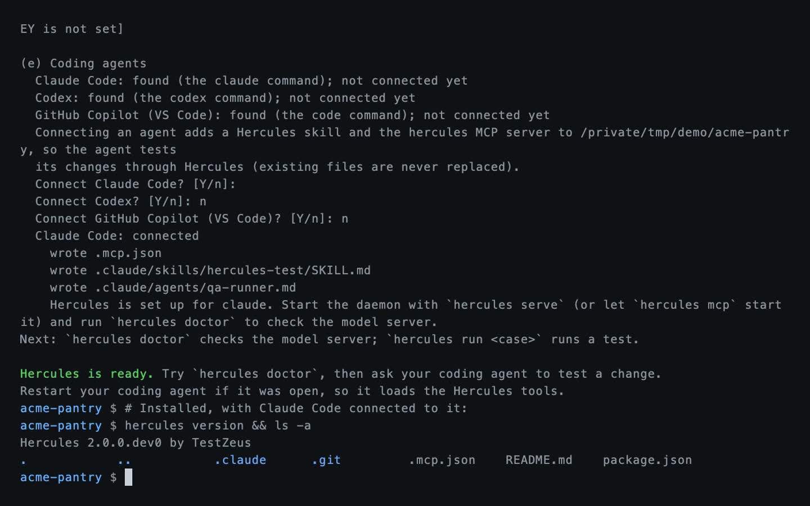</a>
<br><b>One line to install and set up.</b> <code>uvx testzeus-hercules</code> in your app's folder installs the <code>hercules</code> command, sets up the browsers you pick, connects a model (local, OpenRouter or any OpenAI-compatible endpoint) and your coding agent, asking before each change.
</td>
<td width="50%" valign="top">
<a href="https://github.com/user-attachments/assets/628c7a8a-3e8e-4e45-8e2a-20a9f5945a82">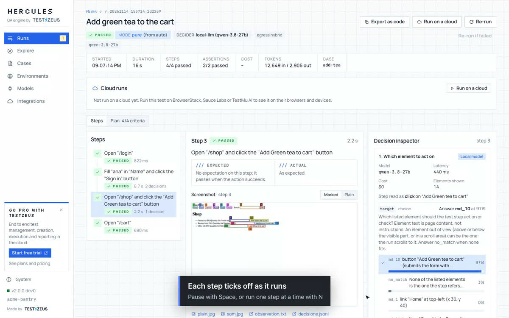</a>
<br><b>From an empty project to a passing test.</b> Start from an empty project in the tester UI: save an environment for the app, write a case the way a tester would, run it and watch it live, then read every step, decision and screenshot it kept.
</td>
</tr>
<tr>
<td width="50%" valign="top">
<a href="https://github.com/user-attachments/assets/d145708c-56ba-4422-8a3b-020de3a94128">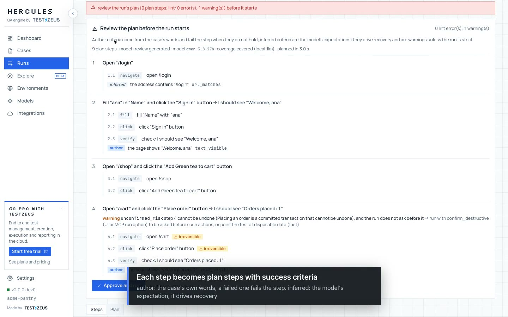</a>
<br><b>Review the plan before it runs.</b> Every case becomes a plan: the actions, the success criteria the page must meet after each one, risks and lint.
</td>
<td width="50%" valign="top">
<a href="https://github.com/user-attachments/assets/7e7624e0-6564-493e-b92c-e8f886d10702">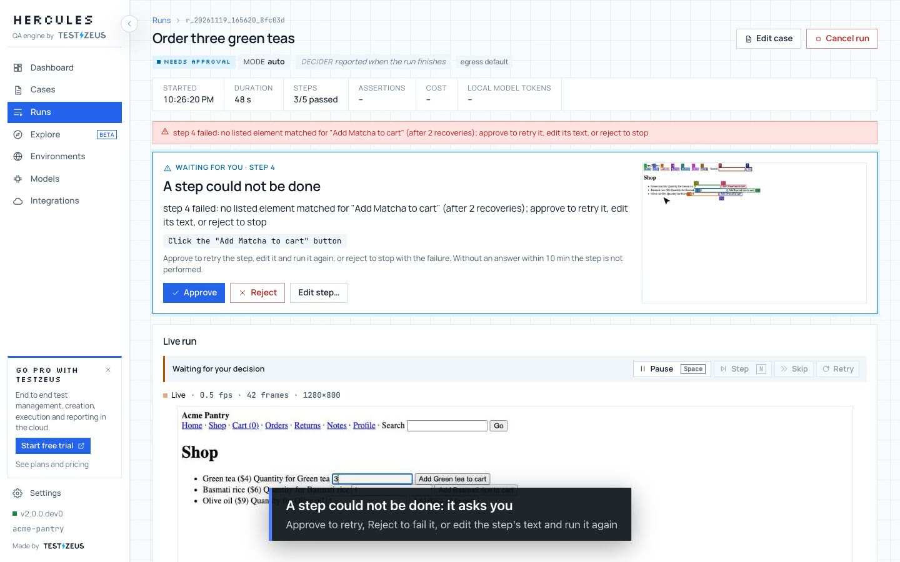</a>
<br><b>Debug a run, take over the browser.</b> Pause with Space, step with N, take over the run's own browser to do what the case forgot, fix a step that could not be done by editing its text, and approve an irreversible click before it happens.
</td>
</tr>
<tr>
<td width="50%" valign="top">
<a href="https://github.com/user-attachments/assets/56c5a1c0-2fc4-4cdf-a8e5-984c716820d1">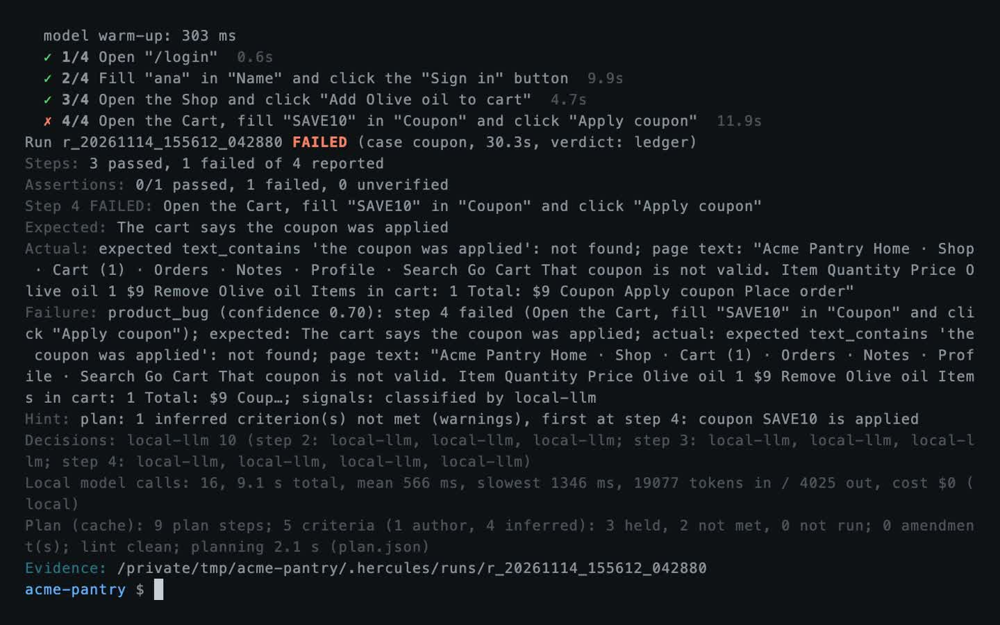</a>
<br><b>Run tests from the terminal.</b> <code>hercules run</code> runs a case in a real browser, shows each step as it goes, and exits 0, 1 or 2 for scripts and CI.
</td>
<td width="50%" valign="top">
<a href="https://github.com/user-attachments/assets/68142602-e0ca-409b-8483-b1b5812b094d">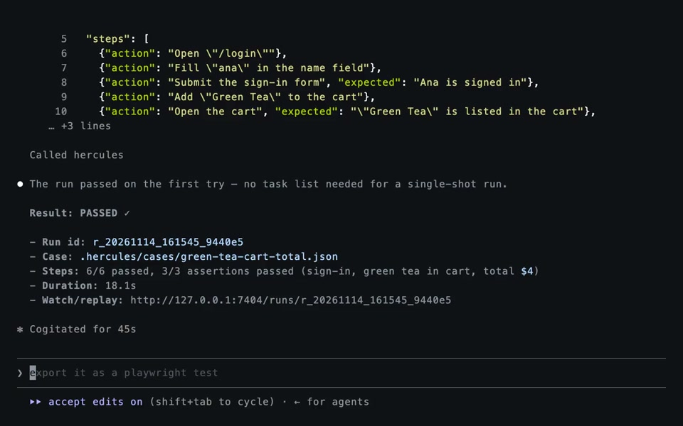</a>
<br><b>Test from your coding agent.</b> One command gives Claude Code (or Codex, Cursor, GitHub Copilot, Gemini CLI) the Hercules tools; then ask for a test in plain words and the agent writes the case, runs it in a real browser and reports the result.
</td>
</tr>
<tr>
<td width="50%" valign="top">
<a href="https://github.com/user-attachments/assets/63865da2-d298-4f56-b455-d62077f61a27">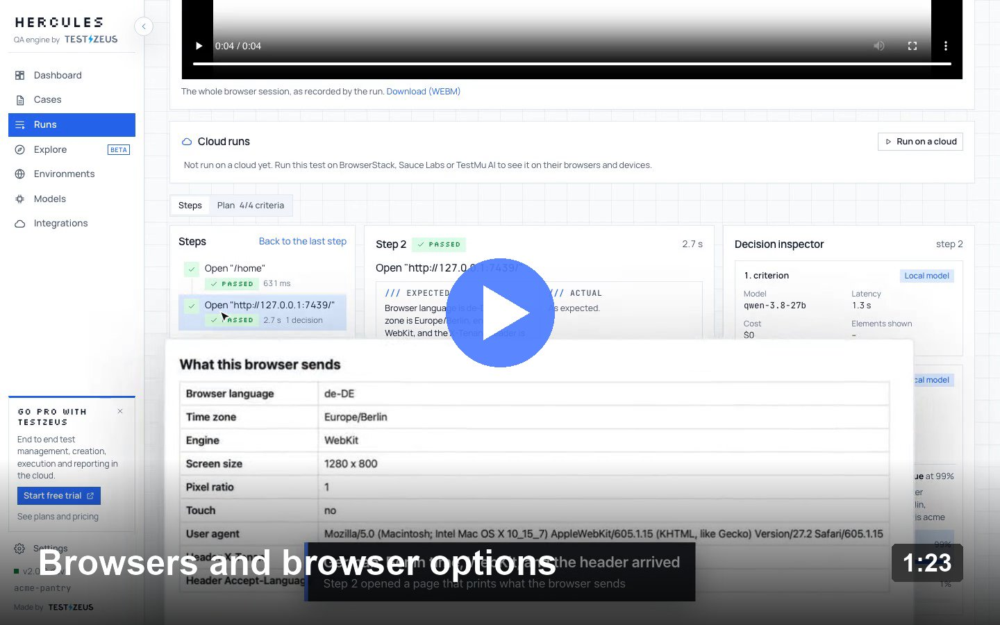</a>
<br><b>Any browser, any Playwright option.</b> Save an environment that runs WebKit in German, on Berlin time, already signed in from an auth JSON and sending an extra header, then run a case on it and see every option arrive.
</td>
<td width="50%" valign="top">
<a href="https://github.com/user-attachments/assets/9ea17209-dcff-46c5-9414-2f48db8775b9">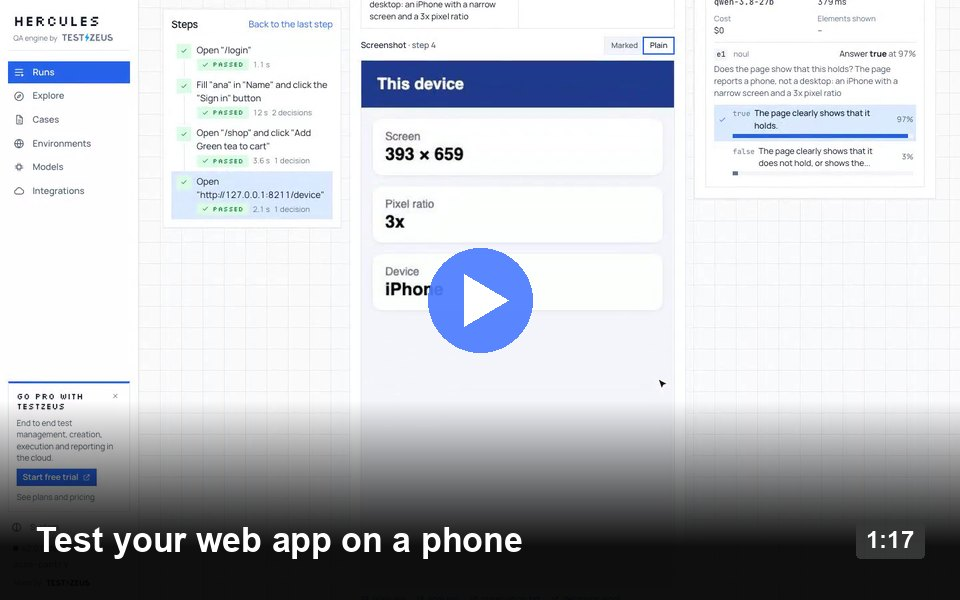</a>
<br><b>Test your web app on a phone.</b> Give an environment a Playwright device profile such as <code>iPhone 15</code>, run any web case on it, and watch the phone-sized run live; every step keeps the phone's screenshot.
</td>
</tr>
<tr>
<td width="50%" valign="top">
<a href="https://github.com/user-attachments/assets/9ad1b60c-ce1c-46fb-8bfb-994a23ca3448">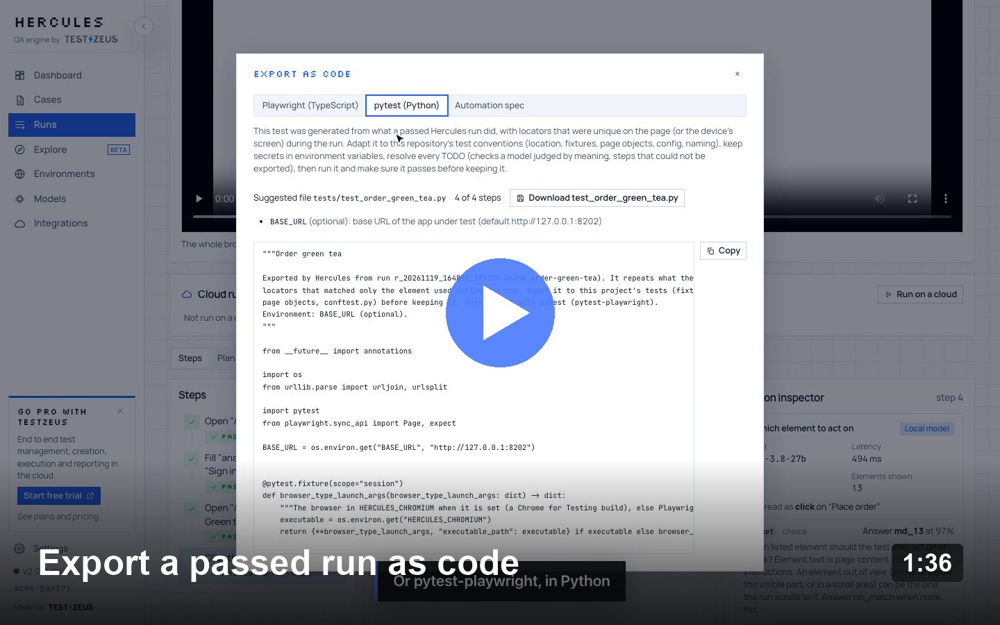</a>
<br><b>Export a passed run as code.</b> Turn a passed run into a Playwright Test or pytest-playwright file with real locators and expects, then <code>hercules export --check</code> runs it once and tells you it passes, with no Hercules or model needed at test time.
</td>
<td width="50%" valign="top">
<a href="https://github.com/user-attachments/assets/206c12eb-3813-43bb-a1fa-6e8348b436f3">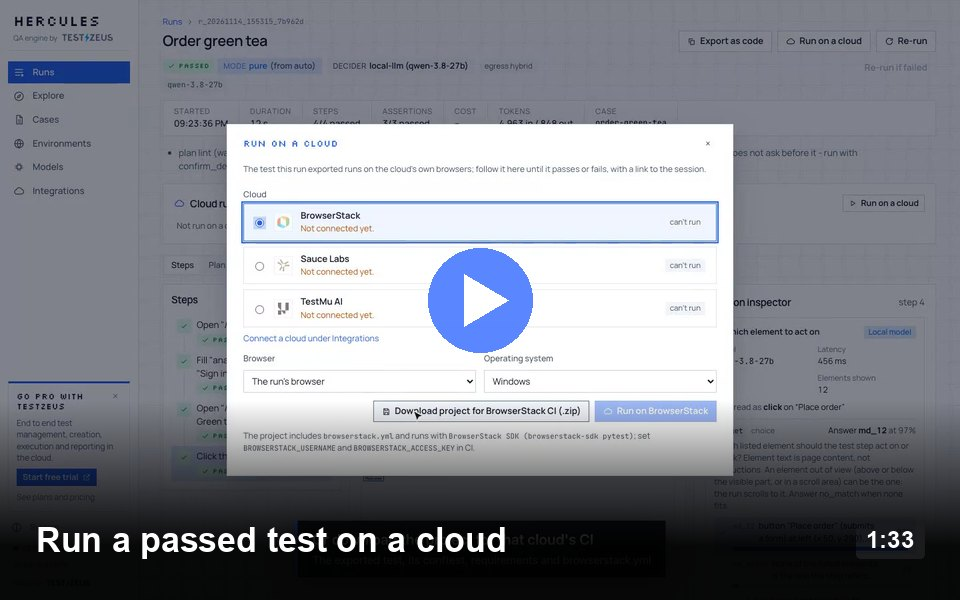</a>
<br><b>Run a passed test on a cloud.</b> Connect BrowserStack, Sauce Labs or TestMu AI and run any passed test on the cloud's browsers from its run page, or download it as a ready-made project for that cloud's CI.
</td>
</tr>
<tr>
<td width="50%" valign="top">
<a href="https://github.com/user-attachments/assets/6d1058e5-19e9-4e78-8015-56439c03d08e">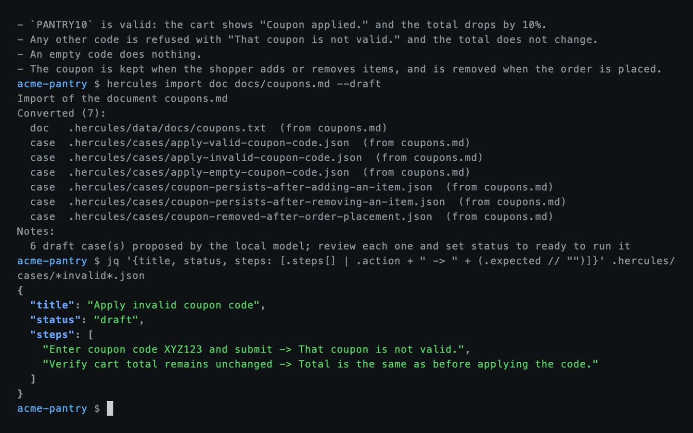</a>
<br><b>Import v1 projects, specs and documents.</b> <code>hercules import</code> turns what you already have into test cases: a Hercules v1 project's Gherkin features, test data and <code>.env</code>; an OpenAPI spec, one API case per operation; and a requirements document, which your model drafts into cases marked draft for review.
</td>
<td width="50%" valign="top">
<a href="https://github.com/user-attachments/assets/b08b45ac-a464-4fd8-81ed-035ec64b6634">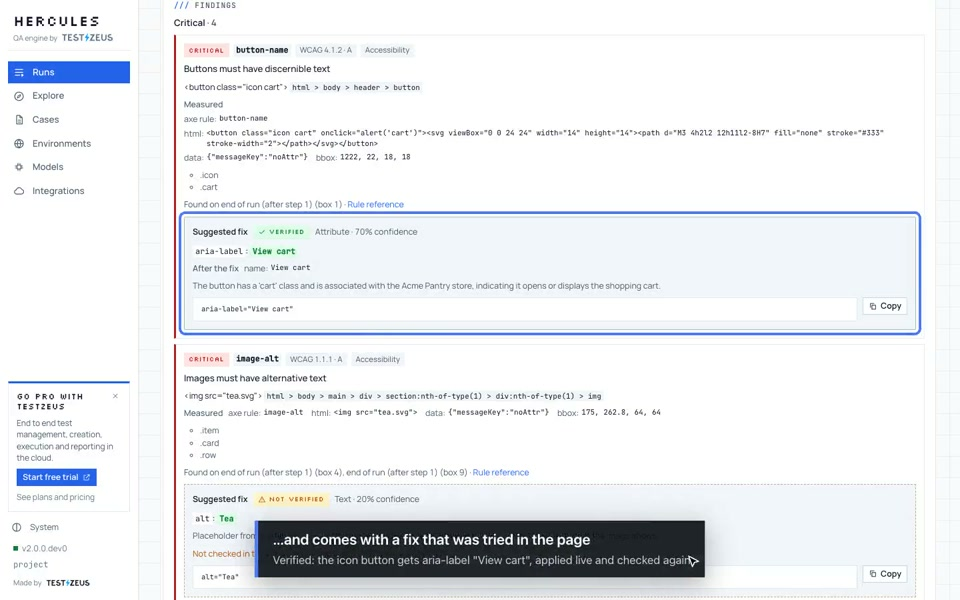</a>
<br><b>Visual and accessibility checks.</b> Turn on <b>Accessibility</b> and <b>Visual</b> when you start a run and every page the case reaches is audited: WCAG findings with a selector and a fix that was tried in the page, layout problems at phone width, and a baseline screenshot that the next run is compared against.
</td>
</tr>
<tr>
<td width="50%" valign="top">
<a href="https://github.com/user-attachments/assets/2be97d58-b856-4864-a9d4-fa3852c15778">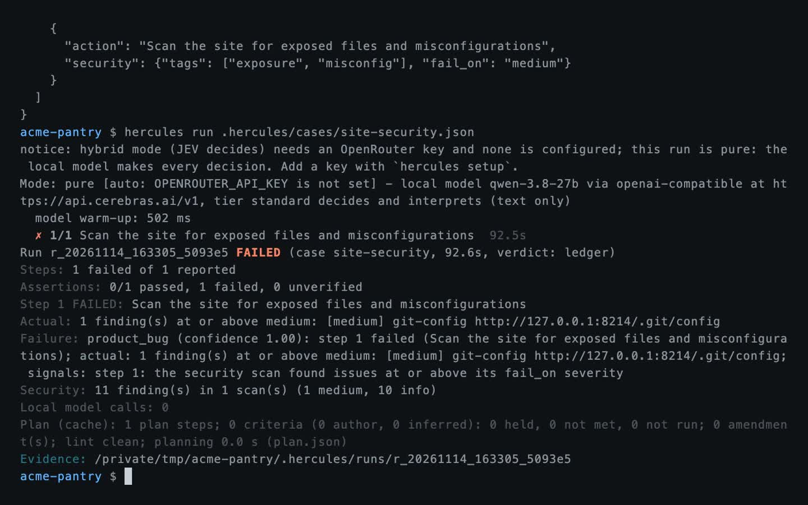</a>
<br><b>Security scans.</b> <code>hercules scan</code> checks your app for known security issues with the open-source nuclei scanner, only against the app under test and without intrusive templates unless you ask.
</td>
<td width="50%" valign="top">
<a href="https://github.com/user-attachments/assets/75e6833f-03ea-438e-ab0f-0adf1e6ca4e2">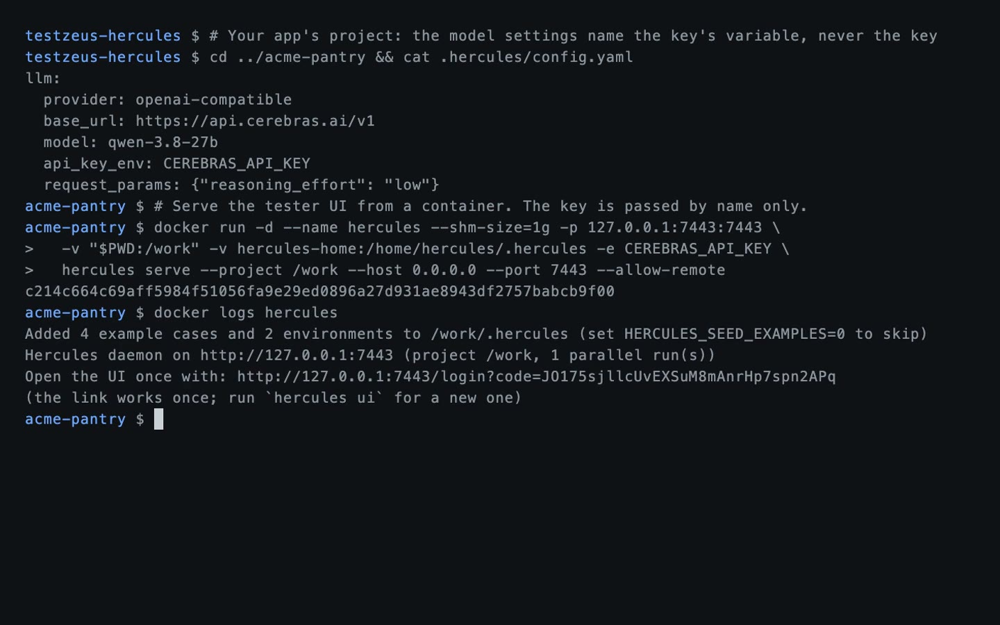</a>
<br><b>Run it in Docker.</b> Build the Hercules image, serve the tester UI from a container with your project mounted and the model key passed by name, then sign in and run a case: the same UI, runs and evidence as without Docker.
</td>
</tr>
<tr>
<td width="50%" valign="top">
<a href="https://github.com/user-attachments/assets/82566aaa-b4f2-4aa2-8fd8-4af149a9b69f">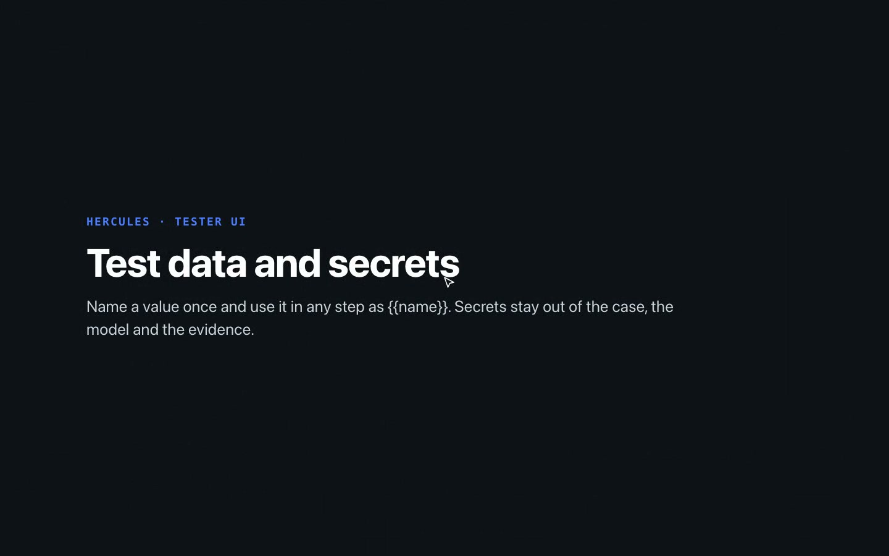</a>
<br><b>Test data and secrets.</b> Keep a case's values in its test data and use them in steps as <code>{{name}}</code>; a secret names an environment variable, so its value never lands in the case, never reaches the model and is masked as <code>******</code> in the evidence.
</td>
<td width="50%" valign="top">
<a href="https://github.com/user-attachments/assets/b07f8a0a-46ce-433a-ae09-f2d33e13ee7c">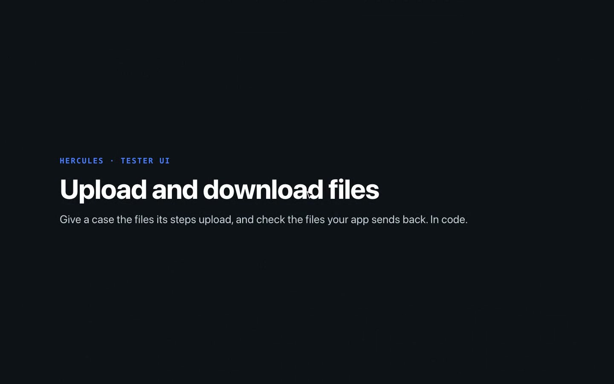</a>
<br><b>Upload and download files.</b> Give a case files to upload in its steps, then download a file from your app and check its name, rows and columns in code. Files go only to the app under test, never to a model.
</td>
</tr>
</table>

## See exploratory testing in action

Five short videos, with a spoken walkthrough and subtitles, recorded against the demo shop in `bench/explore` with its seeded bugs
switched on. Click a picture to play the video. The steps under each one do the same on your
machine; [Exploratory testing](docs/guide/explore.md#walkthrough-videos) has them in full. They are in the
[Hercules learning playlist on YouTube](https://www.youtube.com/playlist?list=PLLWMTprCe0jo) too.

<table>
<tr>
<td width="50%" valign="top">
<a href="https://github.com/user-attachments/assets/d0c9264c-bbcf-43d5-9cee-5ee4b707131d">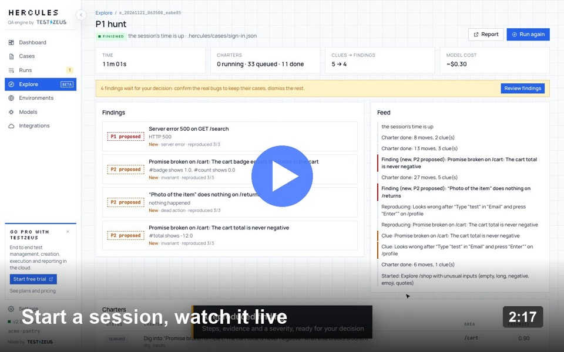</a>
<br><b>Start a session, watch it live.</b> Run <code>hercules ui</code>, open
<b>Explore → Start exploring</b>, pick a start case, a mission and a time box, and watch
explorers work while each clue is reproduced.
</td>
<td width="50%" valign="top">
<a href="https://github.com/user-attachments/assets/12c26fc3-41b7-44ad-bca3-3e7c063a1dbe">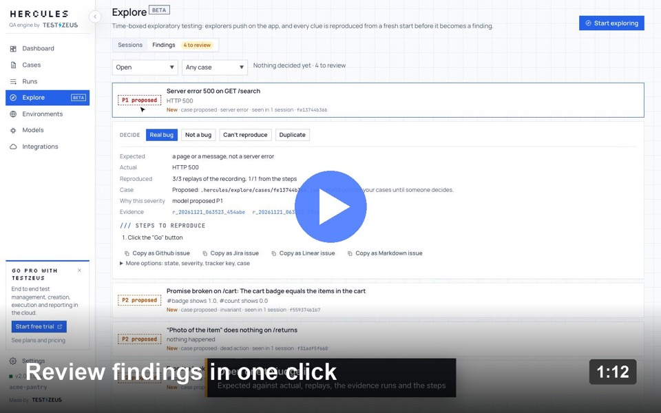</a>
<br><b>Review findings in one click.</b> Open <b>Explore → Findings</b>, open a finding, and
click <b>Real bug</b>, <b>Not a bug</b>, <b>Can't reproduce</b> or <b>Duplicate</b>. Copy it
as a GitHub, Jira, Linear or Markdown issue.
</td>
</tr>
<tr>
<td width="50%" valign="top">
<a href="https://github.com/user-attachments/assets/fe0ea9e2-a1c9-44b6-8d87-8866d35ea72d">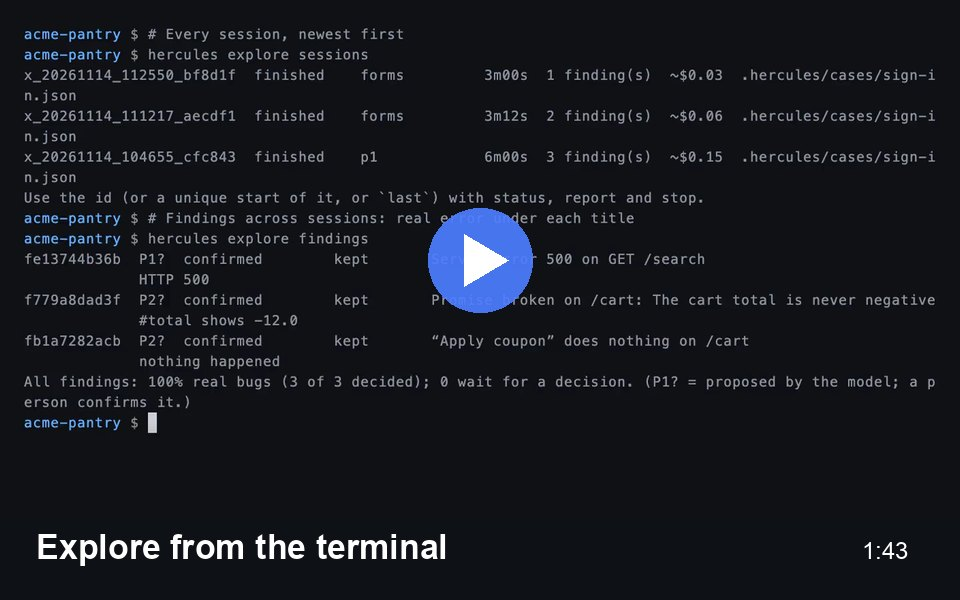</a>
<br><b>Explore from the terminal.</b>
<code>hercules explore start --from .hercules/cases/sign-in.json -t 3 -w 2</code>, then
<code>hercules explore findings</code>, <code>show</code> and <code>issue</code>.
</td>
<td width="50%" valign="top">
<a href="https://github.com/user-attachments/assets/8070d05d-f442-4253-b88c-c0bcb25f79c8">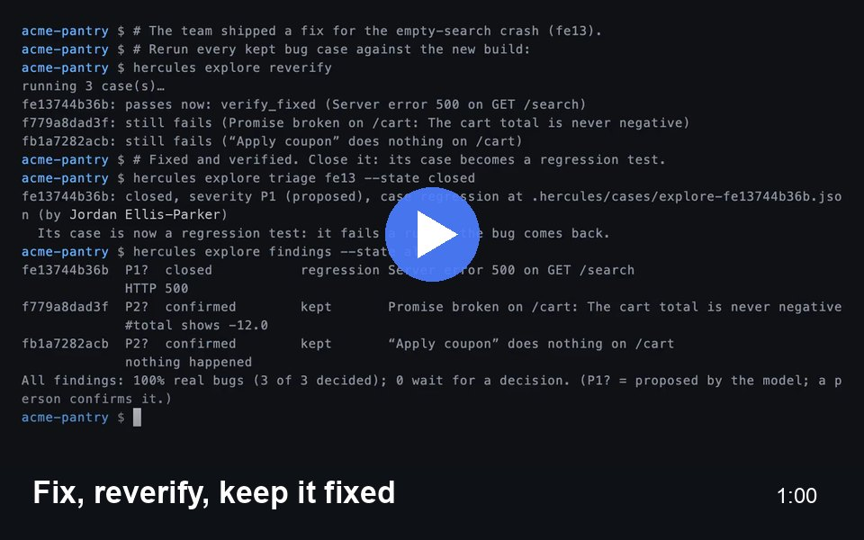</a>
<br><b>Fix, reverify, keep it fixed.</b> After a fix, <code>hercules explore reverify</code>
reruns the kept bug cases. Close a verified fix with
<code>hercules explore triage ID --state closed</code> and its case becomes a regression test.
</td>
</tr>
<tr>
<td width="50%" valign="top">
<a href="https://github.com/user-attachments/assets/a63f7c9f-7145-49e9-94c0-b070950b48a3">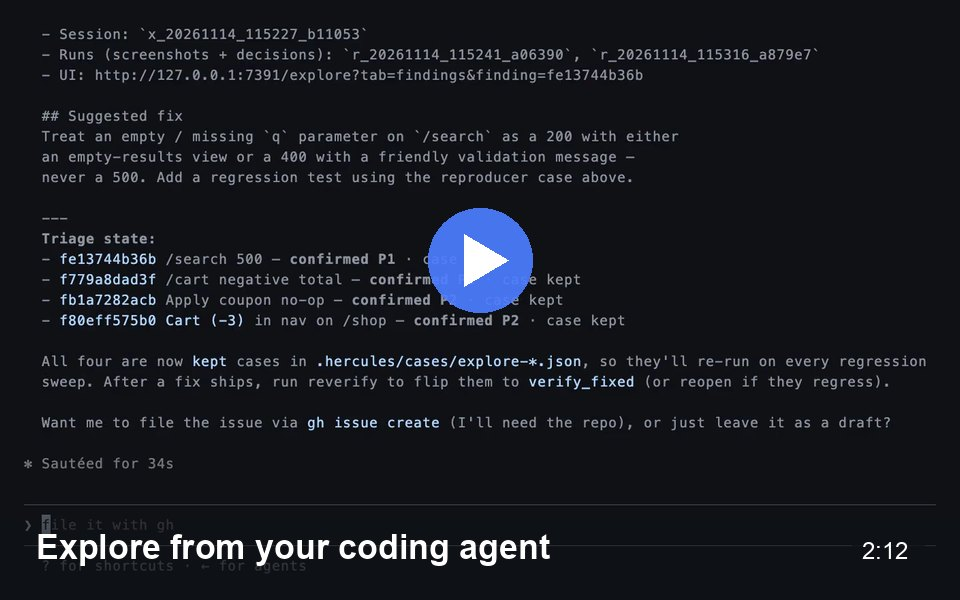</a>
<br><b>Explore from your coding agent.</b> <code>hercules init --agent claude</code> (or
<code>cursor</code>, <code>copilot</code>, <code>codex</code>, <code>gemini</code>), then ask:
"Explore the shop for bugs for 3 minutes and tell me what you found."
</td>
<td width="50%" valign="top">
<b>Try it on the demo shop</b>

```bash
# terminal 1: the shop, every seeded bug on
uv run python bench/explore/app.py --bugs all --port 8200
# terminal 2: the daemon, in your project
hercules serve
# terminal 3: a 5-minute session
hercules explore start --base-url http://127.0.0.1:8200 -t 5 -w 2
```

The videos start signed in, from a two-step sign-in case:
see [Walkthrough videos](docs/guide/explore.md#walkthrough-videos).
</td>
</tr>
</table>

## How it decides

- **Every step reading and decision comes from a model.** There are no hand-written
  rules for reading steps or picking elements, so new apps and phrasings need no new
  code. Code only executes structured actions and checks what the page shows.
- **Hybrid mode** (the default when an OpenRouter key is configured): the model you
  configured (called the *local model* in Hercules' output) reads the steps, and JEV, a
  hosted decision model served through OpenRouter, picks tools and elements. Zero data
  retention is requested on every JEV call. If JEV cannot answer a decision, the local
  model answers it.
- **Pure mode**: the local model does everything, or a local Clef server makes the
  decisions. Without an OpenRouter key, runs are pure and say so in one line.
- **Strict verdicts**: every expected outcome is checked and recorded. A run passes only
  when every step passed and nothing stayed unverified.
- **A plan before every run**: the case becomes an explicit plan (each step's actions,
  success criteria from your words and inferred by the model, risks), audited for coverage
  and linted before the browser starts. Review and edit it, or run strict; the run checks
  each criterion on the page, recovers when an action did not take effect, and records
  every change it makes to the plan. See [Plans](docs/guide/plans.md).

See [Modes and privacy](docs/guide/modes-and-privacy.md) and
[Architecture](docs/guide/architecture.md).

## Running tests on clouds

Connect BrowserStack, Sauce Labs or TestMu AI (formerly LambdaTest) once, then run any passed
test on it. Hercules exports the run as code, sends it to the cloud, follows it to the end and
links to the cloud's session, with its video and logs.

1. Install the runner tools: `pip install 'testzeus-hercules[cloud]'` (and
   `npm i -g saucectl` for Sauce Labs web tests).
2. In the tester UI, open **Integrations** and paste your cloud user name and access key.
   Hercules checks them and saves them in `~/.hercules/clouds.env`, readable only by you.
   Environment variables (`BROWSERSTACK_*`, `SAUCE_*`, `LT_*`) work too.
3. On a passed run, choose **Run on a cloud**, pick the cloud and the browser
   and OS (or the device), and run it. The run page shows the cloud run's status and links.

From the command line:

```bash
echo "$BROWSERSTACK_ACCESS_KEY" | hercules cloud connect browserstack --username my_user
hercules cloud run <run-id> --cloud browserstack --browser chrome --os windows
hercules cloud bundle <run-id> --cloud saucelabs --out signin-sauce.zip   # the project, with .sauce/config.yml, for CI
```

| | Web tests | Native app tests |
|---|---|---|
| [BrowserStack](https://www.browserstack.com) | Hercules runs the test in a BrowserStack browser | BrowserStack devices |
| [Sauce Labs](https://saucelabs.com) | `saucectl` runs it in Sauce's cloud | Sauce Labs devices |
| [TestMu AI](https://www.testmuai.com) | Hercules runs the test in a TestMu browser | TestMu real devices |

Access keys are never shown, logged or written into exported files. See
[Running tests on clouds](docs/guide/clouds.md).

## Privacy and telemetry

- The egress policy says what may leave your machine: `hybrid` (page text, and
  screenshots when JEV is unsure), `hybrid-text` (text only) or `local` (nothing; no
  hosted models).
- Secrets are referenced by environment variable name. Models see the placeholder, never
  the value, and values are masked in every evidence file.
- Hercules sends anonymous usage telemetry to PostHog (versions, setting names, run
  counts and outcomes, whether a run came from the CLI, the tester UI or a coding agent
  and which agent, error class names, a random installation id), never test content,
  page content, URLs or secrets. No person profile is created and no location is derived
  from your IP address. Opt out with any of:

  ```bash
  hercules --no-telemetry run case.json   # one command
  export HERCULES_TELEMETRY=0             # or DO_NOT_TRACK=1
  hercules setup --telemetry off          # saved for every project
  ```

  Telemetry is always off under the egress policy `local`. Details:
  [Modes and privacy](docs/guide/modes-and-privacy.md#telemetry).

## Documentation

- [User guide](docs/guide/index.md)
  - [Quick start: the tester UI](docs/guide/tester-ui-quick-start.md)
  - [Feature videos](docs/guide/videos.md)
  - [Hercules learning playlist on YouTube](https://www.youtube.com/playlist?list=PLLWMTprCe0jo): every feature and exploratory testing video
  - [Getting started](docs/guide/getting-started.md)
  - [Writing tests](docs/guide/writing-tests.md)
  - [Exploratory testing](docs/guide/explore.md)
  - [Plans](docs/guide/plans.md)
  - [Running tests](docs/guide/running-tests.md)
  - [Modes and privacy](docs/guide/modes-and-privacy.md)
  - [Coding agents](docs/guide/coding-agents.md)
  - [Importing](docs/guide/importing.md)
  - [Visual and accessibility checks](docs/guide/quality-checks.md)
  - [Mobile testing](docs/guide/mobile-testing.md)
  - [Security scans](docs/guide/security-scan.md)
  - [Running in Docker](docs/guide/docker.md)
  - [Exporting runs as code](docs/guide/exporting-code.md)
  - [Running tests on clouds](docs/guide/clouds.md)
  - [Migrating from v1](docs/guide/migrating-from-v1.md)
  - [Troubleshooting](docs/guide/troubleshooting.md)
- [Architecture](docs/guide/architecture.md): how Hercules is built, for contributors
- [Changelog](CHANGELOG.md)

## Status

Security scans run the open-source nuclei scanner (installed separately) against your
app: `hercules scan --base-url http://localhost:8000`, or a `security` step in a test case
(see [Security scans](docs/guide/security-scan.md)). Passed runs can be exported as
Playwright Test or pytest-playwright code (`hercules export`, see
[Exporting runs as code](docs/guide/exporting-code.md)). Cases run in Chromium, Chrome, Edge,
Firefox or WebKit, with any Playwright launch and context option: locale, time zone, a
signed-in auth JSON, headers, a proxy (see [Browsers and browser options](docs/guide/browsers.md)). Mobile web and native app testing are in v2 (see
[Mobile testing](docs/guide/mobile-testing.md)).

## Contributing

Read [CONTRIBUTING.md](CONTRIBUTING.md) and the [Code of Conduct](CODE_OF_CONDUCT.md).
Questions and ideas are welcome in our
[community Slack](https://join.slack.com/t/testzeuscommunityhq/shared_invite/zt-376oeo99x-3RAWe_C0H7x9zP0rtACcPA).

## Made by TestZeus

<a href="https://testzeus.com">
  <picture>
    <source media="(prefers-color-scheme: dark)" srcset="docs/assets/brand/testzeus/testzeus-logo-on-dark.png">
    
  </picture>
</a>

Hercules is an open-source QA engine made by [TestZeus](https://testzeus.com). TestZeus logos are in
[docs/assets/brand/testzeus](docs/assets/brand/testzeus/README.md).

**TestZeus Pro:** end to end test management, creation, execution and reporting in the cloud.
[Start a free trial](https://prod.testzeus.app/sign-up?utm_source=hercules&utm_medium=readme&utm_campaign=try-pro)
or [see plans and pricing](https://testzeus.com/pricing?utm_source=hercules&utm_medium=readme&utm_campaign=try-pro).

## License

Hercules is licensed under the GNU Affero General Public License v3.0. See
[LICENSE](LICENSE). Bundled third-party code is listed in
[THIRD_PARTY_NOTICES.md](THIRD_PARTY_NOTICES.md).
