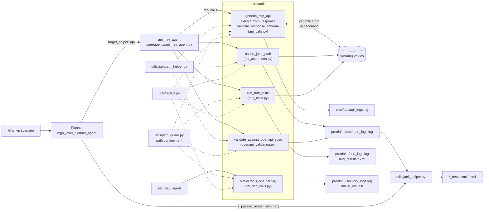

# Deterministic API verification

Hercules can drive an HTTP API from a Gherkin scenario and decide pass or fail in code instead of by reading responses. The `api_nav_agent` (the planner's `api` helper) sends requests, captures values, and calls assertion tools that return an explicit `PASSED`, `FAILED` or `ERROR` verdict. Every assertion is also written to a ledger that the JUnit report checks, so a planner that claims a pass cannot override a recorded failure.

This page covers why the feature exists and where it does not fit, how it is built, and how to use it step by step. The recipes were run against the FastAPI test app in `tests/api_testing_app` (see [Recipe 1](#recipe-1-run-the-test-app)), except where a section says it is unverified.

Contents:

1. [Overview](#1-overview): when to use it, when not to, alternatives, trade-offs
2. [Architecture](#2-architecture): diagram, module map, data flow, variables, verdicts, ledger, security model
3. [How to use it](#3-how-to-use-it): setup, worked example, Gherkin, Hurl, contract checks, security tools
4. [Reference](#4-reference): tools, operators, flags, behaviour notes
5. [Known limits](#5-known-limits)
6. [Troubleshooting](#6-troubleshooting)

---

## 1. Overview

### What it gives you

- **Requests as tool calls.** `generic_http_api` sends any method with any auth type and body encoding. The result is one JSON document the agent passes on to the next tool.
- **Verdicts computed in code.** `assert_json_path`, `validate_response_schema`, `validate_against_openapi_spec` and `run_hurl_suite` return `PASSED`, `FAILED` or `ERROR`. The agent prompt tells the model to relay that value and not to judge a field by eye.
- **Chaining.** `extract_from_response` stores a value as `${name}`. Later URLs, headers, bodies, auth values, assertions and Hurl variables can use it.
- **An audit trail.** Assertion verdicts go to `proofs/<scenario>/run_*/assertion_logs.log`. The JUnit generator reads that file and turns a claimed pass into a failure when the ledger holds a `FAILED` or `ERROR` entry.
- **Redacted evidence.** Request and response logs, the ledger and Hurl/nuclei output are scrubbed of credentials before they are written.

### When to use it

- You want an end-to-end API scenario written in plain language (register, log in, create, read back, check) and still want pass or fail to be reproducible.
- The scenario mixes steps: an API call to seed data, then a browser check, then an API call to verify. The API tools run inside the same scenario as the browser agent.
- You want contract checks (response shape against an OpenAPI/Swagger document) alongside behaviour checks, in one report.
- You have some checks that are already fully known. Put them in a Hurl file and call `run_hurl_suite`, so those steps cost no LLM reasoning.

### When not to use it

- **Load, performance or soak testing.** One request per tool call, driven by an LLM, with a 5 second default timeout. Use a load tool.
- **Large regression suites that run on every commit.** Each step costs model tokens and latency, and the model chooses the call sequence, so two runs can differ. A Hurl suite, pytest or newman is cheaper and fully scripted. `run_hurl_suite` lets you keep that suite inside a Hercules scenario.
- **Fuzzing or schema-driven case generation.** Nothing here generates requests from a spec. It only validates a response you already have.
- **Anything that needs response headers, redirects or cookie sessions** through `generic_http_api` (see [Known limits](#5-known-limits)). A Hurl file has its own cookie handling and can be used for these.
- **Non-HTTP protocols** (WebSocket, gRPC, streaming). Not supported.

### How it compares

| | Hercules API tools | Plain Hurl | Postman / newman | pytest + httpx | Schemathesis |
| --- | --- | --- | --- | --- | --- |
| Who writes the steps | An LLM agent, from a Gherkin scenario | You, in a `.hurl` file | You, in a collection with JS tests | You, in Python | Generated from an OpenAPI/GraphQL schema |
| Step sequence between runs | Chosen by the model each run | Fixed | Fixed | Fixed | Generated |
| Pass/fail decided by | Code (`assertion` field), reported through the planner | Hurl | The collection's tests | Your asserts | The tool's checks |
| Cost per run | LLM tokens and latency per step | None | None | None | None |
| Needs an LLM | Yes (the Hurl tool does not) | No | No | No | No |
| Contract check against a spec | Yes (`validate_against_openapi_spec`) | Not compared here | Not compared here | Whatever you write | Core purpose |
| Mixes with browser steps | Yes, same scenario | No | No | Possible, you wire it | No |

Hurl, newman, pytest and Schemathesis are described here only at the level of what they are for. Check their own documentation for what they can do beyond that.

### Honest trade-offs

- **The model still decides the call sequence.** Verdicts are deterministic, but whether the agent logs in first, passes the right body or captures the right path is model behaviour. A flaky run is usually a different sequence, not a different verdict for the same data.
- **The model re-types the response.** The assertion tools take the payload as an argument (`response_json`). There is no "last response" handle on the tool side, so the agent copies the previous result into the call. That costs tokens, and a long response can be mis-copied. Responses over 100,000 characters are truncated, and assertions that depend on the cut part are refused ([Known limits](#5-known-limits)).
- **A verdict only exists if the agent calls an assertion tool.** A scenario that never calls one has an empty ledger and the report cannot catch it (see [The assertion ledger](#the-assertion-ledger-and-the-junit-report)).
- **`ERROR` is a third state.** CI that treats only `FAILED` as red must also treat `ERROR` as red. The JUnit conversion already does.
- **No SSRF filtering.** The tools exist to hit the application under test, usually on localhost, so they request whatever URL the model gives them.

---

## 2. Architecture

### Component diagram



Solid arrows are the call or write path. Dotted arrows are helper modules the tool modules import.

### Module map

| Path | Role |
| --- | --- |
| `testzeus_hercules/core/agents/api_nav_agent.py` | The agent prompt (rules 1 to 9, including "never judge a field yourself") and tool registration. |
| `testzeus_hercules/core/agents/high_level_planner_agent.py` | Plans steps and picks `target_helper`; `api` routes to the API agent (`_HELPER_MAP` in `core/simple_hercules.py`). |
| `testzeus_hercules/core/tools/api_calls.py` | `generic_http_api`, `extract_from_response`, `validate_response_schema`; the per-scenario variable store and `${name}` interpolation; request/response logging hooks; `redact_tool_output`; the result-size cap. |
| `testzeus_hercules/core/tools/api_assertions.py` | `assert_json_path`: the operator set, the judgment rules, and the ledger write. |
| `testzeus_hercules/core/tools/openapi_validation.py` | `validate_against_openapi_spec`: spec loading, validator selection by spec version, status lookup, ledger write. |
| `testzeus_hercules/core/tools/hurl_calls.py` | `run_hurl_suite`: runs the `hurl` binary with a minimal environment, parses its JUnit report, redacts output. |
| `testzeus_hercules/core/tools/api_sec_calls.py` | One nuclei-backed tool per security tag, registered on `sec_nav_agent`; downloads the nuclei binary on first use. |
| `testzeus_hercules/utils/jsonpath_helper.py` | The single JSONPath entry point (`jsonpath_ng.ext`), imported lazily so the base install works without the `api` extra. Also names the closest existing parent when a path matches nothing. |
| `testzeus_hercules/utils/path_guard.py` | `resolve_in_roots`: `realpath` confinement and refusal of secret/state file names. |
| `testzeus_hercules/utils/redact.py` | Header, query, URL, JSON, form and multipart redaction; `is_sensitive_name`. |
| `testzeus_hercules/core/tools/tool_registry.py` | `@tool` registration plus `api_logger`, `assertion_logger`, `sec_logger`, `assertion_subject`. |
| `testzeus_hercules/core/runner.py` | Clears the variable scope when a scenario starts (`reset_variables`). |
| `testzeus_hercules/utils/junit_helper.py` | Reads `assertion_logs.log` and reconciles it with the planner's verdict. |

### Data flow for one scenario

1. The runner starts the scenario and calls `reset_variables(stake_id)`, so no value captured by an earlier run is visible.
2. The planner reads a Gherkin step and emits a plan step with `target_helper: "api"`.
3. `api_nav_agent` makes tool calls one at a time. The `generic_http_api` result is a string of minified JSON. The agent passes it, or part of it, as `response_json` to the next tool.
4. `generic_http_api` interpolates `${name}` in the URL, headers, query, body and `auth_value`, sends the request with a fresh `httpx.AsyncClient`, writes redacted request and response records to `api_logs.log`, and returns `{status_code, status_type, body, duration_seconds}` (or an error object, see [The result document](#the-result-document)).
5. `extract_from_response` evaluates a JSONPath against that document and stores the first match under `as_name`.
6. `assert_json_path` and `validate_against_openapi_spec` evaluate, append one JSON line to `assertion_logs.log`, and return the verdict.
7. The agent summarises the step to the planner. The planner sets `is_assert`, `is_passed` and `assert_summary` for the scenario.
8. At report time `JUnitXMLGenerator` reads the ledger. If the planner claimed a pass and the ledger holds a `FAILED` or `ERROR` entry, the case becomes a failure whose message names the first three offenders.

### The result document

Everything downstream (assertions, captures, schema checks) evaluates a JSONPath against the document `generic_http_api` returned, not against the raw HTTP body. Paths therefore start with `$.body` or `$.status_code`.

| Response | Document |
| --- | --- |
| 2xx | `{"status_code": 200, "status_type": "success", "body": <parsed JSON, or text if the body is not JSON>, "duration_seconds": 0.03}` |
| 3xx, 4xx, 5xx | `{"error": "<httpx message>", "error_detail": <parsed JSON, or text, or "No details">, "status_code": 401, "status_type": "client_error", "duration_seconds": 0.01}`. There is no `body`; the payload is under `error_detail`. |
| Timeout | `{"error": "...", "timeout_seconds": 5.0, "status_code": null, "status_type": "timeout", ...}` |
| Bad arguments or transport failure | `{"error": "...", "status_code": null, "status_type": "failure", ...}` |
| More than 100,000 characters | `body` (or `error_detail`) is cut and `body_truncated` (or `error_detail_truncated`) is `true`. An assertion returns `ERROR` when its path matched nothing, touches `body`/`error_detail`, or the payload is cut text; fields outside the cut part (for example `$.status_code`) are still evaluated normally. |

`status_type` is one of `success`, `redirect`, `client_error`, `server_error`, `timeout`, `failure`.

### Variable store and interpolation

- **Scope.** One dictionary per test id. `reset_variables` clears it when a scenario starts. Two scenarios never share values.
- **Setting.** Only `extract_from_response` writes it. `as_name` must be non-empty, without surrounding whitespace and without braces, because otherwise it could never be referenced.
- **Syntax.** `${name}`. Names are case-sensitive; whitespace inside the braces is trimmed.
- **Where it applies.** URL, header values, query parameters, body (every string leaf, recursively), `auth_value`, and for `assert_json_path` the `path` and `expected`. `run_hurl_suite` resolves it in `variables` values. `validate_against_openapi_spec` and `validate_response_schema` take no placeholders.
- **Whole-value placeholders keep their type.** `"category_id": "${cat_id}"` sends the JSON number `1` if `cat_id` was captured as the integer `1`. Verified: the request log shows `"category_id": 1`.
- **Embedded placeholders are text.** `"/items/${item_id}"` substitutes the value's text (JSON-encoded for non-strings, `null` for `None`).
- **Unknown names are left as they are.** The literal `${name}` is sent. This is deliberate, so the typo is visible, but it means a failed capture shows up later as a 401 or a 404, not at the point of use. In `assert_json_path` the unresolved `expected` is a hard `ERROR`.
- **`literal:` opt-out.** `expected="literal:${x}"` compares the six characters `${x}` and is never interpolated.

### Verdict model

| Verdict | Meaning | Examples |
| --- | --- | --- |
| `PASSED` | The check was evaluated and holds. | Value equals expected; body conforms to the schema; Hurl exited 0 with no failed cases. |
| `FAILED` | The check was evaluated and does not hold. This is a statement about the application (or about the path, see below). | Value differs; path matched nothing; schema violations; a Hurl assert failed. |
| `ERROR` | The check could not be evaluated, so nothing was learned about the application. | Invalid JSONPath; missing `expected`; unresolved placeholder; truncated response; missing package or binary; path outside the allowed roots; spec path not declared in the OpenAPI document. |

Why `ERROR` is separate: collapsing the two would make a broken check look like an application bug, and treating an unevaluable check as a pass would make a typo go green. Keeping three states lets the report show "unresolved" separately and lets the JUnit step fail on either `FAILED` or `ERROR`.

Two details to know:

- "Path matched nothing" is `FAILED` for `assert_json_path`, `extract_from_response` and `validate_response_schema` (with `path`), but `ERROR` for `validate_against_openapi_spec` when `response_path` matches nothing.
- `run_hurl_suite` is `PASSED` only when the JUnit report has no failures, at least one case executed, and hurl exited 0. A non-zero exit with a clean report is `FAILED` with an explanatory `reason`.

### The assertion ledger and the JUnit report

`assert_json_path` and `validate_against_openapi_spec` append one JSON object per verdict, passes included, to `proofs/<scenario>/run_<timestamp>/assertion_logs.log`:

```json
{"source":"assert_json_path","test_id":"docs159","subject":"8d9849464b7e","path":"$.status_code","operator":"eq","expected":200,"actual":200,"verdict":"PASSED"}
```

`subject` is a short hash of the examined payload. `JUnitXMLGenerator` deduplicates by `(subject, path, operator, expected)` and keeps the last verdict, so a retry of the same check on the same payload replaces the earlier verdict while checks on different payloads stay separate.

At report time:

- If the planner claimed a pass (`is_passed` true, scenario terminated) and any deduplicated entry is `FAILED` or `ERROR`, the case becomes a failure: "Assertion audit ledger contradicts the reported pass". Verified by feeding a ledger that contained one `FAILED` OpenAPI entry to `JUnitXMLGenerator`; the case came out as a `Failure`.
- The ledger never softens a verdict. A planner failure stays a failure.
- When a ledger file exists, the case also gets the properties `Assertions Total`, `Assertions Passed`, `Assertions Failed`, `Assertions Unresolved` and `Assertions Notices`.
- When no ledger file exists (the agent never called an assertion tool), the report adds no assertion properties and cannot override anything. From reading `junit_helper.py`: the `Assertions Missing` marker is only reached when a ledger file exists with zero usable entries, so it does not flag the more common case of no file at all.

Not in the ledger: `extract_from_response` (a capture is not an assertion), `validate_response_schema`, `run_hurl_suite` and the nuclei tools. A failing Hurl suite or schema check reaches the report only through the agent's summary and the planner's verdict, not through the ledger guard. If you rely on the guard, use `assert_json_path` or `validate_against_openapi_spec` for the checks that must not be talked around.

### Proof folder layout

Files appear only for the tools that were used:

| File | Written by |
| --- | --- |
| `api_logs.log` | `generic_http_api` (one request line and one response line per call, redacted) |
| `assertion_logs.log` | `assert_json_path`, `validate_against_openapi_spec` |
| `hurl_logs.log`, `hurl_results/<suite>-<ms>-<id>.xml` | `run_hurl_suite` (redacted raw output; redacted JUnit copy) |
| `security_logs.log`, `nuclei_results/<tag>.txt` | the nuclei tools |

### Security model

| Area | What is done | What is not done |
| --- | --- | --- |
| **API logs** (`api_logs.log`) | Headers whose name contains `authorization`, `cookie`, `token`, `api-key`/`api_key`/`apikey`, `secret`, `form-login` are replaced with `[REDACTED]`. Secret query parameters (`token`, `api_key`, `client_secret`, ...) and URL credentials are redacted. JSON bodies are redacted by key name (`password`, `passwd`, `pwd`, `secret`, `token`, `authorization`, `api-key`...) down to 8 levels and a 10,000-node budget; urlencoded and multipart fields likewise. Request bodies are cut at 64 KiB in the log, response bodies at 1,000,000 bytes. | Matching is by name only: a secret under an innocent key (`sid`, `code`) is logged. Plain-text and XML bodies are not scanned. Deeper levels than 8 or beyond the node budget are logged as received. The match is a substring, so `token_type` is redacted too (verified). |
| **Tool results returned to the model** | URLs inside error text are redacted. | The result document is **not** redacted: a login response's `access_token` is in `body` and therefore in the model's context. Only logs and ledgers are scrubbed. |
| **Assertion ledger** | A secret-named path hides `expected` and `actual`. Values of secret-named captured variables (`access_token`, `password`, ...) are scrubbed from the text. | A secret captured under a harmless name (`sid`) is not recognised as a secret. Verified: asserting `ne ${access_token}` records `expected: "[REDACTED]"`. |
| **File paths** | Every model-supplied path (`file_path` of a multipart upload, `hurl_path`, `spec_path`, `open_api_spec_path`) is resolved with `realpath` and must lie inside `TEST_DATA_PATH`, `PROJECT_SOURCE_ROOT` or an `API_ALLOWED_PATHS` folder. Dotfiles, `*.env`, `agents_llm_config*`, `*.pem`, `*.key`, `*.db`, `*.sqlite*` and Hercules session/selector stores are refused by requested and by resolved name. `/` and the home directory are never accepted as roots. | The content of an allowed `.hurl` file is not inspected. Once running, it can request any URL and use any hurl feature. Confinement is by location only. |
| **Network targets** | Redirects are never followed, so a 3xx cannot send a request elsewhere. | No SSRF filter and no egress allowlist on `generic_http_api`, `run_hurl_suite` or the nuclei tools. Loopback and private addresses are reachable by design. `utils/url_guard.py` protects only the PRD fetch. |
| **`$ref` in schemas and specs** | Only in-document `#/...` references resolve. `http(s)://`, `file://` and relative-file `$ref`s are refused. | Schema `pattern` regexes run without a time limit (catastrophic backtracking can stall the run). |
| **Subprocess environment** | `hurl` starts with an allowlisted environment plus `HURL_VARIABLE_*`, so provider API keys in the parent environment are not inherited. Variables go through `HURL_VARIABLE_<name>`, not argv. Hurl and nuclei output and the saved JUnit copy are scrubbed of credential headers, URL credentials and known secret values. | The nuclei binary is downloaded from GitHub releases with no checksum or signature check. |

---

## 3. How to use it

### Prerequisites

```bash
pip install 'testzeus-hercules[api]'   # jsonpath-ng + openapi-schema-validator
```

`jsonschema` is a base dependency. Without the extra, JSONPath and OpenAPI tools return `ERROR` with an install hint ([Troubleshooting](#6-troubleshooting)).

For Hurl: `brew install hurl` on macOS, or see https://hurl.dev. For the security tools nothing needs installing in advance, see [Recipe 5](#recipe-5-security-scans-unverified).

### Recipe 1: run the test app

`tests/api_testing_app` is a FastAPI app with users (JWT login), categories, items and orders. It needs a scratch virtualenv:

```bash
uv venv --python 3.12 /tmp/api-app-venv
uv pip install --python /tmp/api-app-venv/bin/python \
  fastapi uvicorn sqlalchemy aiosqlite 'fastapi-users[sqlalchemy]'

cd tests/api_testing_app            # run from here: the SQLite file is created in the cwd
/tmp/api-app-venv/bin/uvicorn main:app --host 127.0.0.1 --port 8000
```

On startup it creates a default user, `user@example.com` with password `user@example.com`. Endpoints used below: `POST /auth/register`, `POST /auth/jwt/login` (form-encoded `username` and `password`), `POST /categories`, `POST /items`, `GET /items`, `GET /openapi.json`. Everything except register and login requires a bearer token.

The samples below were run with the port changed to 61xx; nothing else differed.

### Recipe 2: the tool-call sequence, in Python

The tool functions are plain coroutines. Calling them directly shows exactly what the agent does. The configuration singleton reads its roots at import time, so set the environment first:

```python
import asyncio, json, os, uuid, urllib.request

os.environ["PROJECT_SOURCE_ROOT"] = "/tmp/hercules-demo/opt"        # proofs/ is created here
os.environ["TEST_DATA_PATH"] = "/tmp/hercules-demo/test_data"        # specs, uploads, .hurl files
os.makedirs(os.environ["TEST_DATA_PATH"], exist_ok=True)

from testzeus_hercules.config import get_global_conf
from testzeus_hercules.core.tools.api_calls import (
    generic_http_api, extract_from_response, validate_response_schema, reset_variables)
from testzeus_hercules.core.tools.api_assertions import assert_json_path
from testzeus_hercules.core.tools.openapi_validation import validate_against_openapi_spec

BASE = "http://127.0.0.1:8000"

def call(coro):
    return json.loads(asyncio.run(coro))      # every tool returns a JSON string

reset_variables()                              # the runner does this at scenario start

# 1. Register and log in. Login is form-encoded.
email = f"u{uuid.uuid4().hex[:6]}@example.com"
call(generic_http_api("POST", f"{BASE}/auth/register",
                      body={"email": email, "password": "Pw-docs-123"}))
login = call(generic_http_api("POST", f"{BASE}/auth/jwt/login", body_mode="urlencoded",
                              body={"username": email, "password": "Pw-docs-123"}))
print("login", login["status_code"], sorted(login["body"]))
# login 200 ['access_token', 'token_type']

# 2. Capture the token. The path is relative to the result document, so it starts at $.body.
cap = call(extract_from_response(login, "$.body.access_token", "access_token"))
print(cap["assertion"], cap["reference"])
# PASSED ${access_token}

# 3. Authenticated create. auth_value is interpolated.
cat = call(generic_http_api("POST", f"{BASE}/categories",
                            auth_type="bearer", auth_value="${access_token}",
                            body={"name": f"cat-{uuid.uuid4().hex[:5]}", "description": "docs"}))
call(extract_from_response(cat, "$.body.id", "cat_id"))

item = call(generic_http_api("POST", f"{BASE}/items",
                             auth_type="bearer", auth_value="${access_token}",
                             body={"title": "Widget", "description": "docs",
                                   "category_id": "${cat_id}"}))     # sent as the number 1, not "1"

# 4. Assertions: status, value, cross-reference to a capture, presence.
for path, op, expected in [("$.status_code", "eq", 200),
                           ("$.body.title", "eq", "Widget"),
                           ("$.body.category_id", "eq", "${cat_id}"),
                           ("$.body.id", "exists", None)]:
    kwargs = {} if expected is None else {"expected": expected}
    print(path, op, call(assert_json_path(item, path, op, **kwargs))["assertion"])
# all four: PASSED

# 5. Hand-written JSON Schema over the whole body.
schema = {"type": "object", "required": ["id", "title", "owner_id"],
          "properties": {"id": {"type": "integer"}, "title": {"type": "string"},
                         "owner_id": {"type": "string"}}}
print(call(validate_response_schema(item["body"], schema))["assertion"])
# PASSED

# 6. Contract check against the app's own OpenAPI document.
spec = os.path.join(os.environ["TEST_DATA_PATH"], "openapi.json")
with open(spec, "wb") as handle:
    handle.write(urllib.request.urlopen(f"{BASE}/openapi.json").read())
ok = call(validate_against_openapi_spec(item["body"], "openapi.json", "/items", "post", 200))
print(ok["assertion"], ok["operation"], ok["violations"])
# PASSED POST /items -> 200 []

bad = call(validate_against_openapi_spec({"id": "x", "title": 1}, "openapi.json", "/items", "post", 200))
print(bad["assertion"], [v["message"] for v in bad["violations"]])
# FAILED ["'description' is a required property", "'category_id' is a required property",
#         "'owner_id' is a required property", "'x' is not of type 'integer'", "1 is not of type 'string'"]

print(get_global_conf().get_proof_path())      # where api_logs.log and assertion_logs.log landed
```

Look at the evidence afterwards. The token never reaches the logs:

```text
$ grep '"request_data"' api_logs.log | grep /categories | cut -c1-260
... "authorization": "[REDACTED]", "content-type": "application/json" ...
$ grep '"response_data"' api_logs.log | sed -n 2p      # the login response
... "body": "{\"access_token\": \"[REDACTED]\", \"token_type\": \"[REDACTED]\"}"
```

`assertion_logs.log` has one line per assertion and per OpenAPI check (six in this run, one of them `FAILED`).

Notes on what the sample shows:

- `login` is passed whole to `extract_from_response`, so the path is `$.body.access_token`. Passing `login["body"]` would need `$.access_token`.
- The OpenAPI path is the template exactly as declared (`/items`), the method is case-insensitive, and `status_code` selects which declared response to validate against. A relative `spec_path` is looked up under the test data folder first.
- The default `eq` compares strictly and falls back to a text comparison across the string/number divide. When the fallback decides the result the verdict carries a `note`.

### Recipe 3: the same flow as a Gherkin scenario

Put this in `opt/input/test.feature` (or your project's `input/` folder) and the spec file `openapi.json` in `test_data/`. This form was not run end to end, because it needs a configured LLM; the tool-call sequence it should produce is exactly Recipe 2, which was run.

```gherkin
Feature: Items API

  Scenario: Authenticated user creates an item
    Given the API base URL is http://127.0.0.1:8000
    When the user logs in with POST /auth/jwt/login, urlencoded body username "user@example.com" and password "user@example.com"
    And the access_token in the response is captured as "access_token"
    And the user creates a category with POST /categories using bearer auth ${access_token} and the body {"name": "docs-category-1", "description": "docs"}
    And the id in the response is captured as "cat_id"
    And the user creates an item with POST /items using bearer auth ${access_token} and the body {"title": "Widget", "description": "docs", "category_id": ${cat_id}}
    Then assert_json_path says $.status_code equals 200
    And assert_json_path says $.body.title equals "Widget"
    And assert_json_path says $.body.category_id equals ${cat_id}
    And the response conforms to openapi.json for POST /items status 200
```

What the agent does for each step, and what you can check:

| Step | Tool call |
| --- | --- |
| login | `generic_http_api("POST", ".../auth/jwt/login", body_mode="urlencoded", body={"username": ..., "password": ...})` |
| capture | `extract_from_response(<login result>, "$.body.access_token", "access_token")` |
| create | `generic_http_api("POST", ".../categories", auth_type="bearer", auth_value="${access_token}", body={...})`. Passing `headers={"Authorization": "Bearer ${access_token}"}` works too (verified). |
| asserts | `assert_json_path(<item result>, "$.status_code", "eq", 200)` and so on |
| contract | `validate_against_openapi_spec(<item result>["body"], "openapi.json", "/items", "post", 200)` |

Tips for writing the steps:

- Name the tool or the operator when it matters ("assert_json_path says ... equals ..."). The prompt already pushes the model toward the assertion tools, and explicit wording reduces variance.
- Use fixed seeded data (the default user) for login steps, and a unique name per run for anything the app rejects as a duplicate. This app answers 400 for a category name that already exists, which also makes a repeated run of the scenario fail.
- End with an assertion step. The planner prompt requires the final step to be an assertion.
- Set `STRICT_VERDICT=true` if a scenario with no explicit assertion should not count as passed (see `docs/environment_variables.md`).

### Recipe 4: a Hurl suite

Use Hurl for checks that are already known and should not involve the model. Save as `test_data/suites/login_and_create.hurl`:

```hurl
# Log in, capture the token, create a category, assert on the response.
POST {{base_url}}/auth/jwt/login
[FormParams]
username: {{email}}
password: {{password}}
HTTP 200
[Captures]
token: jsonpath "$.access_token"
[Asserts]
jsonpath "$.token_type" == "bearer"

POST {{base_url}}/categories
Authorization: Bearer {{token}}
Content-Type: application/json
{
  "name": "{{category_name}}",
  "description": "created by hurl"
}
HTTP 200
[Asserts]
jsonpath "$.name" == {{category_name}}
jsonpath "$.id" isInteger
```

Run it through the tool (same setup block as Recipe 2; hurl 8.0.1 was used):

```python
from testzeus_hercules.core.tools.hurl_calls import run_hurl_suite

variables = {"base_url": BASE, "email": "user@example.com", "password": "user@example.com",
             "category_name": f"hurl-{uuid.uuid4().hex[:5]}"}
verdict = call(run_hurl_suite("suites/login_and_create.hurl", variables=variables))
print(verdict["assertion"], verdict["executed"], verdict["failed"], verdict["exit_code"])
# PASSED 1 0 0
```

What to know:

- `hurl_path` is a `.hurl` file or a directory whose `*.hurl` files run together as one suite. Relative paths are looked up under the test data folder.
- `executed` counts JUnit cases, which is one per file, not one per request. The suite above has two requests and reports `executed: 1`.
- Run it a second time with the same `category_name` and the app answers 400 to the create; the verdict is `FAILED`, `failed: 1`, and `failures[0].message` carries hurl's own message (`Assert status code ... actual value is <400>`).
- Variable names must match letters, digits, `_` or `-`; anything else returns `ERROR` (`Invalid hurl variable name(s): bad name`).
- `variables` values may be `${name}` placeholders, which bridges a value captured by the agent into the model-free suite.
- A suite file outside the allowed roots returns `ERROR` with `Access denied` and nothing runs.
- Hurl has its own cookie jar, so a suite can do cookie-based login that `generic_http_api` cannot.

### Recipe 5: security scans (unverified)

The nuclei tools are registered on `sec_nav_agent` (the planner's `sec` helper), one per tag. The tool name is derived from the first clause of the tag's description and cut at 32 characters, so some look odd:

| Tag | Tool name |
| --- | --- |
| `cve` | `common_vulnerabilities_and_expos` |
| `xss` | `cross_site_scripting` |
| `sqli` | `sql_injection` |
| `lfi` | `local_file_inclusion` |
| `rce` | `remote_code_execution` |
| `misconfig` | `misconfigurations_caused_by_impr` |
| `exposure` | `the_accidental_or_intentional_di` |
| `unauth` | `unauthorized_access` |
| `authenticated` | `authenticated_testing` |
| `intrusive` | `intrusive_methods_actively_explo` |

The remaining tags are `panel`, `wordpress`, `osint`, `tech`, `edb`, `packetstorm`, `devops` and `cloud`; list the registered names with `dir(testzeus_hercules.core.tools.api_sec_calls)`.

Each tool takes `is_open_api_spec` (true for a spec file, false for a URL), `target_url` or `open_api_spec_path`, and optional `bearer_token`, `header_tokens` (`["Key=Value"]`) and `jwt_token`. It runs `nuclei -skip-format-validation -v -tags <tag> -o <proofs>/nuclei_results/<tag>.txt` with `-u <url>` or `-im openapi -l <spec>` and one `-H` per header, and returns `(result_dict, seconds)`: `{"test_result": "<findings>"}`, `{"test_result": "No failures."}` when the output file is empty, or `{"error": "..."}`.

**Status: unverified against real nuclei.** nuclei was not installed and the binary download was never exercised. What was verified, with a stand-in executable placed at the cache path that ignores its arguments and writes one fake finding:

- The command line is assembled as described above (the stand-in logged the argv).
- A finding line containing `Authorization: Bearer <token>` came back as `Authorization: [REDACTED]`.
- A spec path outside the allowed roots returned `{"error": "Access denied: ..."}` before any download or execution.
- A malformed `header_tokens` entry returned `{"error": {"error": "Invalid header_token format: ..."}}`.
- If the binary exits 0 without writing the output file, the tool returns `{"error": "[Errno 2] No such file or directory: ..."}`. Whether real nuclei writes no file when it has no findings was not checked, so a clean scan may surface as that error. Treat it as a doubt, not a documented behaviour.

Unknown without a real run: which templates nuclei fetches or needs, how long scans take, whether `-skip-format-validation` and `-im openapi` behave as intended, and whether the macOS download (the code picks the `macos_amd64` archive for every Darwin machine) works on Apple Silicon.

The safe way to try it:

1. Point it only at an application you own, ideally a throwaway local instance. Some tags (`intrusive`, `rce`, `sqli`) send attack payloads.
2. Download nuclei yourself from the official project releases, verify its checksum, and put the binary at `<HF_HOME>/nuclei_tool/nuclei` (the default `HF_HOME` is `.cache`, relative to the working directory) so the unverified auto-download never runs.
3. Start with a narrow tag such as `misconfig` or `tech` against a local target.
4. Read `proofs/.../security_logs.log` and `nuclei_results/` and do not treat "No failures." as proof of security: it means the output file was empty.
5. These tools do not write to the assertion ledger, so a finding does not turn the JUnit case red by itself. The planner has to report it.

### Configuration

| Variable | Default | Effect |
| --- | --- | --- |
| `API_REQUEST_TIMEOUT` | `5` | HTTP timeout in seconds for `generic_http_api`. A timeout returns `status_type: "timeout"` naming this variable. |
| `API_ALLOWED_PATHS` | empty | Extra folders (`:` separated on POSIX, `;` on Windows) that model-supplied file paths may live in, on top of the test data folder and the project root. |
| `ENABLE_UI_ASSERTIONS` | `false` | Register `assert_ui` and `capture_ui_value` on the browser, MCP and mobile agents and add a short guidance block to their prompts. Set it before startup. |
| `STRICT_VERDICT` | off | A scenario counts as passed only when it terminated and recorded `is_passed: true`. |
| `PROJECT_SOURCE_ROOT`, `TEST_DATA_PATH` | `./opt`, `<root>/test_data` | Where proofs are written and where relative paths are resolved. |

---

## 4. Reference

### Tools

| Tool | Agent | Purpose |
| --- | --- | --- |
| `generic_http_api` | `api_nav_agent` | Send an HTTP request (any method, auth type, body mode). |
| `extract_from_response` | `api_nav_agent` | Capture a JSONPath value into `${name}` for later calls and assertions. |
| `assert_json_path` | `api_nav_agent` | Assert a value with an operator and get an explicit `PASSED`/`FAILED`/`ERROR` verdict. |
| `validate_response_schema` | `api_nav_agent` | Validate a body (or a sub-value) against a JSON Schema. |
| `validate_against_openapi_spec` | `api_nav_agent` | Validate a body against the response schema declared in an OpenAPI/Swagger spec (Swagger 2.0, OpenAPI 3.0.x, 3.1.x; JSON or YAML). |
| `run_hurl_suite` | `api_nav_agent` | Run a pre-written Hurl suite (needs the `hurl` binary). |
| nuclei tools | `sec_nav_agent` | Tag-based security scans (see [Recipe 5](#recipe-5-security-scans-unverified)). |
| `assert_ui` / `capture_ui_value` | browser, MCP, mobile agents | Assertions over page text. **Opt-in** (`ENABLE_UI_ASSERTIONS`). |

Every `assert_json_path` and `validate_against_openapi_spec` verdict (passes included) is appended to `proofs/assertion_logs.log`. `validate_response_schema` and `extract_from_response` return their verdict to the agent but write nothing to that ledger (a capture is not an assertion, and a schema check is not counted by the report). Values in that ledger are redacted: a secret-named path or capture name (`password`, `token`, `secret`, `api_key`, ...) hides the value, and the values of secret-named captured variables are scrubbed from the text.

### `assert_json_path` operators

| Operator | Passes when | Needs `expected` |
| --- | --- | --- |
| `eq` (default) | Every match equals `expected` (strict typed compare, then text compare across string/number; a bool matches a non-bool only by text, so `true` matches `"true"` with a `note` but never `1`) | yes |
| `ne` | Every match differs | yes |
| `contains` | String contains the text, list contains the item, object has the key | yes |
| `exists` / `not_exists` | The path matches something / nothing | no |
| `not_empty` | No match is null, a blank string or an empty container | no |
| `gt` / `lt` | Every match is numerically greater / less | yes |
| `all_gte` / `all_lte` | Every bound value is at least / at most the number; an empty set is `FAILED` | yes |
| `count_eq` | The array has that many elements (singular path), or the path has that many matches | yes (whole number) |
| `eq_path` | The first match equals the first match of the second JSONPath given as `expected` | yes (a path) |

Examples that were run against two items, with the verdict: `count_eq` on `$.body` with `2` passes; `not_empty` on `$.body[*].title` passes; `all_gte` on `$.body[*].id` with `1` passes; `exists` on `$.body[?(@.title=='Widget')].id` passes; `not_exists` on a missing field passes; `eq` with no `expected` is `ERROR`.

### Behaviour notes

- **`generic_http_api` body mode.** `body_mode` names are case-insensitive (`json`, `JSON`). Without a `body_mode`, a `dict`/`list`/number/boolean body is sent as JSON, a `str` body as `raw` (set the `Content-Type` header yourself) and `bytes` as `binary`. An unknown mode (`xml`, ...) returns an error listing the valid modes (`multipart`, `urlencoded`, `raw`, `binary`, `json`) instead of silently sending no body. With no body, the mode is ignored.
- **`generic_http_api` auth.** `auth_value` accepts `${name}` placeholders like every other argument. `auth_type` must be one of `basic`, `jwt`, `form_login`, `bearer`, `api_key` (`none`, an empty string or omitting it means no auth); an unknown type, a missing `auth_value`, or a `basic` value that is not `[username, password]` returns an error and sends nothing. They map to: `basic` to `Authorization: Basic <base64>`, `jwt` to `Authorization: JWT <v>`, `bearer` to `Authorization: Bearer <v>`, `form_login` to `X-Form-Login: <v>`, `api_key` to `x-api-key: <v>`.
- **`generic_http_api` multipart.** A field value of the form `{"file_path": "...", "filename": "...", "content_type": "..."}` becomes a file part; the path is confined (see the security model). Any caller-supplied `Content-Type` is dropped so the boundary is correct.
- **`generic_http_api` list query values.** A list value in `query_params` is sent as repeated keys (`{"k": ["a","b"]}` becomes `k=a&k=b`).
- **`generic_http_api` JSON body.** With `body_mode="json"` an empty body (`body={}`, `body=[]`, `body=0`) is sent as JSON (`{}`); earlier revisions sent no body at all for falsy values. Only `body=None` sends no body.
- **`generic_http_api` query string.** A query string written in the URL is merged with `query_params`; repeated keys in the URL (`?tag=a&tag=b`) are kept, and a key given in `query_params` replaces every URL occurrence of that key.
- **`generic_http_api` result.** The tool returns one minified JSON string: `{"status_code":..,"status_type":..,"body":..,"duration_seconds":..}`. Earlier revisions of this tool returned a `(text, duration)` tuple, which the executor rendered as text; the duration is now a regular field and the whole result always parses as JSON. A response longer than 100,000 characters is shortened by truncating `body` (or `error_detail`) and setting `body_truncated` (or `error_detail_truncated`), so the result stays valid JSON. `assert_json_path`, `extract_from_response` and `validate_response_schema` (with a `path`) still evaluate fields that were not cut, such as `$.status_code`. They return `ERROR` ("response was truncated") instead of a misleading `FAILED`/"matched nothing" when the path matched nothing, touches `body` or `error_detail` (including `$..` and wildcard steps), or the whole payload is cut text. Schema validation without a `path` on a truncated body is always `ERROR`. Narrow the request (filters, pagination) and retry.
- **Captured variables** (`${name}`) are scoped to the scenario and cleared when the scenario starts, so a re-run never sees stale values.
- **`assert_json_path` with several matches.** `eq`, `ne`, `contains`, `gt`, `lt` and `not_empty` must hold for every match, and the failure names the first match that broke it. Use `exists`, `count_eq`, `all_gte`/`all_lte` or a narrower path for aggregate checks. `count_eq` needs a whole number.
- **Counting and bounds.** `count_eq`, `all_gte` and `all_lte` act on the elements of an array only when the path names exactly one value (no `[*]`, slice, filter, union or `..` anywhere): `$.body.items` with `count_eq 2` counts the array's elements. A multi-valued path counts or bounds its matches: `$.m[*]` on `[[1,2,3]]` has one match, so `count_eq 1` passes. A path that matches nothing has a `count_eq` count of 0 (`$.items[*]` on `[]` passes `count_eq 0`).
- **When a path matches nothing**, the `FAILED` verdict lists the keys available at the closest existing parent (`available_keys`) and, when the last path segment is the name of a captured variable, hints to write `${name}` instead.
- **`expected` is required** for every operator except `exists`, `not_exists` and `not_empty`; leaving it out returns `ERROR` instead of silently comparing against null. Pass `null` explicitly to assert a null value.
- **Numbers.** `gt`, `lt`, `all_gte`, `all_lte` and `count_eq` accept numbers and plain decimal text (`"10"`, `"-1.5e2"`). Spellings such as `"1_000"`, `"inf"` or `"nan"` are not numeric and give `ERROR`. Whole numbers are compared as integers, so ids above 2^53 compare exactly.
- **`literal:` values** are compared exactly as written, including text that looks like a `${name}` placeholder: the prefix is removed first and the rest is never interpolated (`literal:${x}` asserts the six characters `${x}`).
- **Operator names in `expected`.** A value that is exactly an operator name, or an operator glued to a value (`count_eq:2`, `ne_path:$.x`), is rejected as a likely parameter mix-up. Ordinary strings that start with an operator word (`exists_in_cart`) are compared normally. To assert a value that is exactly an operator name, pass `literal:<value>`. With the default `eq` operator and `expected` exactly an operator name, the call is reinterpreted as that operator and the verdict carries a `note` saying so (a field that really holds the text `count_eq` then yields `Expected count None is not a number.`; use `literal:count_eq`).
- **`run_hurl_suite`.** Variables are passed through `HURL_VARIABLE_<name>` environment entries, not `--variable` arguments (argv is visible to other local users). The raw output, and the JUnit report copy saved under `proofs/hurl_results/`, are scrubbed of secret-named variable values, the values of the scenario's secret-named captured variables (even when they are passed on under a harmless hurl-side name), credential headers (`Authorization`, `Proxy-Authorization`, `Cookie`, `Set-Cookie`, `X-Api-Key` and any header whose name contains `token`, `secret`, `api-key` or `form-login`) and URL credentials before they are logged, saved or returned. Redaction is a linear per-line scan, so very large output does not stall the run, and invisible characters (zero-width, bidi, NUL) are stripped before matching so they cannot be used to hide a header name; a header split across two lines is not rejoined. Header values are redacted wherever they appear on a line: verbose `> Authorization: ...` / `* Cookie: ...` lines, quoted `--header '...'` arguments and mid-sentence mentions in failure messages. The verdict is `PASSED` only when the JUnit report has no failures **and** hurl exits with code 0. The default timeout is 60 seconds (`timeout_seconds`); a timed-out suite is killed with its process group and returns `ERROR`.
- **`validate_against_openapi_spec` status lookup.** The response object is picked by the exact status code first, then the OpenAPI range key (`2XX`/`2xx` for a 2xx status, and so on), then `default`. A status with no declaration is `ERROR` and lists the declared ones (`Status 500 is not declared for POST /items (declared: 200, 422).`).
- **`assert_ui` text normalisation.** URLs and `id=`/`class=`/`data-testid=` assignments are stripped before matching. Pass `raw=true` to keep them (for example to assert that a link target is shown).

---

## 5. Known limits

- **SSRF scope.** The URL guard (`utils/url_guard.py`) protects only the PRD fetch (`intelligence/prd_parser.py`). `generic_http_api`, `run_hurl_suite` and the nuclei security tools are **not** SSRF-filtered: they exist to test the application under test, which is routinely on `localhost` or a private address, so they request whatever URL the model supplies, internal and loopback addresses included. There is no egress allowlist; run Hercules on a network that restricts egress if that matters.
- **Redirects are never followed.** A 3xx answer comes back as an error object (`error`, `error_detail`, `status_code`, `status_type: "redirect"`), not as the redirect target's response.
- **No response headers.** `generic_http_api` returns the status code and body only; response headers (`Location`, `Set-Cookie`, rate-limit headers, ...) are neither returned nor assertable. They are only written, redacted, to the API log.
- **No cookie persistence.** Each call uses a new client, so a `Set-Cookie` from one call is not sent on the next. (This follows from the code: one `httpx.AsyncClient` per request and no headers in the result. It was not tested separately.) Use bearer/API-key auth through `generic_http_api`, or put cookie flows in a Hurl suite.
- **Non-2xx results carry `error_detail`, not `body`.** For a 4xx/5xx (or 3xx) response the payload is `{"error", "error_detail", "status_code", "status_type"}`; assert on `$.error_detail...`, not `$.body...`.
- **Oversized responses.** Anything over 100,000 characters is truncated (see above); assertions on the cut `body`/`error_detail` return `ERROR`.
- **Only some verdicts reach the ledger.** `validate_response_schema`, `run_hurl_suite` and the nuclei tools do not, so the JUnit guard does not see them.
- **Schema `pattern` cost.** `validate_response_schema` evaluates schema `pattern` regexes with Python's `re` with no time limit, so a catastrophic-backtracking pattern in a model-written schema can stall the run. Python's regex engine cannot be interrupted from a thread, so no timeout is applied.
- **`format` is not enforced.** `format: email` / `date-time` / ... in a schema or OpenAPI spec is treated as an annotation (JSON Schema's default), not validated.
- **Security tool names.** The nuclei tool names are derived from the tag description and cut at 32 characters (for example `common_vulnerabilities_and_expos`); they are unique and stable, so look them up by the registered name.
- **Unverified nuclei download.** The nuclei binary is downloaded from GitHub releases without checksum or signature verification (pre-existing behaviour). The nuclei tools were not run against a real nuclei.
- **Subprocess environment.** `run_hurl_suite` starts hurl with a minimal environment (`PATH`, `HOME`, locale, temp dir, proxy and CA settings) plus the parent's own `HURL_VARIABLE_*` entries (hurl's documented way to inject variables, e.g. from CI) and the variables passed to the tool, which take precedence over a parent entry of the same name; the rest of the parent environment is not passed on. Header values and URL credentials in the nuclei command line are redacted in logs (the executed command is unchanged), and nuclei's stdout/stderr and result file get the same treatment (credential headers, the auth tokens passed to the tool, URL credentials) before they are logged or returned.
- **Remote `$ref`s are blocked.** `validate_response_schema` and `validate_against_openapi_spec` resolve only in-document `#/...` references. An `http(s)://`, `file://` or relative-file `$ref` is refused with an error and is never fetched or read, so a schema or spec cannot be used for SSRF or local file reads.

---

## 6. Troubleshooting

Each row was reproduced against the test app or a stand-in unless marked otherwise.

| Symptom | Cause | Fix |
| --- | --- | --- |
| 401 or 403 on the call right after a login step; `api_logs.log` shows `"authorization": "[REDACTED]"` so the sent value cannot be read | `${access_token}` was never resolved (capture missing or failed, wrong name or case, new scenario). An unknown placeholder is sent literally, and credential headers are redacted in the log. | Check that the capture returned `PASSED` and that the name matches exactly. Placeholders in the URL or body stay visible in `api_logs.log`, so test the name there first. |
| `assert_json_path` returns `ERROR`: "Expected value still contains the unresolved placeholder ${nope}" | A `${name}` in `expected` has no captured value. | Capture it first with `extract_from_response`, or assert on a literal. |
| Result is `{"error": "Redirect response '307 Temporary Redirect' ...", "status_type": "redirect", "error_detail": "No details"}` | Redirects are never followed. A common trigger is a trailing slash (`/categories/` redirects to `/categories`). The `Location` appears inside the `error` text. | Call the target URL directly. |
| `FAILED`: "Path matched nothing" on `$.body.detail` after a 4xx or 5xx | Non-2xx results have `error_detail`, not `body`. | Assert on `$.error_detail.detail` and on `$.status_code`. |
| `FAILED`: "Path matched nothing", or `count_eq` actual `0`, on a path like `$.items` | Paths run against the result document, so they need the `$.body` prefix. The failure lists `available_keys` for the closest parent. | Use `$.body.items`. |
| `ERROR`: "The response was truncated by generic_http_api (over 100000 characters)" | The response was cut (`body_truncated: true`). | Narrow the request with filters, pagination or field selection. |
| `ERROR`: "jsonpath_ng is not installed ..." or "openapi_schema_validator is not installed ..." | The `api` extra is missing (OpenAPI 3.x needs `openapi-schema-validator`; Swagger 2.0 only needs `jsonschema`). | `pip install 'testzeus-hercules[api]'`. |
| `ERROR`: "'hurl' is not installed or not on PATH" | The `hurl` binary is missing. | Install it (`brew install hurl`, or https://hurl.dev), then restart so `PATH` is current. |
| `ERROR`: "Access denied: '...' is outside the allowed roots (...)" (also from the nuclei tools, as `{"error": ...}`) | The path resolves outside `TEST_DATA_PATH`, `PROJECT_SOURCE_ROOT` and `API_ALLOWED_PATHS`, or it names a secret/state file. | Move the file under the test data folder, or add its folder to `API_ALLOWED_PATHS`. |
| `{"status_type": "timeout", "error": "Request timed out after 5s (ConnectTimeout)..."}` | `API_REQUEST_TIMEOUT` (default 5 seconds) elapsed. | Raise `API_REQUEST_TIMEOUT` if the endpoint is legitimately slow. |
| `{"error": "Unknown body_mode 'xml'..."}` or `"Unknown auth_type 'oauth'..."` | Unsupported value; nothing was sent. | Use a listed mode or type. For XML, use `raw` plus a `Content-Type` header. |
| `ERROR`: "Operator 'eq' needs an 'expected' value" | `expected` omitted for an operator that needs it. | Pass it, or `null` to compare against null. |
| `ERROR`: "'expected' looks like an operator name", or a surprise `Expected count None is not a number` | The compared text equals an operator name. | Pass `expected="literal:count_eq"`. |
| `validate_against_openapi_spec` `ERROR`: "Status 500 is not declared for POST /items (declared: 200, 422)" or "Path '/nope' is not declared in the spec" | The spec has no response or path under that key. Paths must match the template exactly (`/users/{id}`). | Use a declared status and the spec's own path string. |
| `run_hurl_suite` `FAILED` with `Assert status code ... actual value is <400>` on a re-run | The suite created a resource that already exists. | Use unique data per run, for example a variable. |
| `run_hurl_suite` `ERROR`: "Invalid hurl variable name(s)" | A variable name has characters outside letters, digits, `_`, `-`. | Rename it. |
| A schema or OpenAPI `format: email` is not rejected | `format` is an annotation only. | Add a `pattern` or assert the value with `assert_json_path`. |
| The JUnit case is green although an API step failed | No assertion tool was called, or the failing check came from `validate_response_schema`, `run_hurl_suite` or a nuclei tool, none of which write to the ledger. | Make the check an `assert_json_path` or OpenAPI step; use `STRICT_VERDICT=true`. |
| Console shows a traceback after a 3xx response but the tool returned normally | `handle_error_response` logs when the error body is not JSON. The tool result is still returned. | Ignore, or read `error_detail` in the result. |
