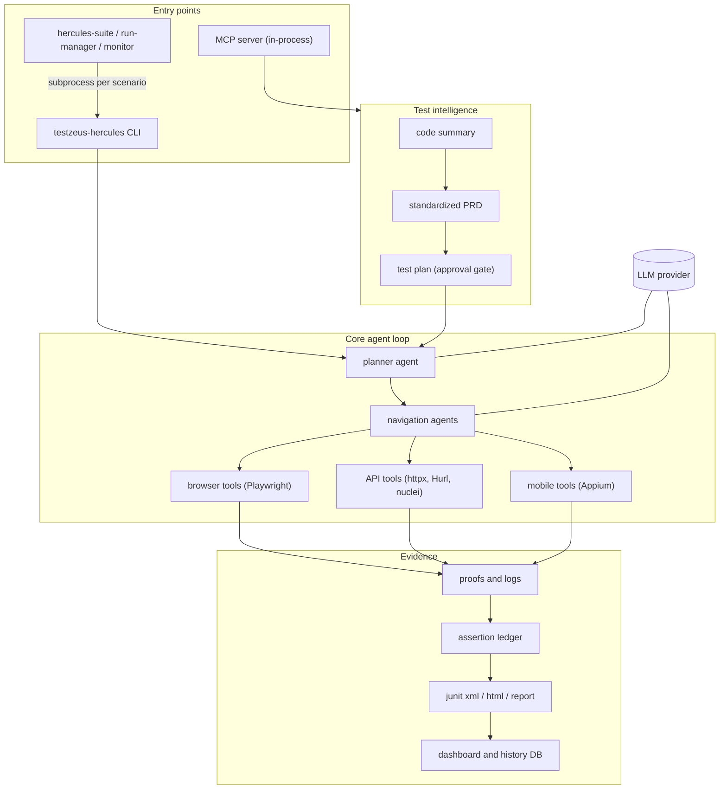

# Hercules architecture overview

This page is the map. It explains how the pieces of Hercules fit together, when
each piece is worth using (and when it is not), and where the detailed guides
live. Every statement here is backed by one of those guides, which were checked
against the code and, where noted, by running the commands locally with a
scripted mock LLM (no real LLM, real azure/anthropic client or iOS device was
involved; each guide lists what it did not verify).

## 1. The pieces

| Layer | What it is | Entry points | Guide |
| --- | --- | --- | --- |
| Core agent loop | A planner agent turns Gherkin steps into tool calls; navigation agents (browser, API, SQL, security, mobile) execute them with Playwright and helper tools. Produces proofs, an assertion ledger and junit/html results. | `testzeus-hercules`, `python -m testzeus_hercules` | [core_loop_and_reliability.md](core_loop_and_reliability.md) |
| API verification | Tools the API agent calls: `generic_http_api`, JSON-path / JSON-schema / OpenAPI assertions, variable capture and `${name}` chaining, Hurl, nuclei-based security checks. | tool calls from the planner | [api_verification.md](api_verification.md) |
| Mobile | Optional Appium layer (`[mobile]` extra) with a mobile navigation agent and 20 tools. Off unless `DEVICE_MANAGER=appium`. | planner routes `target_helper: "mobile"` | [mobile_automation.md](mobile_automation.md) |
| MCP server | Runs Hercules in-process behind an MCP streamable-http endpoint, grouped in sessions with approval-gated plan execution. | `testzeus-hercules-mcp` | [mcp_server.md](mcp_server.md), [MCP_Usage.md](MCP_Usage.md) |
| Test intelligence | Code summary, standardized PRD and test-plan generation feeding the MCP flow. | MCP tools | [test_intelligence.md](test_intelligence.md) |
| Orchestration and dashboard | Suites with gating and retry, parallel run manager, scheduled monitor with regression detection, static report dashboard. | `hercules-suite`, `hercules-run-manager`, `hercules-monitor`, `hercules-dashboard` | [orchestrator_and_dashboard.md](orchestrator_and_dashboard.md), [run_guide.md](run_guide.md) |
| Configuration | LLM, browser, reporting and strictness flags. Everything new is opt-in and defaults to the previous behaviour. | environment variables, `--config` YAML | [environment_variables.md](environment_variables.md) |

## 2. How they connect

Key properties that hold across the layers:

- **One result path.** Every tool writes evidence under `proofs/`, the
  assertion ledger feeds the junit generator, and the dashboard, history DB and
  orchestrators read the junit output. A run that claims success while the
  ledger holds a failed assertion is overruled and reported as a failure.
- **Opt-in hardening.** Strict verdicts, strict exit codes, observer
  invariants, failure bundles, run history and reporting are off by default so
  existing pipelines behave as before. Turn them on one at a time (see the flag
  table in the core loop guide).
- **Security boundaries are explicit.** The MCP server and dashboard bind
  loopback by default, require a bearer token elsewhere, confine every
  client-supplied path, and refuse private/metadata hosts for PRD URLs. The API
  tools and Hurl intentionally reach the application under test (including
  localhost) and are not SSRF-filtered; secrets are redacted in logs and
  ledgers, not in the result the model sees.
- **Process hygiene.** The orchestrator CLIs run each scenario in its own
  process group and terminate the whole tree on SIGINT/SIGTERM; the mobile layer
  quits its Appium sessions on exit and bounds every driver call with a timeout.

## 3. Which piece should I use

| I want to... | Use | Do not use it when |
| --- | --- | --- |
| Run Gherkin scenarios against a web app with an LLM | Core loop | You need deterministic, millisecond-fast checks: write plain Playwright or API tests instead. The LLM adds cost, latency and variability. |
| Assert on API responses, schemas and OpenAPI contracts from a scenario | API verification | You need load testing, fuzzing or response-header assertions (headers are not returned) or must follow redirects. |
| Run a prewritten API contract suite | Hurl tool inside API verification | You need SSRF filtering: Hurl and `generic_http_api` do not filter targets. |
| Drive a native Android app | Mobile layer | You need iOS (not verified), parallel devices, or fast scripted flows: use Appium scripts, Maestro or Espresso directly. |
| Let an IDE agent generate and run tests | MCP server | The machine is shared or the endpoint is reachable by untrusted users without a token; the server runs with your privileges. |
| Generate a test plan from a PRD | Test intelligence plus plan approval | You will execute unreviewed output: generated plans are untrusted and are not run until approved. |
| Run many scenarios, gate on smoke tests, schedule regression checks | Suite, run manager, monitor | A single `testzeus-hercules` run is enough; the orchestrators add moving parts. |
| Browse results | Dashboard | You need live status; it is a static, read-only view over finished runs. |

## 4. First run

1. Set up an LLM and run one feature: follow the quickstart in
   [core_loop_and_reliability.md](core_loop_and_reliability.md). The first
   run should use `STRICT_EXIT_CODE=true` so CI sees failures.
2. Add checks one flag at a time from the flag table (reporting, bundles,
   history) rather than all at once.
3. Add API assertions or mobile steps when the scenario needs them
   ([api_verification.md](api_verification.md),
   [mobile_automation.md](mobile_automation.md)).
4. Move to orchestration or MCP only when you need parallelism, scheduling or
   IDE-driven authoring.

## 5. Verification status

| Area | Verified locally | Not verified |
| --- | --- | --- |
| Core loop | CLI happy path, failing and false-pass scenarios, timeouts, LLM errors, SIGINT, reporting flags | Real LLM runs, streaming, azure/anthropic/bedrock clients |
| API tools | Every method, assertion and OpenAPI path, interpolation, Hurl (real binary), redaction | Real nuclei, header assertions (not supported) |
| Mobile | Android emulator end to end (all tool categories, timeouts, exit hooks) | iOS, cloud device farms, parallel devices |
| MCP and dashboard | Token mode, bind refusals, plan approval, path and SSRF guards, XSS escaping | TLS, Windows paths, PDF/DOCX PRDs |
| Orchestrators | Suite, run manager, monitor with a local webhook, signal handling | Real Slack notifications |

The remaining known gaps (for example the legacy `run_test` tool not requiring
a session id in token mode) are listed in the "known limits" section of the
relevant guide.
