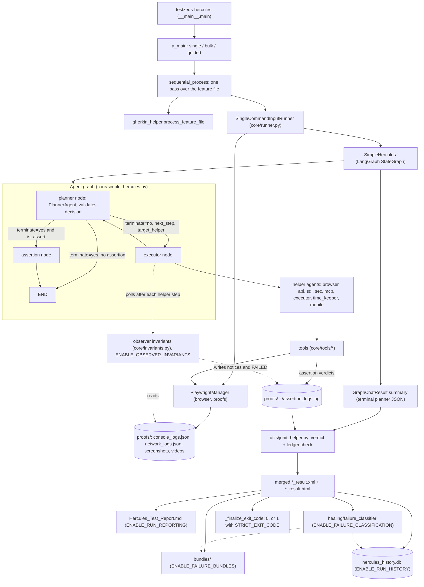

# Core agent loop and reliability

This page describes the core Hercules agent loop (planner, helper agents, tools) and the reliability, reporting and execution-safety layer added in PR #157. It covers why the layer exists and where it does not fit, how it is built, and how to run it step by step.

Almost everything that changes verdicts, exit codes or the files a run writes is **opt-in and off by default**. A run with no new environment variables behaves as before, plus a set of always-on safety fixes (listed in [section 1.2](#12-what-is-always-on-and-what-is-opt-in)). The recipes in section 3 were run on this branch against a scripted mock LLM and a local web page, not against a real model; see [section 5](#5-verified-behaviour-and-what-is-not-verified) for exactly what was and was not checked.

Contents:

1. [Overview](#1-overview): what changed, when to use it, when not to, alternatives, trade-offs
2. [Architecture](#2-architecture): diagram, module map, data flow, verdict model, termination and safety, exit codes, flag table, on-disk layout
3. [How to use it](#3-how-to-use-it): offline quickstart, reading the results, configuring the LLM
4. [Troubleshooting](#4-troubleshooting)
5. [Verified behaviour and what is not verified](#5-verified-behaviour-and-what-is-not-verified)

---

## 1. Overview

### 1.1 What it gives you

- **A bounded agent loop.** The planner/helper loop in `testzeus_hercules/core/simple_hercules.py` has an LLM call timeout, a planner round limit, a stall guard, a corrective re-prompt for malformed planner output, and containment: an LLM or tool failure ends one scenario as failed instead of aborting the batch.
- **Verdicts that can be checked.** Deterministic assertion tools write every verdict to an audit ledger (`assertion_logs.log`). When a scenario claims a pass while the ledger holds a `FAILED` or `ERROR` entry, the JUnit generator turns the case into a failure. Optional strict modes (`STRICT_VERDICT`, `STRICT_EXIT_CODE`) tighten what counts as green.
- **Evidence you can hand to someone else.** Optional markdown report, per-failure bundles (`bundle.md` plus copied logs and screenshots), a SQLite run-history database, and a heuristic failure classifier.
- **Safer teardown.** Cancellation (Ctrl-C) is never swallowed, cleanup errors are collected instead of first-error-wins, and a crashed scenario is recorded and the next one still runs.
- **Redaction.** Error-evidence files, network logs and post data are scrubbed of credentials (authorization headers, URL userinfo, `sk-...` keys, password-like keys) before they are written.

### 1.2 What is always on and what is opt-in

Always on (no flag):

- Cancellation (Ctrl-C, `asyncio.wait_for`) stops the whole run; it is not swallowed per scenario.
- Planner failure containment (LLM error, timeout, invalid decision, stall) and the corrective re-prompt.
- The LLM request timeout (`LLM_REQUEST_TIMEOUT`, default 60 s) and per-call retry count (`LLM_MAX_RETRIES`, default 1).
- Crashed scenarios become a failed JUnit entry; JUnit generation failures fall back to a minimal failed entry.
- XML-incompatible characters are stripped from everything written to JUnit.
- Cleanup error aggregation and tool-result size capping (20,000 characters).
- The assertion ledger override, whenever a ledger file exists (it exists only when a deterministic assertion tool ran).
- Redaction of error evidence, network logs and post data.

Opt-in (default off): see the flag table in [section 2.6](#26-opt-in-flags).

### 1.3 When to use it

- You run Hercules in CI and the process exit status must reflect scenario results (`STRICT_EXIT_CODE=true`).
- You have seen scenarios go green because the planner narrated a pass. Turn on a deterministic assertion tool (`ENABLE_UI_ASSERTIONS=true`, or the API assertion tools in [api_verification.md](api_verification.md)) so the ledger can contradict the narration, and consider `STRICT_VERDICT=true`.
- You want a self-contained artifact per failed scenario (`ENABLE_FAILURE_BUNDLES`) or a trend across runs (`ENABLE_RUN_HISTORY`).
- You need a run to end in bounded time even when the model misbehaves (hangs, returns garbage, loops).

### 1.4 When not to use it

- **You expect it to prove the test is right.** The ledger only contradicts a pass that a deterministic tool already recorded as failed. A scenario in which no deterministic assertion ran is still decided by what the planner says. With the flags off, a helper that reports success after its assertion tool was unavailable still produces a green scenario (verified, see [5.1](#51-reruns-on-this-branch)).
- **You embed Hercules inside a running event loop and need the exit status.** `main()` called from a running loop schedules `a_main()` as a background task and does not apply the exit code.
- **You want fully automatic self-healing.** `ENABLE_SELECTOR_RECORDING` and the classifier are observability only; nothing is auto-healed.
- **You want the observer invariants on a noisy app.** `ENABLE_OBSERVER_INVARIANTS` fails a claimed pass on HTTP 5xx and uncaught frontend exceptions. It is off by default because those signals can fail an otherwise healthy scenario.

### 1.5 Alternatives and trade-offs

| Need | Option | Trade-off |
| --- | --- | --- |
| Reliable CI exit status | `STRICT_EXIT_CODE=true` | Breaking for pipelines that relied on exit 0 with failures. Default stays 0. |
| Reliable CI exit status | Parse `*_result.xml` yourself | No flag change; you own the parsing and the pass/fail policy. |
| Catch false passes | `ENABLE_UI_ASSERTIONS=true` plus prompts that use `assert_ui` | Needs the model to call the tool. A model that never calls it leaves no ledger. |
| Catch false passes | `STRICT_VERDICT=true` | Only rejects scenarios without an explicit `is_passed: true`; cannot detect a wrong `true`. |
| Catch false passes | Observer invariants | Catches 5xx and uncaught exceptions from the proof logs; can produce red runs on apps that log those routinely. |
| Run history across runs | `ENABLE_RUN_HISTORY=true` (SQLite) | Adds a database file under the project root. The orchestrator and dashboard ([orchestrator_and_dashboard.md](orchestrator_and_dashboard.md)) read the same database. |
| Fewer moving parts | Keep every flag off | Legacy semantics, including exit 0 on failure and green runs with no assertion. |

### 1.6 What it does not guarantee

- It does not make LLM decisions deterministic. The planner can still choose wrong steps or claim a wrong verdict.
- A nav-helper that fails on every LLM call can still produce a green scenario if the planner then asserts `is_passed: true` (verified, scenario `nav_500`).
- A pass backed by zero deterministic assertions is only marked, not failed: when a ledger file exists with no entries the case gets the property `Assertions Missing=true`. When no ledger file exists there are no `Assertions *` properties at all.
- The failure classifier is a keyword heuristic with confidence between 0.30 and 0.95 (`unclassified` reports 0.10). Treat the category as a hint.
- Ctrl-C exits 130 but does not write the merged result files (see [4](#4-troubleshooting)).
- Provider and key-resolution behaviour is not changed by this layer. Changes there (blank-key handling, `MODEL_API_KEY` fallback for planner and navigation agents, `model_api_type`) are in the separate open PR #171 and are not on this branch.

---

## 2. Architecture

### 2.1 Component diagram



### 2.2 Module map

| Area | Module | Role |
| --- | --- | --- |
| Entry point | `testzeus_hercules/__main__.py` | `main`, `a_main`, `sequential_process`, `_finalize_exit_code`, `compute_exit_code`, classification and bundle annotation. |
| Runner | `testzeus_hercules/core/runner.py` | `SingleCommandInputRunner`: initializes config, agents and browser; always tears down; round limits (planner 500, helper 50). |
| Agent graph | `testzeus_hercules/core/simple_hercules.py` | LangGraph graph (`planner`, `executor`, `assertion`), decision validation, stall guard, LLM timeout wrapper, context-limit compression, failure results. |
| Planner and helpers | `testzeus_hercules/core/agents/` | `high_level_planner_agent.py`, `browser_nav_agent.py`, `api_nav_agent.py`, `sql_nav_agent.py`, `sec_nav_agent.py`, `mcp_nav_agent.py`, `executor_nav_agent.py`, `time_keeper_nav_agent.py`, `mobile_nav_agent.py` (only when the Appium gate is open). |
| Tools | `testzeus_hercules/core/tools/` | Browser, API, SQL, security tools; `tool_registry.py` holds `assertion_logger` (writes the ledger). |
| Browser and proofs | `testzeus_hercules/core/playwright_manager.py`, `core/browser_logger.py` | Playwright lifecycle; console and network logs; screenshots and videos. |
| Observer invariants | `testzeus_hercules/core/invariants.py` | Incrementally reads `console_logs.json` and `network_logs.json`, classifies entries as binding or notice. |
| Verdicts and JUnit | `testzeus_hercules/utils/junit_helper.py` | Verdict policy, ledger reading and override, merged XML. |
| Result summary | `testzeus_hercules/utils/llm_helper.py` | `GraphChatResult.summary`, `extract_planner_summary`, `parse_agent_response`; LLM timeout and retry settings. |
| Reporting | `testzeus_hercules/reporting/markdown_report.py`, `bundle.py`, `run_db.py` | Markdown report, failure bundles, SQLite run history. |
| Classification | `testzeus_hercules/healing/failure_classifier.py` | Keyword and signal heuristics, five categories. |
| Evidence and redaction | `testzeus_hercules/utils/error_evidence.py`, `utils/redact.py` | Redacted per-failure error files under `<log_dir>/errors/`; shared URL, header and post-data redaction. |
| Cleanup | `testzeus_hercules/utils/cleanup_helper.py` | `raise_if_cancelled`: cancellation keeps precedence over aggregated cleanup errors. |
| Flags | `testzeus_hercules/utils/env_flags.py` | One reader per flag, evaluated at call time. |
| Signals | `testzeus_hercules/telemetry.py` | SIGINT/SIGTERM handler that flushes telemetry, then forwards to the previous handler. |

### 2.3 Data flow for one scenario

1. `a_main` picks single, bulk or guided mode. In bulk and guided mode the per-run overrides (`PROJECT_SOURCE_ROOT`, `INPUT_GHERKIN_FILE_PATH`, `TEST_DATA_PATH`) are applied with dict-over-env precedence for that call only, and are kept above re-parsed CLI flags.
2. `sequential_process` splits the feature file into scenarios. If none are found it logs an error and exits 1 (`SystemExit(1)`), independent of `STRICT_EXIT_CODE`.
3. For each scenario a `SingleCommandInputRunner` starts: LLM config, agents, then the browser (skipped with `SKIP_BROWSER=true`). `process_command` runs the graph.
4. **Planner node.** The planner LLM returns JSON (`plan`, `next_step`, `terminate`, `target_helper`, `is_assert`, `assert_summary`, `is_passed`, `final_response`). The decision is validated: `terminate` must be `yes` or `no`, `is_assert` and `is_passed` must be JSON booleans, `target_helper` must be a known helper, and `next_step` must be non-empty while `terminate` is `no`. A malformed decision gets one corrective re-prompt; a second malformed answer fails the scenario.
5. **Executor node.** The selected helper runs its own multi-turn tool loop (up to 50 rounds) until it prints `##TERMINATE TASK##`. Its answer is appended to the planner conversation as `[<agent>]: ...`. If `ENABLE_OBSERVER_INVARIANTS` is on, the proof logs are polled after each step.
6. **Assertion node.** A terminal decision with `is_assert=true` passes through this node, which writes the final planner-shaped JSON. A terminal decision without an assertion ends the graph directly (unless `STRICT_VERDICT` routes `Not_Applicable` terminals through the node).
7. **Summary.** `GraphChatResult.summary` returns the terminal planner JSON. If the planner never terminated, the last non-empty helper answer is used when it is a terminal verdict, so a helper `### Success` or `### Error or Uncertainty` is not lost. (This path is from code reading; it was not exercised in the local runs.)
8. **Observer verdict.** Any binding invariant finding recorded during the run overwrites the result with `is_passed=false` and appends the finding to `final_response` and `assert_summary`.
9. **JUnit.** `build_junit_xml` applies the verdict policy ([2.4](#24-verdict-model)), reads the ledger and writes a per-scenario XML. A missing result, an `execution_failure` record, or a crash during the run becomes a failed case.
10. After the last scenario the per-scenario files are merged into `<output>/run_<timestamp>/<feature>_result.xml`, converted to HTML (`junit2htmlreport`, best effort), and the opt-in outputs are produced, each best effort: a failure logs a warning and never fails the run.
11. `_finalize_exit_code` logs the totals and exits with the status described in [2.5](#25-termination-safety-and-exit-codes).

### 2.4 Verdict model

Default (legacy) policy versus `STRICT_VERDICT=true`:

| Result shape | Default | `STRICT_VERDICT=true` |
| --- | --- | --- |
| No result at all | Failed (harness failure) | Failed |
| `execution_failure` record present | Failed, even if the planner claims a pass | Failed |
| `is_assert=true` | Passed when `is_passed` is truthy | Passed only when `is_passed` is `True` and `terminate` is `yes` |
| `is_assert=false` | Failed only when `terminate` is `no` | Passed only when `terminate` is `yes` and `is_passed` is `True` |

In both modes the **ledger check** then runs: when the case is a claimed pass (`is_passed is True`, `terminate == yes`, no execution failure) and the deduplicated ledger holds a `FAILED` or `ERROR` entry, the case becomes a failure whose message names the first three offenders (path, operator, expected, actual) and the totals. An already failed case is never softened.

Ledger notes:

- Location: `<proofs>/<scenario>/run_<timestamp>/assertion_logs.log`, one JSON object per line.
- Writers: `assert_ui` (only registered when `ENABLE_UI_ASSERTIONS=true`), the API assertion tools ([api_verification.md](api_verification.md)), and the observer invariants (as `FAILED` or `notice`).
- Retries of the same target (same subject, path, operator and expected value) are deduplicated; the last verdict wins.
- Verdict classes: `PASSED`, `FAILED` (never forgivable), `ERROR` (could not be evaluated, also turns a claimed pass red), `NOTICE` (counted, never red). Unknown verdict values are counted in the total only.
- Case properties written when a ledger exists: `Assertions Total`, `Assertions Passed`, `Assertions Failed`, `Assertions Unresolved`, `Assertions Notices`, and `Assertions Missing=true` for a claimed pass with a total of zero.

Observer invariants (`ENABLE_OBSERVER_INVARIANTS=true`):

| Class | Source entry | Effect |
| --- | --- | --- |
| Binding | HTTP 5xx in `network_logs.json`; console text containing `uncaught`, `typeerror` or `cannot read` (case-insensitive) | Recorded in the ledger as `FAILED`; marks the scenario failed at graph end |
| Notice | Other console errors; HTTP 4xx | Recorded as `notice`; never fails anything |

The design rule in `invariants.py` is to miss a red rather than raise a false red: entries that cannot be judged confidently are skipped or downgraded to notice. Read positions are kept per test id, and a recreated file is re-read from the start.

Failure classification (`ENABLE_FAILURE_CLASSIFICATION=true`) assigns each failed or errored case one of `environment`, `contract_violation`, `test_fragility`, `product_bug`, `unclassified`, checked in that priority order. It writes the result into the case's `bundle.md` (replacing the "Unclassified" placeholder) and records a `classification` healing event in the run-history database. Both writes happen only when the corresponding opt-in outputs (`ENABLE_FAILURE_BUNDLES`, `ENABLE_RUN_HISTORY`) are on.

### 2.5 Termination, safety and exit codes

| Condition | Where | Outcome |
| --- | --- | --- |
| Planner LLM call exceeds `LLM_REQUEST_TIMEOUT` (default 60 s) | `_llm_ainvoke` (`asyncio.wait_for` around the whole call, so client retries share the budget) | `PLANNER_TIMEOUT`: scenario ends failed |
| Planner LLM error (rate limit, 5xx, connection) | `_invoke_planner` | `PLANNER_ERROR`: scenario ends failed |
| Helper LLM call times out or errors | `_run_nav_agent` | The error text (`[ERROR] <agent> ...`) is returned to the planner as the helper answer; the planner decides what to do |
| Context-window error | `_ainvoke_with_context_fallback`, `_run_nav_agent` | History is compressed and the call is retried once |
| Malformed planner decision | `_planner_node` | One corrective re-prompt; a second bad answer ends the scenario failed (`PLANNER_INVALID_DECISION`) |
| Three consecutive planner turns with an empty or unparseable `next_step` | `_PLANNER_STALL_LIMIT = 3` | `PLANNER_STALL`: scenario ends failed. A repeated step that executes only logs `PLANNER_REPEAT_NOTICE` |
| More than 500 planner turns | `BaseRunner(planner_max_chat_round=500)` | `PLANNER_MAX_ROUNDS`: scenario ends failed. Not configurable through an environment variable |
| Helper uses all 50 rounds without `##TERMINATE TASK##` | `BaseRunner(browser_nav_max_chat_round=50)` | The helper returns an `[ERROR] ... max nav rounds` message to the planner |
| Tool result larger than 20,000 characters | `_truncate_tool_result` | Truncated with a total-size marker before it reaches the model |
| Scenario crashes (any exception) | `sequential_process` | Runner shut down best effort, failed JUnit entry recorded, next scenario runs |
| JUnit generation fails for a scenario | `sequential_process` | A minimal failed entry (`build_fallback_junit_xml`) is written |
| Cancellation (`asyncio.CancelledError`, Ctrl-C) | `sequential_process`, `clean_up` | Scenario recorded as cancelled, runner torn down, the cancellation re-raised. The merged reports are not written |
| Start fails | `SingleCommandInputRunner.start` | The browser is closed even when `DONT_CLOSE_BROWSER=true`; the original exception is re-raised and recorded |
| Cleanup errors | `BaseRunner.clean_up` | Agent shutdown and browser stop both run; errors are aggregated; cancellation keeps precedence |
| Graph recursion | `process_command` | `recursion_limit` is 2000 graph steps |

Exit status of `testzeus-hercules`:

| Situation | Exit status |
| --- | --- |
| All scenarios pass | 0 |
| Some scenario failed or errored, default | 0 (the failure is only in the logs and reports) |
| Some scenario failed or errored, `STRICT_EXIT_CODE=true` | 1 |
| As above plus `EXIT_CODE_COMPAT=1` | 0 (the compatibility switch wins) |
| No scenarios in the feature file; bulk mode without a `tests/` directory; `--dry-run` without `--test` | 1 (independent of the flags) |
| SIGINT (Ctrl-C) | 130 |
| Unhandled exception outside the per-scenario handler | Not verified |

`STRICT_EXIT_CODE` accepts `1`, `true`, `yes`, `on` (case-insensitive). `EXIT_CODE_COMPAT` only has an effect when it is exactly `1`. The orchestrator CLIs (`hercules-run-manager`, `hercules-suite`, `hercules-monitor --once`) have their own exit-code rules and start each scenario with `STRICT_EXIT_CODE=true`; see [environment_variables.md](environment_variables.md).

### 2.6 Opt-in flags

All boolean flags accept `1`, `true`, `yes`, `on` (case-insensitive); anything else, including unset or empty, is off. They are read at call time (`testzeus_hercules/utils/env_flags.py`). The authoritative list is in [environment_variables.md](environment_variables.md#reliability-reporting-and-strictness-flags).

| Flag | What it changes | Default | Enable when |
| --- | --- | --- | --- |
| `STRICT_EXIT_CODE` | Process exits 1 when any scenario failed or errored | off | CI must fail the job on a red scenario |
| `EXIT_CODE_COMPAT=1` | Forces exit 0 even if `STRICT_EXIT_CODE` is set | unset | You need the legacy status temporarily |
| `STRICT_VERDICT` | Green requires a clean termination and an explicit `is_passed: true`; routes `Not_Applicable` terminals through the assertion node | off | You want unproven or aborted scenarios to be red |
| `ENABLE_UI_ASSERTIONS` | Registers `assert_ui` and `capture_ui_value` on browser, MCP and mobile agents so UI checks reach the ledger | off | You want deterministic UI assertions that can overrule a narrated pass |
| `ENABLE_OBSERVER_INVARIANTS` | Judges proof logs after each helper step; HTTP 5xx and uncaught exceptions overrule a claimed pass | off | The app under test should be free of server errors and uncaught JS errors |
| `ENABLE_RUN_REPORTING` | Writes `Hercules_Test_Report.md` next to the merged XML | off | You want a readable run summary |
| `ENABLE_FAILURE_BUNDLES` | Copies evidence per failed case into `bundles/<case>/` and writes `bundle.md` | off | You hand failures to someone who does not have the whole proofs tree |
| `ENABLE_RUN_HISTORY` | Records runs, cases, artifacts and healing events in `hercules_history.db` (`HERCULES_HISTORY_DB` overrides the location) | off | You want trends or dashboard history |
| `ENABLE_FAILURE_CLASSIFICATION` | Classifies failed cases; annotates bundles and the history database | off | You triage many failures |
| `ENABLE_SELECTOR_RECORDING` | Records alternative selectors in the selector store (writes a file under `opt/`) | off | You want data for future healing; nothing is auto-healed |
| `STRICT_AGENTS_LLM_CONFIG` | A missing or unparseable `AGENTS_LLM_CONFIG_FILE` raises instead of falling back to `LLM_MODEL_*` | off | You never want a silent fallback to another model |
| `CONFIG_DICT_OVERRIDES_ENV` | A programmatic config dict beats environment variables | off | You embed Hercules and pass a config dict |
| `HERCULES_DISABLE_CLI_PARSE` | Skips parsing the shared CLI flags | off | You embed Hercules in another CLI |
| `SKIP_BROWSER` | No browser launch for the run | off | Pure API, SQL or MCP scenarios |
| `LLM_REQUEST_TIMEOUT` | Hard per-request LLM timeout in seconds (falls back to `PORTKEY_TIMEOUT`, then 60) | 60 | Slow models, or a faster failure for CI |
| `LLM_MAX_RETRIES` | Client retries per LLM call | 1 | You want no retries (set 0) |

`LLM_REQUEST_TIMEOUT` and `LLM_MAX_RETRIES` are read in `testzeus_hercules/utils/llm_helper.py`; they are not listed in `environment_variables.md` at the time of writing.

### 2.7 On-disk layout

Observed after a run with all reporting flags on (`PROJECT_SOURCE_ROOT=<run>`):

```text
<run>/
├── input/test.feature                         # you provide
├── test_data/                                 # optional inputs
├── gherkin_files/<Scenario_name>.feature      # one split file per scenario
├── log_files/<Scenario_name>/run_<ts>/
│   ├── agent_inner_thoughts.json              # full planner conversation
│   ├── text_only_dom.txt                      # last DOM text the browser agent read
│   └── errors/<category>_<id>.log             # redacted evidence, only after a harness failure
├── proofs/<Scenario_name>/run_<ts>/
│   ├── assertion_logs.log                     # ledger, only when an assertion tool or invariant wrote
│   ├── console_logs.json
│   ├── network_logs.json
│   ├── screenshots/                           # <action>_start_/_end_<ns>.png
│   └── videos/                                # only with RECORD_VIDEO=true
├── output/run_<ts>/
│   ├── test.feature_result.xml                # merged JUnit
│   ├── test.feature_result.html
│   ├── Hercules_Test_Report.md                # ENABLE_RUN_REPORTING
│   └── bundles/<Scenario_name>/               # ENABLE_FAILURE_BUNDLES, failed cases only
│       ├── bundle.md
│       ├── agent_inner_thoughts.json
│       ├── planner_thoughts.json
│       ├── console.json
│       ├── network.json
│       └── screenshots/step_NN.png            # up to the 3 most recent
├── hercules_history.db                        # ENABLE_RUN_HISTORY (plus -shm and -wal files)
└── installation_id.txt
```

Notes:

- `.cache/` (the Hugging Face cache, `HF_HOME` default `./.cache`) is created in the **working directory**, not in the project base. Run from a scratch directory or set `HF_HOME`.
- When `output/` already holds artifacts, per-scenario XMLs are written to a run-private `.hercules_run_<id>` subdirectory and removed after the merge, so concurrent runs do not delete each other's intermediates. The merged files stay at the usual path.
- `errors/` evidence files were not produced in the local runs (no graph-level exception occurred); the path is from `utils/error_evidence.py`.
- `hercules_history.db` tables observed: `runs`, `test_cases`, `steps`, `artifacts`, `healing_events`.

---

## 3. How to use it

### 3.1 Prerequisites

- A checkout of this repository with `uv sync --frozen` done (Python 3.11 to 3.13), or an installed `testzeus-hercules` package.
- Playwright browsers (`playwright install --with-deps`) or a Chromium or Chrome for Testing binary you point to with `BROWSER_PATH`.
- `python3` for the demo web server and the mock LLM below. No real LLM key is needed for this quickstart.

Environment note, not a product limitation: on the machine used for verification the installed Playwright driver expected an ffmpeg build that was not installed, so `RECORD_VIDEO=true` failed at browser launch (see [4](#4-troubleshooting)). The demo therefore sets `RECORD_VIDEO=false` and uses `BROWSER_PATH` for a Chrome for Testing binary. On a machine where `playwright install` matches the Playwright package, neither is needed.

### 3.2 Create the demo (verified)

The demo has a two-page web app, a scripted OpenAI-compatible mock LLM (non-streaming) that plays the planner and the browser helper, and a launcher script. Put everything in one directory, for example `demo/`. Ports 5901 (web app) and 5910 (mock LLM) are used. On macOS, avoid port 5900: it is the Screen Sharing (VNC) port, and a mock bound there fails to start.

`demo/app/welcome.html`:

```html
<!doctype html><title>Dashboard</title><h1>Welcome, admin</h1><p>You are logged in.</p>
```

`demo/app/order.html`:

```html
<!doctype html><title>Order</title><h1>Order #1001</h1><p id="status">Order status: Pending</p>
```

`demo/pass.feature`:

```gherkin
Feature: Dashboard

  Scenario: Dashboard greets the admin
    Given the user opens http://127.0.0.1:5901/welcome.html
    Then the page shows the heading "Welcome, admin"
```

`demo/order.feature`:

```gherkin
Feature: Order status

  Scenario: Order is shipped
    Given the user opens http://127.0.0.1:5901/order.html
    Then the page shows "Order status: Shipped"
```

`demo/mini_mock.py`:

```python
#!/usr/bin/env python3
"""Scripted OpenAI-compatible LLM for offline Hercules runs (non-streaming).

usage: python mini_mock.py --port 5910 --app http://127.0.0.1:5901 --scenario pass|fail|false_pass
"""
import argparse, json, threading, uuid
from http.server import BaseHTTPRequestHandler, ThreadingHTTPServer

PLANNER_MARK = "CRITICAL INSTRUCTION: You MUST respond ONLY"
LOCK = threading.Lock()
NAV = {"tasks": 0, "by_key": {}}


def text_of(content):
    if isinstance(content, list):
        return "\n".join(p.get("text", "") for p in content if isinstance(p, dict))
    return content or ""


def plan(next_step="", terminate="no", final="", is_assert=False, summary="", passed=False, helper="browser"):
    return json.dumps({"plan": "1. do it", "next_step": next_step, "terminate": terminate, "final_response": final,
                       "is_assert": is_assert, "assert_summary": summary, "is_passed": passed, "target_helper": helper})


def build(app, scenario):
    page = "welcome.html" if scenario == "pass" else "order.html"
    done = {"text": "previous_step: step\ncurrent_output: done\nData: n/a\n##TERMINATE TASK##"}
    nav = [{"name": "open_url", "args": {"url": f"{app}/{page}"}}, {"name": "get_page_text", "args": {}}]
    if scenario == "false_pass":
        # a deterministic assertion that FAILS, followed by a helper that still says "Success"
        nav.append({"name": "assert_ui", "args": {"payload": "@lastresult", "mode": "contains", "expected": "Order status: Shipped"}})
        done = {"text": "### Success:\nprevious_step: assert\ncurrent_output: order shipped\n##TERMINATE TASK##"}
    summary_pass = "EXPECTED RESULT: Welcome, admin\nACTUAL RESULT: Welcome, admin"
    summary_fail = "EXPECTED RESULT: Order status: Shipped\nACTUAL RESULT: Order status: Pending"
    final = {
        "pass": plan(terminate="yes", final="Welcome, admin is visible.", is_assert=True, summary=summary_pass, passed=True, helper="Not_Applicable"),
        "fail": plan(terminate="yes", final="Order status was Pending.", is_assert=True, summary=summary_fail, passed=False, helper="Not_Applicable"),
        "false_pass": plan(terminate="yes", final="### Success: order shipped", is_assert=True, summary="EXPECTED RESULT: Shipped\nACTUAL RESULT: Shipped", passed=True, helper="Not_Applicable"),
    }[scenario]
    return {"planner": [plan(next_step=f"Open {app}/{page} and read the page text"), final], "nav": nav + [done]}


def reply(messages, script):
    system = next((text_of(m.get("content")) for m in messages if m.get("role") == "system"), "")
    n_assist = sum(1 for m in messages if m.get("role") == "assistant")
    if system.lstrip().startswith(PLANNER_MARK):
        seq = script["planner"]
        return {"content": seq[min(n_assist, len(seq) - 1)]}
    if "Web Navigation Agent" not in system:
        return {"content": "ok"}
    step = script["nav"][min(n_assist, len(script["nav"]) - 1)]
    if "text" in step:
        return {"content": step["text"]}
    args = dict(step["args"])
    if args.get("payload") == "@lastresult":
        args["payload"] = next((text_of(m.get("content")) for m in reversed(messages) if m.get("role") == "tool"), "")
    call = {"id": "call_" + uuid.uuid4().hex[:10], "type": "function", "function": {"name": step["name"], "arguments": json.dumps(args)}}
    return {"content": None, "tool_calls": [call]}


class Handler(BaseHTTPRequestHandler):
    protocol_version = "HTTP/1.1"
    script = None

    def log_message(self, *a):
        pass

    def _send(self, obj):
        body = json.dumps(obj).encode()
        self.send_response(200)
        self.send_header("Content-Type", "application/json")
        self.send_header("Content-Length", str(len(body)))
        self.end_headers()
        self.wfile.write(body)

    def do_GET(self):
        self._send({"ok": True})

    def do_POST(self):
        body = json.loads(self.rfile.read(int(self.headers.get("Content-Length", 0))) or b"{}")
        msg = reply(body.get("messages", []), self.script)
        finish = "tool_calls" if msg.get("tool_calls") else "stop"
        self._send({"id": "chatcmpl-" + uuid.uuid4().hex[:12], "object": "chat.completion", "model": body.get("model"),
                    "choices": [{"index": 0, "message": dict(role="assistant", **msg), "finish_reason": finish}],
                    "usage": {"prompt_tokens": 100, "completion_tokens": 20, "total_tokens": 120}})


if __name__ == "__main__":
    ap = argparse.ArgumentParser()
    ap.add_argument("--port", type=int, default=5910)
    ap.add_argument("--app", default="http://127.0.0.1:5901")
    ap.add_argument("--scenario", choices=["pass", "fail", "false_pass"], default="pass")
    a = ap.parse_args()
    Handler.script = build(a.app, a.scenario)
    ThreadingHTTPServer(("127.0.0.1", a.port), Handler).serve_forever()
```

`demo/run.sh` (`chmod +x demo/run.sh`):

```bash
#!/usr/bin/env bash
# usage: [RUN_NAME=dir] ./run.sh <pass|fail|false_pass> [VAR=value ...]
# Environment: BROWSER_PATH (Chromium / Chrome for Testing binary, optional),
#              HERCULES (command to start Hercules, default: testzeus-hercules)
set -u
HERE="$(cd "$(dirname "$0")" && pwd)"
SCENARIO="$1"; shift
RUN="$HERE/runs/${RUN_NAME:-$SCENARIO}"
FEATURE=order.feature; [ "$SCENARIO" = pass ] && FEATURE=pass.feature

rm -rf "$RUN"; mkdir -p "$RUN/input" "$RUN/test_data"
cp "$HERE/$FEATURE" "$RUN/input/test.feature"

python3 -m http.server 5901 --bind 127.0.0.1 --directory "$HERE/app" >/dev/null 2>&1 &
APP_PID=$!
python3 "$HERE/mini_mock.py" --port 5910 --app http://127.0.0.1:5901 --scenario "$SCENARIO" >/dev/null 2>&1 &
MOCK_PID=$!
trap 'kill $APP_PID $MOCK_PID 2>/dev/null' EXIT
sleep 1

cd "$RUN"   # Hercules writes a relative .cache (HF_HOME) into the working directory
env \
  PROJECT_SOURCE_ROOT="$RUN" \
  LLM_MODEL_NAME=mock-model LLM_MODEL_BASE_URL=http://127.0.0.1:5910/v1 LLM_MODEL_API_KEY=sk-mock \
  HEADLESS=true RECORD_VIDEO=false ENABLE_TELEMETRY=0 \
  LLM_REQUEST_TIMEOUT=20 LLM_MAX_RETRIES=0 \
  "$@" \
  ${HERCULES:-testzeus-hercules} --project-base "$RUN" >"$RUN/hercules.log" 2>&1
echo "scenario=$SCENARIO exit=$?"
```

The mock decides behaviour from the system prompt: a system prompt starting with `CRITICAL INSTRUCTION: You MUST respond ONLY` is the planner, one containing `Web Navigation Agent` is the browser helper. The `pass` scenario scripts: planner step, helper `open_url` + `get_page_text`, helper terminates, planner terminates with `is_passed: true`. `fail` ends with `is_passed: false`. `false_pass` makes the helper call `assert_ui` for text that is not on the page, then answer `### Success`, and the planner claims `is_passed: true`.

Set the launcher variables from the repository root:

```bash
export HERCULES="uv run --frozen --project $PWD testzeus-hercules"   # or just: testzeus-hercules
export BROWSER_PATH="/path/to/Google Chrome for Testing"              # optional if playwright install matches
cd demo
```

### 3.3 Step 1: a passing scenario

```bash
./run.sh pass
```

Expected (verified): the script prints `scenario=pass exit=0`, and the log ends with

```text
INFO {__main__.py:525} - Test run finished: 1 passed, 0 failed, 0 errors
```

Outputs are under `demo/runs/pass/` (layout in [2.7](#27-on-disk-layout)). The scenario name comes from the feature file, so the proofs live under `proofs/Dashboard_greets_the_admin/run_<ts>/`.

### 3.4 Step 2: a failing scenario and the exit status

```bash
./run.sh fail                           # default
./run.sh fail STRICT_EXIT_CODE=true     # CI behaviour
./run.sh fail STRICT_EXIT_CODE=true EXIT_CODE_COMPAT=1
```

Verified results: the first prints `exit=0` even though the log says `Test run finished: 0 passed, 1 failed, 0 errors`; the second prints `exit=1` and the log has `STRICT_EXIT_CODE active: exiting with status 1 due to test failures/errors.`; the third prints `exit=0`.

The failure text in the result XML is the planner's `assert_summary`:

```text
EXPECTED RESULT: Order status: Shipped
ACTUAL RESULT: Order status: Pending
```

### 3.5 Step 3: a false pass, with and without the ledger

Without any flag the scenario is green although the page does not contain the expected text, because `assert_ui` is not registered and the helper still ends with `### Success`:

```bash
./run.sh false_pass
# log: Test run finished: 1 passed, 0 failed, 0 errors   (verified; this is the gap, not a feature)
```

With the deterministic assertion tool registered, the ledger contradicts the claim:

```bash
RUN_NAME=false_pass_guarded ./run.sh false_pass ENABLE_UI_ASSERTIONS=true STRICT_EXIT_CODE=true
# scenario=false_pass exit=1
```

The ledger line (`proofs/Order_is_shipped/run_<ts>/assertion_logs.log`):

```json
{"source":"assert_ui","test_id":"Order_is_shipped","subject":"3573cd704d23","verdict":"FAILED","mode":"contains","expected":"Order status: Shipped","actual":"not visible","scope":null}
```

The `subject` value is a hash of the examined text and is not stable across pages. The result XML then contains:

```text
<failure message="Assertion audit ledger contradicts the reported pass: 1 failed and 0 unresolved assertion(s) out of 1 recorded.
1. [FAILED] path=null operator=null expected=Order status: Shipped actual=not visible"/>
```

and the properties `Assertions Total=1`, `Assertions Passed=0`, `Assertions Failed=1`, `Assertions Unresolved=0`, `Assertions Notices=0`. The planner's own claim (`EXPECTED RESULT: Shipped / ACTUAL RESULT: Shipped`) remains in the agent logs; the failure message comes from the ledger.

### 3.6 Step 4: all reporting outputs

```bash
RUN_NAME=fail_allflags ./run.sh fail \
  STRICT_EXIT_CODE=true STRICT_VERDICT=true \
  ENABLE_RUN_REPORTING=true ENABLE_FAILURE_BUNDLES=true \
  ENABLE_RUN_HISTORY=true ENABLE_FAILURE_CLASSIFICATION=true \
  ENABLE_OBSERVER_INVARIANTS=true
```

Verified: exit 1; `output/run_<ts>/` contains `Hercules_Test_Report.md` and `bundles/Order_is_shipped/{bundle.md, console.json, network.json, planner_thoughts.json, agent_inner_thoughts.json}`; `hercules_history.db` holds one run with status `failed`.

A passing run with the same flags (`RUN_NAME=pass_allflags ./run.sh pass ... ENABLE_UI_ASSERTIONS=true`) stayed green, with one ledger `notice` entry: the demo server answers `/favicon.ico` with 404, which the observer records as a console-error notice (`Assertions Notices=1`). Notices never fail a case.

### 3.7 Reading the results

**Merged JUnit XML** (`output/run_<ts>/<feature>_result.xml`). One `<testcase>` per scenario. A failed case has a `<failure message="...">` with the planner's `assert_summary`, the ledger override message, or the harness failure text. Properties on each case:

| Property | Meaning |
| --- | --- |
| `Terminate` | `yes` when the scenario ended through a terminal decision |
| `Feature File`, `Output File` | Source and per-scenario result path |
| `Proofs Base Folder, ...`, `Proofs Screenshot`, `Proofs Video`, `Network Logs` | Where the evidence is (`Proofs Video` is `None` with `RECORD_VIDEO=false`) |
| `Agents Internal Logs`, `Planner Thoughts` | The `log_files/<scenario>/run_<ts>` folder and `agent_inner_thoughts.json` |
| `Assertions Total/Passed/Failed/Unresolved/Notices`, `Assertions Missing` | Ledger counts, present only when a ledger file exists |
| `usage_including_cached_inference.*` | Token counts; cost is flagged unavailable when the provider reports none |

**HTML**: the same data rendered by `junit2htmlreport` (`*_result.html`). It is skipped with a warning if generation fails.

**Ledger** (`assertion_logs.log`): one JSON line per verdict; `source` is `assert_ui`, an API tool, or `invariant`; `verdict` is `PASSED`, `FAILED`, `ERROR` or `notice`.

**`bundle.md`**: status, failure message, system output, a property table, the classification section (when enabled), a list of copied artifacts, and generic next steps. The classification in the demo was `test_fragility` with confidence 0.30 from the signal `not_visible`; the signal list explains why, and the category is a heuristic.

**`Hercules_Test_Report.md`**: run id, totals, a results table, a section per failure with its evidence paths, and the features exercised.

**Run history**: query it with any SQLite client, for example:

```bash
sqlite3 runs/fail_allflags/hercules_history.db \
  "select run_id,status,total,passed,failed,errors from runs; select kind,status from healing_events;"
```

### 3.8 Configuring the LLM

Hercules has two configuration paths (details in [environment_variables.md](environment_variables.md#basic-llm-setup) and [run_guide.md](run_guide.md)):

```bash
# 1. direct variables (used by the demo)
LLM_MODEL_NAME=gpt-4o
LLM_MODEL_API_KEY=<key>
LLM_MODEL_BASE_URL=<optional, for an OpenAI-compatible endpoint>

# 2. a profile file with separate planner, navigation and helper models
AGENTS_LLM_CONFIG_FILE=/abs/path/agents_llm_config.json
AGENTS_LLM_CONFIG_FILE_REF_KEY=<top-level key in that file>
```

Verified on this branch against the mock: path 1, and path 2 with a profile whose three agents each carry `model_name`, `model_base_url` and a non-blank `model_api_key`. What this branch does with keys: a missing key raises (`OpenAIError: Missing credentials`), and a blank or whitespace-only key is passed through and fails as `Connection error` ([4](#4-troubleshooting)). Provider and key-resolution changes (the `MODEL_API_KEY` fallback for planner and navigation agents, a no-op `model_api_type`, keyless endpoints, form-control state in the DOM view) are in the separate open PR #171 and are not described here. With `STRICT_AGENTS_LLM_CONFIG` off, an unusable `AGENTS_LLM_CONFIG_FILE` is logged and the `LLM_MODEL_*` configuration is used.

For a real model replace the three `LLM_*` lines in `run.sh` and write a feature file for your application. The loop, timeouts and reporting behave the same; model quality, streaming behaviour and real provider clients were not part of this verification.

### 3.9 Using it in CI

```bash
export STRICT_EXIT_CODE=true
export STRICT_VERDICT=true
export ENABLE_RUN_REPORTING=true ENABLE_FAILURE_BUNDLES=true
export LLM_REQUEST_TIMEOUT=60 LLM_MAX_RETRIES=1
testzeus-hercules --project-base=opt
```

Publish `output/run_*/` (merged XML, HTML, markdown report, bundles) as build artifacts. The exit status is 1 when any case failed or errored and 130 if the job is interrupted. Add `ENABLE_UI_ASSERTIONS=true` if your scenarios use `assert_ui`.

---

## 4. Troubleshooting

| Symptom | Cause | Fix |
| --- | --- | --- |
| Job is green but the log says `0 passed, 1 failed` | `STRICT_EXIT_CODE` is off; the default exit status is 0 | Set `STRICT_EXIT_CODE=true` (and make sure `EXIT_CODE_COMPAT` is not `1`) |
| `Planner LLM call failed: Connection error.` | The endpoint is unreachable, or the API key is blank or whitespace (both reproduced; with a reachable mock and a blank key the mock received no request) | `curl $LLM_MODEL_BASE_URL/models`; set a non-blank key. Keyless-endpoint handling is in PR #171, not on this branch |
| Port in use or mock does not start, then `Connection error` | Another service owns the port (macOS uses 5900 for Screen Sharing) | Use a free port such as 5910 |
| `Scenario ... crashed ... OpenAIError: Missing credentials` | No API key at all (`LLM_MODEL_API_KEY` unset and no profile key) | Set `LLM_MODEL_API_KEY` or `model_api_key` in the profile |
| `BrowserContext.new_page: Executable doesn't exist at .../ffmpeg-NNNN/...` or `BrowserType.launch: Connection closed while reading from the driver` with `RECORD_VIDEO=true` | The Playwright package expects an ffmpeg build that is not installed locally | Set `RECORD_VIDEO=false`, or install the matching Playwright browsers and ffmpeg. The failure is recorded as a failed scenario and the exit status is still 0 without `STRICT_EXIT_CODE`. Installing the matching build was not verified |
| A scenario is green but the page does not show the expected text | No deterministic assertion ran, so there is no ledger and the planner's claim stands | Register `assert_ui` (`ENABLE_UI_ASSERTIONS=true`) or use the API assertion tools; check for `Assertions Total` on the case, and absence of any `Assertions *` property means nothing was verified |
| Green scenario even though the helper reported only errors | The planner asserted `is_passed: true` regardless; the loop does not second-guess it (reproduced with an all-500 helper) | Use deterministic assertions plus the ledger; review `agent_inner_thoughts.json` |
| `Planner produced no executable progress 3 times in a row` | The planner returned an empty or unparseable `next_step` three turns running | Check the model output format in `agent_inner_thoughts.json`; use a model that follows the JSON contract |
| `Invalid planner decision: is_assert must be a boolean, got 'true'` | The planner returned a string where a boolean is required, twice in a row | Same as above; the first occurrence only triggers a re-prompt |
| `planner_agent LLM call timed out after Ns` | The model did not answer within `LLM_REQUEST_TIMEOUT` | Raise `LLM_REQUEST_TIMEOUT` for slow models, or investigate the endpoint. Helper timeouts appear as `[ERROR] browser_nav_agent LLM error` in the planner conversation |
| After Ctrl-C there is no merged `*_result.xml` or `.html` | Cancellation re-raises before the merge. The exit status is 130 and the per-scenario `*_results.xml` stays in `output/run_<ts>/` | Re-run, or read the per-scenario XML. Merging an interrupted run is not implemented |
| `.cache/` directories appear next to where you ran the command | `HF_HOME` defaults to `./.cache` | Run from a scratch directory or set `HF_HOME` |
| `Proofs Video` is `None` in the report and bundle evidence table | `RECORD_VIDEO=false` or the video was not produced | Expected when video recording is off |
| `Assertions Notices=1` on a passing run with observers on | A 404 or other console error was recorded as a notice | Informational; only binding findings (5xx, uncaught exceptions) change the verdict |
| Config falls back to `LLM_MODEL_*` after a typo in `AGENTS_LLM_CONFIG_FILE` | `STRICT_AGENTS_LLM_CONFIG` is off, so the problem is only logged | Set `STRICT_AGENTS_LLM_CONFIG=true` to fail fast (documented behaviour, not run locally) |

---

## 5. Verified behaviour and what is not verified

### 5.1 Reruns on this branch

Branch `hercules-oss-tes-1939-landed-bugs` (landed #157 to #160 plus the TES-1939 fixes), macOS, LLM timeout 20 s, no retries. The happy path, failing assertion, false-pass and all-flags rows were run with the exact demo files from section 3. The remaining rows used a richer scripted mock (more scenarios, not part of the repository) against the same kind of local pages.

| Scenario | Result |
| --- | --- |
| Happy path (login and welcome page) | 1 passed, exit 0 |
| Failing assertion, default flags | 1 failed, exit 0 |
| Failing assertion, `STRICT_EXIT_CODE=true` | 1 failed, exit 1, warning logged |
| Failing assertion, `STRICT_EXIT_CODE=true` and `EXIT_CODE_COMPAT=1` | 1 failed, exit 0 |
| False pass (planner claims pass, `assert_ui` should fail), no flags | 1 passed (the tool is not registered; gap documented) |
| False pass with `ENABLE_UI_ASSERTIONS=true`, strict exit | 1 failed via ledger override, `Assertions Failed=1`, exit 1 |
| Claimed pass with no assertion, `STRICT_VERDICT=true` | 1 failed; the failure message is the planner's `### Success: ...` text (the detail used when no summary exists) |
| All reporting flags on, failing scenario | Markdown report, `bundle.md` with `test_fragility` classification, history row with status `failed` and a `classification` healing event, exit 1 |
| All reporting flags on, passing scenario | Green; one observer `notice` (favicon 404); history row status `passed` |
| Planner returns unparseable text every turn | Failed after 3 stalled turns (about 0.2 s of scenario time) |
| Planner returns `is_assert: "true"` every turn | One corrective re-prompt, then failed with `Invalid planner decision` |
| LLM returns HTTP 500 | Failed with `Planner LLM call failed: Error code: 500`; exit 1 under strict |
| LLM hangs after two calls, timeout 20 s | Helper call timed out at 20 s (error passed to the planner), planner call timed out at 20 s, failed with `planner_agent LLM call timed out after 20s` |
| Helper LLM returns 500 on every call, planner claims `is_passed: true` | Green (by design, see [1.6](#16-what-it-does-not-guarantee)) |
| No API key set | Scenario recorded as crashed (`OpenAIError: Missing credentials`), exit 0 (1 under strict) |
| Whitespace API key, mock reachable | `Connection error`; the mock saw no request |
| `RECORD_VIDEO=true` on the test machine | Failed at browser launch (Playwright ffmpeg build missing); recorded as a failed scenario, exit 0 |
| SIGINT sent to the process group during a run | Exit 130, scenario logged as cancelled, one `KeyboardInterrupt` traceback in the log, per-scenario XML left behind, no merged XML or HTML |
| `AGENTS_LLM_CONFIG_FILE` profile with non-blank keys | 1 passed |
| Unit tests: `test_core_loop_safety`, `test_exit_code`, `test_invariants_observer`, `test_assertion_ledger_junit`, `test_junit_helper_hardening`, `test_cleanup_robustness`, `test_error_evidence`, `test_markdown_report`, `test_main_async_safety` | 179 passed |

All processes started for these runs (mock LLM, web server, Hercules, browsers) were stopped afterwards.

### 5.2 From an earlier session (main at beb8be5, not rerun on this branch)

| Scenario | Result |
| --- | --- |
| Planner loops on the same step with the mock | Ended with `Max planner rounds exceeded` after 500 rounds (about 23 s with the mock) |
| Mock LLM process killed after two calls | Failed with `Connection error` |
| Mock returns a non-JSON body | Failed with a client parsing error recorded as `Planner LLM call failed` |
| Findings noted at the time | A stray `print("===== LTM =====")` in the planner and `Could not read network log None` log noise on some paths; neither affects results |

### 5.3 Not verified

- Any run driven by a real LLM. Planner and helper behaviour with real models, prompt adherence, and cost accounting (`cost_unavailable` is reported for the mock).
- Streaming responses. The demo mock is non-streaming; the richer earlier mock supports streaming but no streaming-specific behaviour was checked for this page.
- Real Azure, Anthropic or other native provider clients. Only OpenAI-compatible endpoints were exercised.
- Binding observer findings (HTTP 5xx, uncaught exceptions) in an end-to-end run. Only notices were observed live; the binding path is covered by the unit tests listed above.
- Terminal helper verdict recovery when the planner never terminates, the context-limit compression path, and the `PLANNER_MAX_ROUNDS` path on this branch (seen only on main in the earlier session).
- `errors/` evidence files, `ENABLE_SELECTOR_RECORDING`, `STRICT_AGENTS_LLM_CONFIG` failure behaviour, bulk and guided modes, and the `SKIP_BROWSER` run.
- Installing the matching Playwright ffmpeg build as a fix for the video failure.
- Exit status on an unhandled exception outside the per-scenario handler.
- Concurrent runs sharing one project root, and behaviour on Windows or Linux (all runs were on macOS).
