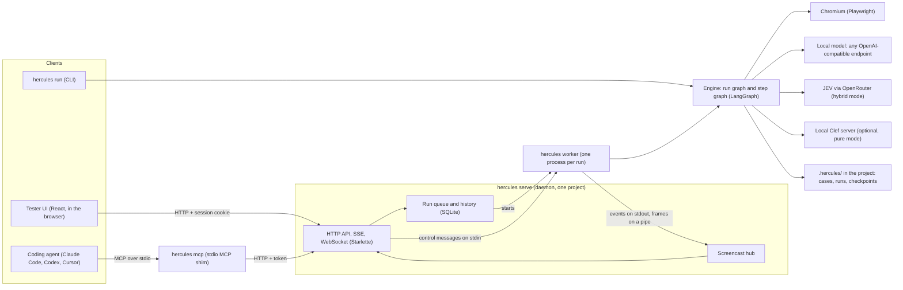
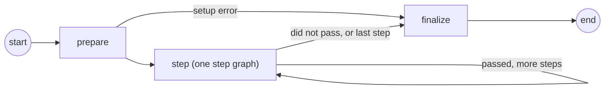
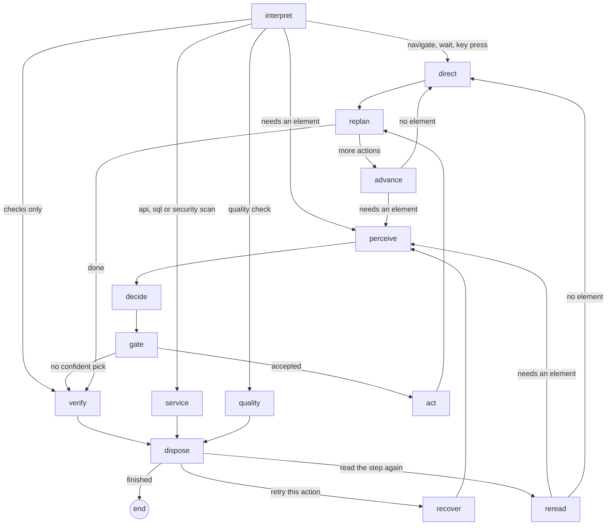
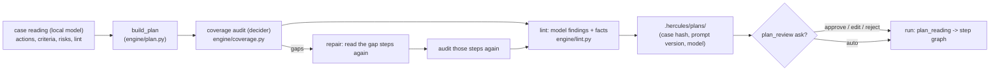

# Architecture

This page explains how Hercules v2 is built: the processes, the run and step graphs, how
a page is perceived and a decision made, how outcomes are verified, what is written to
disk, and how the pieces are kept safe. It is written for contributors and for users who
want to know what happens during a run. Module names are relative to the
`testzeus_hercules` package.

## Design principle: models read, code executes

Every step reading and every decision comes from a model. Hercules has no rule-based
step reader and no coded decider to fall back to. Deterministic code does two things
only:

- it executes structured payloads: a browser action on a chosen element, an HTTP
  request, a read-only SQL query, an accessibility or visual check;
- it checks observed facts: the text and URL a page shows, an API response, the rows a
  query returned, the measurements of a quality check.

When a model is not confident, the result is `unverified` or the step is retried; code
never guesses in its place. Changes that add hand-written rules for reading steps or
picking elements are not accepted.

Two model roles appear throughout:

- **The local model** (`llm.*` settings): a chat model behind any OpenAI-compatible
  endpoint, usually a server on your machine. It reads the steps, writes values, drafts
  cases and does every other language task, and makes the decisions in pure mode.
- **The decider**: the engine that answers typed decision questions (which element,
  which tool, did the step work). In hybrid mode it is JEV, a hosted decision model
  served through OpenRouter, with the local model as fallback. In pure mode it is the
  local model, or a local Clef server.

## Components



- **`hercules run`** (`cli/run.py`) runs one case in the foreground: it loads settings,
  builds the run's engines (`engine/factory.py`) and runs the run graph in-process.
- **`hercules serve`** (`cli/serve.py`, `daemon/`) serves one project. It binds to
  `127.0.0.1` by default, writes `~/.hercules/daemon.json` (port, pid, API token; mode
  0600), keeps the run queue and event log in `<project>/.hercules/history.db`
  (`daemon/store.py`) and serves the HTTP API and the built tester UI (`daemon/app.py`,
  `daemon/ui.py`). Only one daemon runs per Hercules home.
- **`hercules worker`** (`cli/worker.py`) runs one queued case. The daemon's manager
  (`daemon/manager.py`) starts each run in its own process group, so a crash in one run
  (or its browser) cannot take down the daemon or other runs. The worker reuses the
  `hercules run` path, streams JSON-lines events on stdout, reads control messages
  (pause, approvals, screencast on or off, input) on stdin, and sends screencast frames
  on a separate pipe. A worker that dies without `run.json` marks its run `error`, and
  leftover processes in its group are killed.
- **`hercules mcp`** (`mcp/`) is a thin stdio shim for coding agents. It answers MCP
  `initialize` without touching the daemon, then maps each tool call onto the daemon's
  HTTP API (`mcp/tools.py`), starting `hercules serve` for the current project if none
  is running (`mcp/daemon_client.py`). Every call returns within 55 seconds; long runs
  are polled.
- **The tester UI** (`ui/`, React and Vite) is built into `testzeus_hercules/ui/static/`
  and served by the daemon. It talks only to the daemon's API.
- **Model endpoints**: the local model through `llm/client.py` (plain httpx), JEV
  through `decide/backends/jev.py`, a Clef server through `decide/backends/clef.py`.

## The run graph

`engine/run_graph.py` runs a case as a small LangGraph graph:



- **prepare** makes the run's plan (see [The plan phase](#the-plan-phase)): the local
  model reads the whole case (see [Case reading](#case-reading-and-caching)), the decider
  audits its coverage, and lint adds the model's findings and the facts. With
  `plan_review: ask` the run waits for the plan's approval, and in strict mode lint errors
  end the run; in both cases before the browser starts. Otherwise the plan is made while
  the browser starts. prepare then opens the browser (unless every step is an API or SQL
  step), starts the console and network logs, and judges the case's `preconditions` on
  the page as the run starts. A precondition that clearly does not hold ends the run
  with `error`.
- **step** runs the next step through the step graph, with run control checked before
  it. The run stops at the first step that does not pass; the remaining steps are
  reported as `skipped`.
- **Order.** Steps run as written, with one exception (`engine/ordering.py`): inside a
  block of consecutive field-entry steps (fills and choices only, no expected outcome, no
  click, check or navigation between them), a step whose case reading says its field
  `needs` another step's field (a region that depends on the country) runs after it. The
  model states the dependency; code only keeps dependencies inside the block and applies
  them as a stable topological order (a cycle keeps the written order, with a note). At
  run time, a step whose field cannot be set (disabled, no such option, the value does not
  stick) may get a `run_first` answer from the local model naming a later field step of its
  block: that step runs now and the step runs again after it (once per step). Steps keep
  their numbers; `StepResult.sequence` says when one ran out of order and `notes` why, and
  the reorder is recorded in the step's `plan.jsonl` (`stage: order`, `depends`).
- **finalize** builds the `RunResult`, asks the decider to classify why a run that did
  not pass failed (`engine/failure.py`; below 50 % confidence it is `unclassified`),
  and writes `run.json` and `junit.xml`. The browser is closed when the run ends.

## The step graph

`engine/step_graph.py` runs one step:



- **interpret** takes the step's reading: from the case reading, or (an edited step, no
  case reading) read on its own with the page's controls as context
  (`engine/intent.py`). A step may be read as several actions; the first runs and the
  rest follow through `advance`.
- **direct** runs actions that need no element: navigation, waits, key presses.
- **perceive** lets the page settle and takes a Set-of-Mark snapshot
  ([Perception](#perception)).
- **decide** sends one decision request with every element of the page to the decider
  ([Deciders](#deciders-and-the-confidence-gate)).
- **gate** accepts the decider's element pick only above the engine's threshold.
- **act** performs the action on the chosen element (`act/browser.py`). Actions never
  raise; a fill reads the field back and fails when the value did not stick.
- **Verification after blur.** After a fill or a choice, focus leaves the field
  (`el.blur()`, as tabbing away does; never a click elsewhere), the page gets up to about
  1.5 s for a validation request it starts, and the field is read again: its value,
  `aria-invalid` (on it or its own container), the browser's validity (unless the form has
  `novalidate`), the text of its `aria-errormessage` / `aria-describedby` targets, new text
  in its own container (the highest ancestor holding no other field), and its format
  hints (`placeholder`, `pattern`, `title`, `maxlength`, `min`, `max`, `type`,
  `inputmode`). Focus is then given back, so a key the test presses next still reaches the
  field; a field showing suggestions is not left. The same facts appear in every field's
  row for the decider and in the page view a continuation sees. What they mean is left to
  models: a changed value passes only when the decider judges it the same (≥ 0.8); a
  rejected value goes to the local model (`field_value`), which may rewrite it in the
  field's format (it must confirm `same_meaning` and quote the field's error or hint, and
  the decider must judge both values the same) or say the test expects the rejection
  (quoting the test's words). When no writing of the value fits (longer than the field's
  limit, a form it never takes), the model may replace it with other sample data of the
  same kind that fits (`substitute`: it must quote the field's error or limit and fit the
  limit), only when no later step names the value, it is not a secret and the run is not
  strict; the change is a `substitute` amendment and a note on the step. Otherwise a value
  longer than the field's limit fails as `ValueTooLong` and the run is classified `test_data`. A
  step that clicks (a form's submit) re-reads the fields earlier steps filled: one the page
  now marks invalid (a format checked only on submit) is asked about the same way, entered
  again, and the click is done again; the change is an amendment of the step that filled it. At the end of each
  step, a field it changed that the page now marks invalid fails that step. The extra cost
  is about 0.2 s per fill on a page that validates without a request.
- **replan** continues a step the model planned from the page, or whose words do not
  name every control it needs: the local model is asked once, with the page's fields,
  messages and headings, whether the step still needs something (a menu entry that only
  appeared, a submit, an empty field).
- **verify** runs the step's checks and records them in the assertion ledger
  ([Verification](#verification-and-verdicts)).
- **service** runs an API or SQL step (`engine/service.py`): the payload is executed as
  written and every check is judged in code. No perception, no decider, no recovery.
- **quality** runs an accessibility, visual or layout check (`engine/quality.py`).
- **dispose** decides what a failure leads to. **recover** looks again (after a short wait
  on a first miss, by scrolling after later ones) and asks the decider again without the
  elements that already failed, at most `max_recoveries` (2) times per action and
  `max_actions` (6) actions. **reread** asks the local model once to plan what the step
  still needs on the page as it is, given what was already done. Actions that already
  succeeded are never repeated.
- A continuation or re-read plans for **the current step's words only**. The model is given
  the step's text, how the case reading read it, what was done, and the case's earlier steps
  as "already done: never repeat them". Each planned action must quote, in a `because` field,
  the words of the step it carries out; actions whose quote is not in the step are dropped
  and the model is asked once more (told which and why). It also sees each control's dialog,
  section and whether it is scrolled out of view (it can act on such a control directly: the
  act layer scrolls it into view).

Any exception in a node ends the step with status `error` and the reason. The step graph
is never checkpointed (its state holds pages and images); the run graph is.

## The plan phase

Before the browser starts the case becomes an explicit plan (`cases/plan.py`, schema
`cases/schemas/plan.schema.json`; user guide: [Plans](plans.md)). The model decides what
the plan says; code checks its structure, executes it and checks what the page shows.



- **Generation** (`engine/planning.py`) evolves the whole-case reading: the same parts,
  cache and fallbacks, one structured call per part, whose reply now also has, per action
  item, `_criteria` (what the page should show once its actions are done, each `author` or
  `inferred` with a check form) and `_risk` (destructive, irreversible, external side
  effect, with a reason), and per step a `_lint` list. `build_plan` turns the reading into
  plan steps (one per action, then a `verify` plan step holding the expected outcome's
  checks as author criteria); an `author` criterion must be words of the step, else it is
  recorded as `inferred`; a value the step enters is not repeated as a criterion.
- **Coverage audit** (`engine/coverage.py`): one decision request with a yes/no question
  per audited step ("does the plan cover every obligation of this step?"), at most 12
  per request. Steps below 0.5 are read again in one call (`repair_case`) and audited
  again; what remains is a lint error.
- **Lint** (`engine/lint.py`): the model's findings (`suspicious_value`,
  `ambiguous_reference`, `unclear_outcome`) and facts (missing secrets, credentials in
  URLs, unresolved placeholders, a query step with no connection, unconfirmed risky steps,
  coverage gaps, steps read only on the page).
- **Store and review** (`engine/plan_run.py`): plans are stored under `.hercules/plans/`
  by the SHA-256 of the case, `PROMPT_VERSION` and the model id; an approved plan is
  reused without asking until one of them changes. `review: ask` asks through the run's
  control (`needs_approval` of kind `plan`, which the daemon reports as
  `needs_plan_approval`); an edit is read from `plan.edited.json`, checked against the case
  (`apply_edits`: a plan step whose text alone changed is read again by the model) and
  recorded as amendments from the user.
- **Execution** (`plan_reading`): the run executes the plan's reading. Each action carries
  its plan step id, criteria and risk flags. After the action, on the settled page,
  `engine/criteria.py` checks its criteria (text, address, element state, field value and
  count in code; `judged` by the decider; an element that is not named unambiguously is
  judged, never guessed). An author criterion that fails fails the step; an unmet inferred
  one drives one continuation with the expectation (`remaining(..., expected=...)`), never
  for an action flagged risky, and is then a warning (strict mode: `unverified`). Criteria
  of actions replaced on the page are settled at the end of the step (author ones checked,
  inferred ones `not_run`). Every plan change is an `Amendment` (continuation, reread,
  recovery, reorder, run_first, reformat, edit) in the step's `plan.jsonl` and in
  `plan.json`.
- **Results**: `plan.json` beside `run.json` (the plan, each criterion's last result, the
  amendments), `RunResult.plan` (a summary), and the export: author criteria that the run
  checked become assertions, inferred ones review notes.

## Case reading and caching

Before step 1 the local model reads the whole case with structured output
(`LLMInterpreter.read_case` in `engine/intent.py`): each step's action and, separately,
its `expected` outcome. The reply is a typed `StepIntent` per action (navigate, click,
fill, select, check, hover, press, wait, assertions, API, SQL or quality) plus a flag
saying whether the step's words name every control it uses, and a `needs` list: the other
steps whose field must be set before this step's field (see the run graph's order).

The case is read in consecutive parts of at most 16 items, fewer when the model's context
or output budget is small (`case_part_size`); a step's action and outcome stay in one
part. Each part's call carries its own items, the titles of the case's other steps and the
test-data names as context, and its reply schema has one key per item, so the parts merge
into one reading by key. Parts run up to three at a time on a hosted endpoint and one
after another on a local server. A part that fails is tried once more; if it fails again,
only its steps are read one at a time on the page, and `worker.log` names the part, the
error type and the HTTP status (never the prompt).

Each part's reading is cached in `<project>/.hercules/cache/interpret/`, keyed by the
model id, the reading prompt's version (`PROMPT_VERSION`) and the SHA-256 of the part's
text. An unchanged part is never read twice, so editing one step reads only its part again. Placeholders such as `{{password}}` stay in the
reading and are substituted only when the action runs, so secret values never reach a
model or the cache. `plan.jsonl` in each step's evidence records where the reading came
from and every continuation or re-reading.

API, SQL and quality steps that carry a structured payload run as written. Plain-language
ones are read into the same payload by the local model (`engine/service_intent.py`,
`engine/quality_intent.py`), and the payload then runs in code.

## Perception

`perceive/` turns a page into something a model can choose from:

- **Page settling.** Before Hercules reads a page (to pick an element, continue a step or
  check an outcome) it waits, within a few seconds at most, for a navigation in flight,
  the page's own data requests and network activity, then for the DOM to stop adding
  elements, finite animations and transitions to finish and visible loading indicators
  (`aria-busy`, an indeterminate progress bar) to go away.
- **The walker** (`perceive/walker.js`) runs in every frame and walks open shadow roots.
  It never writes to the page. Each interactive element gets an `md` number in DOM
  order, with its role, accessible name, value, state and box, and a path (frame paths,
  then one CSS selector per shadow tree) that `perceive/snapshot.py` resolves back to a
  Playwright locator. The walker survives pages that patch globals and prototypes or
  define custom elements whose properties throw: it uses plain loops instead of Array
  methods and guards every element, shadow root, slot and frame, so a node that cannot be
  read is skipped and counted (the observation header says `# read: N elements skipped
  (first error: ...)`). If it cannot run in the top document, Hercules waits for the page
  to settle and tries again, then reads the page in an isolated world (Chromium) where the
  page's scripts are absent. If that fails too, perception raises an error with the page's
  own message and the step ends as `error` ("the page could not be read: ...", with
  `perception_error.json` in its evidence); the run is classified `environment` without
  asking a model.
- **Set-of-Mark images** (`perceive/painter.py`): the marks are painted off-page onto a
  plain screenshot, with numbered badges that never overlap each other or leave the
  image. Each snapshot keeps both images (`plain.jpg`, `som.jpg`).
- **Modal dialogs.** The walker notes every open modal dialog: a `<dialog>` shown as modal
  (`:modal`, in the top layer) and a visible element with `role="dialog"` or
  `role="alertdialog"` and `aria-modal="true"`. When several are open, the one on top
  counts (the top layer first, then the one a hit test finds on top, then the highest
  stacking layer, then the last in the page). Every element outside it, through shadow
  roots and slots, and every element in an `inert` or `aria-hidden="true"` subtree is
  marked as not offered: it stays in the snapshot but is not listed in the observation,
  not marked on the screenshot, not offered to the decider and not listed to the step
  reader. Frames behind the modal are behind it too. Alerts and live regions outside the
  modal (a toast) still count as the page's messages. The observation header says
  `# modal: "<dialog name>" open; N elements behind it not offered` (and `# hidden: N
  elements inert or aria-hidden, not offered`). When the modal holds nothing that can be
  read (a stale `aria-modal`), every element is offered and the header says so.
- **Context from the element's ancestry.** Each element records the accessible name of the
  dialog it is in, the heading of its section (the nearest heading before it inside its
  own section, landmark, fieldset, scroll area or dialog; a dialog is never left), and,
  when it is scrolled out of the scroll area it sits in, on which side of the shown part.
  None of this comes from screen positions, so a modal over a list page never borrows the
  list's heading, and the list never borrows the modal's.
- **Observation text** (`Snapshot.observation_text`): a header (title, path, viewport,
  headings above and below, an open modal), then one row per offered on-screen element.
  This is what `observation.txt` holds.
- **Locations** (`decide/locate.py`): every candidate carries where it is (region and
  approximate centre on the screenshot, the dialog it is in and its section heading, its
  rank among elements with the same role and name), so a decider can tell look-alike
  elements apart. A field scrolled out of a dialog's scroll area says `in dialog "New
  record", under "Address", in the dialog's scroll area, below the visible part` instead of
  a page position.
- **Finding an element again** (`perceive/snapshot.py` `resolve`). An element is found by
  its recorded path. When the path no longer finds it (the page re-rendered its fields,
  after a scroll or on a timer), it is looked for in its frame, inside its dialog, by the
  locators a test would use (role and name, label, placeholder, text, id, `name`
  attribute), keeping one only when exactly one element matches and it has the recorded
  role and name; it is then scrolled into view inside its scroll area. If none does, the
  page is read again and the one offered element with the same role, name, dialog and
  frame is used (exact match only). Otherwise the action fails with `TargetGone`. The
  step's `plan.jsonl` records which fallback found it (`"stage": "resolve"`).

## Deciders and the confidence gate

A decision is a `DecisionRequest` (`decide/contract.py`): one `state` (the element rows,
the step, optionally the Set-of-Mark screenshot) and a flat map of typed questions
(`choice`, `score`, `noul` yes/no-style questions, `box`). For a step that needs an
element, `decide/questions.py` asks `target` (one row `md_<n>`, or `no_match`),
`target_absent`, and `tool` only when the step's kind is unknown. Every element is
offered in page order; nothing is ranked or dropped by matching words. A request bigger
than a decider takes in one call is split into page-order parts and the parts' picks are
compared in one more request (`decide/chunking.py`).

Every backend implements the `DecisionEngine` protocol (`decide/engine.py`):

| Backend | Module | Used in |
|---|---|---|
| `JevFallbackDecider` | `decide/backends/jev_fallback.py` | Hybrid mode. Asks JEV with text first; when egress is `hybrid` and the `target` confidence is below 0.5, asks again with the screenshot. When JEV cannot answer, the local model answers that one decision. |
| JEV client | `decide/backends/jev.py` | OpenRouter's decisions endpoint, zero data retention requested, retries with backoff and a circuit breaker after repeated failures. |
| `LocalLLMDecider` | `decide/backends/local_llm.py` | Pure mode. The questions become one JSON-schema response; the reply's probabilities give the confidence. Long lists are split at a quarter of the model's context. |
| Clef | `decide/backends/clef.py` | Pure mode with a local Clef server, wrapped with the same local-model fallback. |
| `StubDecider` | `decide/backends/stub.py` | Tests only: fixed answers, no model. |

The **confidence gate** (`engine/gate.py`) accepts a `target` pick only at or above the
engine's own threshold, because confidences are not comparable across engines: 0.5 for
JEV (its probabilities are calibrated), 0.6 by default (the local model and Clef, until
calibrated). A rejected pick goes to verification and then recovery, not to a guess.

`engine/factory.py` chooses the mode: `decider.backend` when set, else hybrid when a JEV
key is found and the egress policy allows page text to leave, else pure with a one-line
notice. Model-backed deciders contact only the endpoints resolved from settings, after
the egress check.

## Verification and verdicts

`engine/verify.py` runs checks against what the page shows and records each one as a
`LedgerEntry` with the verdict `passed`, `failed` or `unverified`:

- **Literal checks** (`text`, `not_text`, `url`, `visible`) run in code. A check is kept
  only when its expected text comes from the step itself; a model can restate what you
  expect, never replace it with what the page happens to show.
- **Judged checks**: an outcome with no exact text (or `semantic: true`) and a case's
  preconditions are judged by the decider (`engine/judge.py`) on the page's address,
  title, visible text and, when images may be sent, the screenshot. 0.7 or more passes,
  0.3 or less fails, anything between is `unverified`. Appearance checks need a decider
  that can see the screenshot; without one they are `unverified`.
- **API, SQL and quality checks** are judged in code from the response, the rows or the
  measurements (`act/api_assert.py`, `act/api_schema.py`, `engine/quality.py`).

Verdicts are strict: a step passes only when every check in its ledger passed, and a run
passes only when every step passed. An `unverified` check fails the run.

## Evidence on disk

Every run writes to `<project>/.hercules/runs/<run_id>/` (`engine/evidence.py`). All
text passes through the run's redactor first.

```text
run.json            the RunResult (schema: cases/schemas/run_result.schema.json)
plan.json           the run's plan, criteria results and amendments (schema: cases/schemas/plan.schema.json)
junit.xml           one testcase per step
console.jsonl       console messages and page errors (browser runs)
network.jsonl       requests, statuses and failures, credentials masked (browser runs)
case.json           the case as run (daemon runs)
worker.log          the worker's stderr (daemon runs)
preconditions/      the page and the judgement of the case's preconditions
steps/<n>/
  plain.jpg         screenshot
  som.jpg           screenshot with numbered marks
  observation.txt   the page as text
  decisions.jsonl   every decision: engine, model, latency, cost, answers, fallback reason
  plan.jsonl        how the step was read, continued and re-read; how an element was found again
  locators.json     the locator candidates tried for each acted-on element, with match counts
  http.json, sql.json, checks.json    API and SQL steps
  summary.txt, findings.jsonl, scan.json    security steps
  quality/          findings, annotated screenshots, visual before/after/diff
```

Evidence is addressed as `hercules://runs/<run_id>/...` by the UI and the MCP tools. The
daemon serves it only from inside the run folder, with fixed content types and a
sandboxing Content-Security-Policy (`daemon/evidence.py`).

## Exporting runs as code

As a step runs, the step graph records what it did for the run's automation spec
(`RunResult.automation`, models in `cases/automation.py`; recording in
`engine/step_automation.py` and `engine/automation.py`): each action that succeeded, the
checks with their verdicts, and the API, SQL and quality payloads as executed. Before an
element is used, `perceive/locators.py` lists the ways a test could find it (test id
attributes, role and accessible name, label, placeholder, exact text, alt text, title, CSS)
and evaluates each in the element's frame on the live page; only candidates that match
exactly that one element are kept (`locators.json` has every candidate and its count).
Typed values are kept as the case wrote them (placeholders, never secret values). For a
literal text check that held, the Playwright assertion forms that also hold on the page are
recorded. Recording never fails a step.

`export/` renders the spec as Playwright Test or pytest-playwright code, or as JSON: a
translation of what the run did, with no decisions of its own. Checks a model judged and
steps that cannot be written faithfully stay as TODO comments and review notes. Only passed
runs are exported (see [Exporting runs as code](exporting-code.md)).

## Checkpoints and resume

Daemon runs pass a checkpointer to the run graph (`engine/checkpoint.py`): LangGraph's
in-memory saver, written through to `<project>/.hercules/checkpoints/<run_id>.db`
(SQLite, mode 0600). After every completed step the run also saves the page's URL,
cookies and local storage (`engine/page_state.py`). When a worker dies without a result,
the run is marked `error` and can be resumed: a new worker (`hercules worker --resume`)
opens a fresh browser, restores the page state and continues from the last completed
step. The checkpoint is removed when the run finishes. `hercules run` keeps no
checkpoints.

## Human in the loop

`engine/control.py` holds a `RunControl` that the run graph checks before every step and
the step graph before every action. Commands come from the daemon as JSON lines on the
worker's stdin:

- **pause, resume, step, skip, retry** at step and action boundaries;
- **approvals** (`needs_approval`): a drafted case before it starts, the run's plan
  before the browser starts (with `plan_review: ask`; reported as `needs_plan_approval`),
  a click on an element whose name suggests deleting, paying or transferring, or that the
  plan flags destructive or irreversible (with `confirm_destructive`), and a step whose
  recovery is exhausted (with `ask_on_failure`, or while a tester is debugging). The answer is approve, reject or edit (new step text,
  run again). No answer within the timeout counts as a rejection; waiting time does not
  count against step or case timeouts;
- **take over**: while paused, clicks and keys from the live view are relayed to the page
  (`POST /api/runs/{id}/input`).

When the command stream closes, a paused run resumes and open questions are rejected, so
a run never waits for nobody.

## Live screencast

`engine/live.py` streams the active page over CDP (`Page.startScreencast`, JPEG, at most
1280 px wide) only while someone watches, following popups and new tabs. Frames go from
the worker to the daemon on their own pipe; `daemon/screencast.py` relays them to the
run's WebSocket viewers (`/api/runs/{id}/screencast`). Each viewer holds only the newest
frame, so a slow client skips frames instead of falling behind.

## Security model

- **Loopback by default.** The daemon binds `127.0.0.1`. Any other address needs
  `--allow-remote` and `HERCULES_DAEMON_TOKEN` of at least 32 characters.
- **Token and cookie.** Every API request needs `Authorization: Bearer <token>` (from
  `daemon.json`) or the UI session cookie. `hercules ui` asks for a one-time sign-in code
  (valid 5 minutes) that is traded for an `HttpOnly`, `SameSite=Strict` cookie, so the
  browser never sees the token. `Host` must be a loopback name (against DNS rebinding)
  and a present `Origin` must be a loopback origin; WebSockets pass the same checks
  (`daemon/security.py`).
- **Content-Security-Policy.** The UI is served with a same-origin-only CSP,
  `frame-ancestors 'none'`, `X-Frame-Options: DENY` and `nosniff` (`ui/assets.py`);
  evidence files with `default-src 'none'; sandbox`.
- **Egress policy.** `local`, `hybrid-text` or `hybrid` applies to every model call
  (`llm/providers.py`): under `local`, hybrid mode and remote model endpoints are
  refused. Whether an endpoint is local is decided from its URL alone, without DNS.
- **Secrets as environment references.** Cases hold `{"secret": "NAME"}`; values are
  read at run time (`engine/data.py`) and never reach a model, the reading cache or
  disk. Configuration files refuse keys that look like secrets and only name the
  variable that holds a key. The OpenRouter key file must be readable by its owner only.
- **Redaction.** Everything written to evidence passes through the run's redactor (known
  secret values, and the credential parameters of any URL, masked by name) and, for API
  and SQL steps, `act/redact.py` (URL credentials, secret headers and body fields). Logs,
  run results and the worker's events are redacted the same way. Credentials in the
  case's URLs become `{{url_credential_N}}` placeholders for the run (`engine/data.py`),
  and every decision request leaves through `engine/masking.py`, so models never see them.
- **Path confinement.** Run ids are single safe path segments (`kernel/paths.py`).
  Files a step names (uploads, schema and spec files) must stay inside the project and
  may not be dotfiles, keys or databases (`act/files.py`). Evidence and UI files are
  served only as regular files inside their folder, with no symbolic links. Importers
  write only inside `.hercules/`.
- **Read-only SQL.** One `SELECT` per step; anything that writes is refused before
  connecting, and sessions are made read-only where the database allows (`act/sql.py`).
- **Security scans** (`scan/`): the external scanner targets only the case's base URL (or
  a spec inside the project, scoped to the base URL), without update checks or
  out-of-band callbacks; intrusive templates need an explicit opt-in. Its command,
  output and findings are redacted before they are kept or shown.
- **Telemetry** (`kernel/telemetry.py`): a closed set of events, each checked against an
  allowlist of fields; text that looks like a URL, path, email or token is refused. A
  background thread posts each event to PostHog's capture API as an anonymous event (no
  person profile, no GeoIP); the payload is checked again just before it is sent.

## Package layout

| Package | Responsibility |
|---|---|
| `cli/` | The `hercules` command: argument parsing (`main.py`) and one module per subcommand |
| `kernel/` | Settings (`settings.py`), on-disk layout (`paths.py`), per-run context, telemetry |
| `llm/` | Providers and endpoints, the chat client, structured output, model aliases, hardware tiers, preflight probes and the capability cache |
| `cases/` | `TestCase`, `RunResult` and `Plan` models, published JSON Schemas, Playwright device profiles (`devices.py`), the Gherkin compiler, importers (`importers/`) |
| `engine/` | Run and step graphs, the engine factory, case reading, the plan phase (plan building, coverage audit, lint, criteria checks, plan store and review), verification, judgements, failure classification, run control, checkpoints, live view, evidence, API/SQL and quality sessions |
| `perceive/` | Set-of-Mark snapshots: the walker, the painter, the snapshot model |
| `decide/` | The decision contract, question catalogue, chunking, locations and the backends |
| `act/` | Browser actions, HTTP requests, read-only SQL, JSON assertions, schema checks, file confinement, evidence redaction |
| `mobile/` | Native app runs: the device target (local Appium, BrowserStack, Sauce Labs) and its egress check, the W3C WebDriver session, page source parsing, the per-step read-decide-act-verify loop, device cloud upload and status |
| `quality/` | Accessibility (bundled axe-core and own checks), visual baselines, layout checks, verified fixes |
| `daemon/` | The HTTP API, run queue and store, worker manager, screencast hub, request guard, UI serving |
| `mcp/` | The stdio MCP shim, tool definitions and handlers, the daemon client |
| `export/` | Exporters of a run's automation spec: Playwright Test (TypeScript), pytest-playwright (Python), the spec as JSON |
| `ui/` | The built tester UI and safe asset serving (source in the repository's `ui/`) |
| `scan/` | Security scans with the external nuclei scanner: finding or installing it, the scope check, the command, redaction of its output, findings and evidence (used by security steps and `hercules scan`) |

## Extension points

- **A model server type**: add a `ProviderSpec` to `PROVIDERS` in `llm/providers.py`
  (default URL, local or not, key variable, capability hints). Any OpenAI-compatible
  server already works as `openai-compatible`.
- **A decision backend**: implement `DecisionEngine.decide` (`decide/engine.py`), give it
  a threshold in `engine/gate.py`, and wire it in `engine/factory.py`.
- **A step kind**: add the kind to the reading model in `engine/intent.py` (so the model
  can produce it), its execution in `act/browser.py` or a session, and its routing in
  the step graph. The reading stays the model's job; do not add text-matching rules.
- **A check**: literal checks live in `engine/verify.py`; accessibility, visual and layout
  checks in `quality/`, with fixes verified on the live page.
- **An importer**: add a module under `cases/importers/` that builds `PlannedFile`s and
  hands them to `write_plan`, and a subcommand in `cli/import_cmd.py`.
- **An MCP tool**: a definition in `mcp/specs.py`, a handler in `mcp/tools.py`, and the
  daemon route it calls in `daemon/app.py` (with its model in `daemon/models.py` so it
  appears in `/api/openapi.json`).
- **A UI screen**: `ui/src/screens/`, talking to the daemon API through `ui/src/lib/api.ts`.
