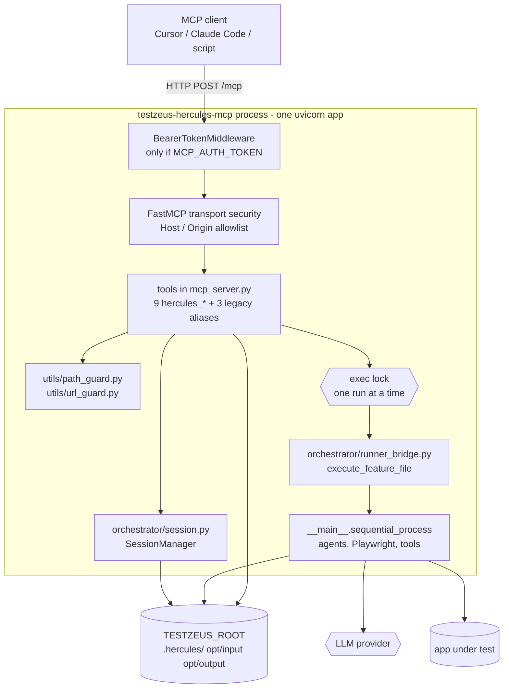

# Hercules MCP Server

Hercules can run as an MCP server over the `streamable-http` transport, so MCP
clients such as Cursor, Claude Code, or Windsurf can drive test generation and
execution directly. The server runs Hercules **in-process** (no subprocess per
call) and groups work in **sessions**: a session records the app under test,
the project path, the generated artifacts (code summary, standardized PRD, test
plan) and the run results.

Contents: [1 Overview](#1-overview) | [2 Architecture](#2-architecture) |
[3 Starting the server](#3-starting-the-server) | [4 Tools](#4-tools) |
[5 How to use](#5-how-to-use) | [6 Session and artifact persistence](#6-session-and-artifact-persistence) |
[7 Redaction rules](#7-redaction-rules) | [Security notes / known limitations](#security-notes--known-limitations) |
[9 Troubleshooting](#9-troubleshooting) | [10 Known limits / not verified](#10-known-limits--not-verified)

Related: `docs/test_intelligence.md` (what the PRD/plan tools do),
`docs/orchestrator_and_dashboard.md` (parallel runs, suites, monitor, dashboard),
`docs/MCP_Usage.md` (Hercules as an MCP *client*, the opposite direction).

## 1. Overview

### 1.1 When to use it

- A coding agent (Cursor, Claude Code, Windsurf) should write, run and inspect
  Hercules tests as part of its own loop, with structured results instead of
  scraping a terminal.
- You want the PRD -> plan -> reviewed run pipeline (`docs/test_intelligence.md`)
  with sessions that remember the app URL, project path and generated artifacts.
- A single trusted operator, on the same machine (or behind an authenticated,
  TLS-terminated proxy), drives one test run at a time.

### 1.2 When not to use it

| Situation | Why the MCP server is the wrong tool | Use instead |
| --- | --- | --- |
| CI gating | Results come back as a JSON dict over HTTP; there is no exit code | `testzeus-hercules` with `STRICT_EXIT_CODE=true`, or `hercules-suite` / `hercules-run-manager` (exit 1 on failures) |
| Parallel execution | Runs are serialized per server process by a lock (the runner mutates a process-wide config singleton and a shared notification hub) | `hercules-run-manager`, `hercules-suite` (one subprocess per scenario) |
| Untrusted or multi-tenant callers | Tools run with the server process's privileges and environment (API keys, browser, files). All sessions share one filesystem and one `opt/output` tree. A session id is only a lookup key | One server per trust domain, or do not expose it |
| Hard isolation of test code | Runs execute inside the server process; `execute_python_sandbox` is not a security boundary | Run Hercules in a container/VM per run |
| Scheduled regression monitoring | No scheduler, no baselines | `hercules-monitor` |
| Browsing past results | `hercules_open_dashboard` only returns a path | `hercules-dashboard` |

### 1.3 Alternatives and trade-offs

- **In-process vs subprocess.** The server avoids a Python and Playwright start-up
  per call, at the cost of shared state: one hung or leaking run affects the
  process. `HERCULES_MCP_EXEC_TIMEOUT` cancels the awaiting run after the deadline
  (default 1800 s) so the lock is released; it does not make runs isolated.
- **Serialized runs.** A second `hercules_generate_and_execute` (or
  `hercules_rerun`) call waits for the lock; the wait itself is not bounded, so a
  client with a short request timeout can give up while the call is still queued.
- **Sessions are convenience, not isolation.** Without a token the "most recent
  session" shortcut applies. With a token every call needs an explicit
  `session_id` (see 2.5 for what that does and does not protect).
- **Generated plans cost approval friction on purpose** (`docs/test_intelligence.md`).
- **Hercules as MCP client** (`mcp_servers.json`, `MCP_ENABLED`, see
  `docs/MCP_Usage.md`) is a different feature: it lets the Hercules agent call
  *other* MCP servers during a test.

## 2. Architecture



### 2.1 Module map

| Path | Responsibility |
| --- | --- |
| `testzeus_hercules/mcp_server.py` | FastMCP app, tool definitions, path/URL confinement calls, approval gate, result parsing, `build_http_app`, `main` |
| `testzeus_hercules/orchestrator/session.py` | `SessionState`, `SessionManager`, `sessions.json` persistence, explicit-session-id switch |
| `testzeus_hercules/orchestrator/runner_bridge.py` | `execute_feature_file` (calls `sequential_process`, listens to the notification hub), `write_plan_scenarios_feature`, `describe_run` |
| `testzeus_hercules/orchestrator/code_scan/` | code summary and git-diff helpers (`docs/test_intelligence.md`) |
| `testzeus_hercules/intelligence/` | PRD parsing, plan generation, coverage (`docs/test_intelligence.md`) |
| `testzeus_hercules/utils/path_guard.py` | realpath confinement, PRD document/secret-name checks |
| `testzeus_hercules/utils/url_guard.py` | SSRF-guarded PRD fetch |
| `testzeus_hercules/utils/http_security.py` | bind policy, token middleware, Host allowlist |
| `testzeus_hercules/utils/redact.py` | URL, header, post-data and text redaction |

### 2.2 Data model: sessions

`SessionState` (one per `hercules_configure_session` call):

| Field | Meaning |
| --- | --- |
| `session_id` | `sess_` + 16 hex chars (`secrets.token_hex(8)`, 64 random bits) |
| `app_url` | App under test; recorded and probed for reachability only (the URL a run visits comes from the Gherkin) |
| `project_path` | Resolved, confined source tree (absolute in state; re-confined on every use) |
| `test_type`, `test_scope` | Informational label; `codebase` is the only scope |
| `prd_path` | Confined local file or URL |
| `code_summary_path`, `standard_prd_path`, `test_plan_path` | Artifact paths under `.hercules/<session_id>/` |
| `plan_approved`, `plan_approved_sha256` | Approval bound to the plan file's bytes |
| `last_run_summaries` | Last 10 run summaries (in memory and on disk) |
| `app_url_reachable` | `true`/`false`/`null` from the probe |
| `credentials` | Always `{}`: the argument is ignored |

The registry keeps at most 100 sessions (oldest evicted). `session_id=""` resolves
to the most recently created session, except for the synthetic session the legacy
`run_test` alias creates, which never becomes "most recent".

### 2.3 On-disk layout (observed after a full run)

```text
$TESTZEUS_ROOT/                      (default: current working directory)
├── .hercules/
│   ├── sessions.json                registry, mode 0600, written atomically
│   └── sess_<16hex>/
│       ├── code_summary.json
│       ├── standard_prd.json
│       └── test_plan.json
└── opt/
    ├── input/hercules_mcp_run_<8hex>.feature     one per run, kept
    ├── gherkin_files/TC001_REQ-001_happy.feature  split per-scenario files written by the runner
    └── output/run_<YYYYMMDD_HHMMSS>/              one folder per server process (its start time)
        ├── hercules_mcp_run_<8hex>.feature_result.xml    JUnit, one per executed feature file
        ├── hercules_mcp_run_<8hex>.feature_result.html
        ├── Hercules_Test_Report.md                       only with ENABLE_RUN_REPORTING=true
        └── bundles/<case>/bundle.md                      only with ENABLE_FAILURE_BUNDLES=true
```

Screenshots, logs and videos land in `opt/proofs/` and `opt/log_files/` as for any
Hercules run.

### 2.4 Identifiers

| Id | Shape | Notes |
| --- | --- | --- |
| `session_id` | `sess_<16 hex>` | Capability-like but only a lookup key; unknown ids return `Unknown session_id 'x'.` without listing known ones |
| `run_id` | `run_<YYYYMMDD_HHMMSS>` | Name of the folder under `opt/output/`; **one per MCP server process**, named after the process start time, so every run of that process shares it |
| `result_id` | `<feature file name>_result`, e.g. `hercules_mcp_run_e1c66012.feature_result` | The XML file name without `.xml`; selects one result inside a run folder. `<name>` without `_result` is also accepted |
| feature file | `opt/input/hercules_mcp_run_<8hex>.feature` | Fresh per run so concurrent calls cannot clobber each other |
| test case id | `TC001...` | Assigned when the plan is generated |

`run_id` and `result_id` must be a single path component of letters, digits, `.`,
`_`, `-` (max 128 characters); anything else is rejected before touching the file system.

### 2.5 Trust boundaries and threat table

```text
 client ──HTTP──► [Bearer token] ─► [Host/Origin check] ─► [tool args] ─► [path/URL guards] ─► in-process run
 (untrusted           401                421 / 403         confined to         allowed roots,       full process
  until token)                                              allowed roots       public URLs only     privileges
```

| Threat | Guard | What it does not prevent |
| --- | --- | --- |
| Remote caller on a network-exposed bind | Non-loopback `MCP_HOST` refused unless `MCP_AUTH_TOKEN` (>= 16 chars); token enforced on every request including loopback; constant-time compare | Tokens are plain bearer tokens over HTTP: terminate TLS in front. Any holder of the token has full tool access |
| DNS rebinding against a loopback server | FastMCP transport security: `Host` (421) and `Origin` (403) must be loopback names (plus `MCP_ALLOWED_HOSTS`); wildcard bind with no allowlist skips the Host check and relies on the token | Not a substitute for the token on shared hosts |
| Client reads arbitrary files via `project_path` / `prd_path` | `resolve_within`: realpath inside the Hercules root, `PROJECT_SOURCE_ROOT`, `TEST_DATA_PATH` or `HERCULES_MCP_ALLOWED_ROOTS`; `/` and `$HOME` are never accepted as roots; PRD files must be document types with non-secret names | The `project_path` stored in a session is re-confined every time it is used (code summary, README fallback, PRD root); one edited into `sessions.json` to point outside the allowed roots is refused with an error that does not echo the path. Anyone who can edit `.hercules/sessions.json` still controls the host |
| SSRF through `prd_path` URL | `url_guard` (public addresses only, redirects re-checked, IP pinned, bounded) | The `app_url` probe and the URLs test steps visit are intentionally not guarded; they must reach local apps |
| Running an LLM-generated plan unreviewed | Approval gate bound to the plan's SHA-256 | A careless reviewer; `HERCULES_MCP_AUTO_APPROVE_PLAN=true` |
| One client driving another client's session | With a token, `session_id` is mandatory for the session tools (`hercules_generate_code_summary`, `_generate_standardized_prd`, `_generate_test_plan`, `_generate_and_execute`, `_rerun`) and for the legacy `run_test` alias; unknown ids reveal nothing | `hercules_get_run_results`, `hercules_open_dashboard`, `hercules_check_config`, `get_test_results` and `generate_gherkin` never read session state and take no session; results are read from the shared `opt/output` folder |
| Host path leakage to remote clients | Tool results use root-relative paths or bare names; errors and JUnit failure text are scrubbed | `sessions.json` and the artifact files on disk hold absolute paths (the file is mode 0600) |
| Credential leakage via session state | `credentials` is ignored; `app_url` and PRD URL secrets are redacted before persisting | Anything you put into Gherkin text is written verbatim to `opt/input/*.feature` and kept |
| Hung run pinning the server | `HERCULES_MCP_EXEC_TIMEOUT`; Gherkin generation capped at 120 s | Queued callers wait without a bound |

## 3. Starting the server

```bash
testzeus-hercules-mcp
# or
python -m testzeus_hercules.mcp_server
```

Both start a FastMCP streamable-http server at `http://127.0.0.1:8000/mcp` by
default (loopback only). Run it from the project root (or set `TESTZEUS_ROOT`):
`opt/`, `.hercules/` and `agents_llm_config.json` are resolved under it. The
process prints the client config block at start-up and stops on SIGINT/SIGTERM like
any uvicorn app.

> **Security model:** the MCP server exposes tools that can drive test execution
> (browsers, API calls, LLM usage) with the privileges of the server process. It
> therefore binds **loopback only** by default and keeps DNS-rebinding protection
> (the `Host`/`Origin` headers must be loopback names). To bind any other address
> (`MCP_HOST=0.0.0.0`, a LAN IP, ...) you **must** set `MCP_AUTH_TOKEN` to a random
> secret of at least 16 characters; the server refuses to start otherwise. When a
> token is set it is enforced on every request, loopback included: clients send
> `Authorization: Bearer <token>`. Terminate TLS in front of the server when it
> leaves the machine, because the token travels in a request header.
>
> Client-supplied filesystem paths (`project_path`, local `prd_path`) must resolve
> inside the Hercules root (`TESTZEUS_ROOT`/cwd), `PROJECT_SOURCE_ROOT`,
> `TEST_DATA_PATH` or a directory listed in `HERCULES_MCP_ALLOWED_ROOTS`. The
> filesystem root `/` and the user's home directory are never accepted as allowed
> roots (they are dropped with a warning), and a local `prd_path` must be a
> `.md`, `.markdown`, `.txt`, `.rst`, `.pdf` or `.docx` file whose name is not a
> dotfile or a config/secret file (`agents_llm_config*`, `*.env`, `.env*`, `*.pem`,
> `*.key`, `sessions.json`, `hercules_history.db*`). PRD URLs
> may only be public `http(s)` hosts (no loopback/private/link-local/metadata
> addresses, every redirect re-checked, size/time bounded).
>
> `hercules_generate_and_execute` **executes what you give it** (`gherkin` or the
> Gherkin generated from `description`). A test plan generated from a PRD is
> untrusted LLM output and is **not** executed until you review it and pass
> `approve_plan=true` (or set `HERCULES_MCP_AUTO_APPROVE_PLAN=true`). Approval is
> bound to the SHA-256 of the plan file: regenerating or editing the plan
> invalidates it. When the HTTP server enforces a bearer token (`MCP_AUTH_TOKEN`,
> or a token passed to `build_http_app`), every tool call must pass an explicit
> `session_id` (the "most recent session" shortcut is for unauthenticated
> loopback use only).

Exit behaviour (verified): a refused bind (`MCP_HOST=0.0.0.0` without a token, or
with a token shorter than 16 characters) prints one line and exits with status 1:

```text
Refusing to bind the Hercules MCP server to non-loopback host '0.0.0.0' without authentication. Set MCP_AUTH_TOKEN to a random secret (>= 16 chars), or bind 127.0.0.1.
MCP_AUTH_TOKEN is too short for a non-loopback bind of the Hercules MCP server (need >= 16 chars).
```

### Environment variables (all optional)

| Variable | Default | Purpose |
| --- | --- | --- |
| `MCP_HOST` | `127.0.0.1` | Bind host (applied to the HTTP server). Non-loopback values require `MCP_AUTH_TOKEN`. |
| `MCP_PORT` | `8000` | Bind port (applied to the HTTP server). |
| `MCP_PATH` | `/mcp` | URL path of the MCP endpoint (applied to the HTTP server). |
| `MCP_AUTH_TOKEN` | *(unset)* | Bearer token required on every request when set (>= 16 chars, mandatory for non-loopback binds). |
| `MCP_ALLOWED_HOSTS` | *(unset)* | Extra comma-separated `Host` header names to accept (e.g. a public DNS name). With a wildcard bind (`0.0.0.0`) and no list, the Host check is skipped and the token is the only gate. |
| `HERCULES_MCP_ALLOWED_ROOTS` | *(unset)* | `os.pathsep`-separated extra directories that `project_path`/`prd_path` may point into. |
| `HERCULES_MCP_AUTO_APPROVE_PLAN` | `false` | Skip the `approve_plan` confirmation for PRD-derived test plans. |
| `PRD_FETCH_ALLOW_PRIVATE_HOSTS` | `false` | Allow PRD URLs on private/loopback hosts (e.g. an intranet wiki). |
| `TESTZEUS_ROOT` | current working directory | Project root; `opt/` and `.hercules/` are resolved under it. |
| `HERCULES_MCP_EXEC_TIMEOUT` | `1800` | Per-run execution deadline in seconds for the run tools (`hercules_generate_and_execute`, `hercules_rerun`). Invalid values fall back to the default. Note: the description-to-Gherkin LLM generation step has a separate, fixed 120-second deadline (`_GHERKIN_GENERATION_TIMEOUT_S`, not configurable); on timeout the tool returns an error dict before execution starts. |
| `TESTZEUS_PYTHON` | `sys.executable` | Reserved helper variable. The in-process server does not shell out, so it is currently unused; kept for compatibility with external tooling. |

### LLM configuration (required for LLM-backed tools)

The MCP server does **not** reuse the plain `LLM_MODEL_*` setup for its own LLM
calls. The LLM-backed tools — `hercules_generate_standardized_prd`,
`hercules_generate_test_plan`, `hercules_generate_and_execute(description=...)`,
`generate_gherkin`, and the `ping_model` check in `hercules_check_config` —
require a litellm-profile config:

```bash
AGENTS_LLM_CONFIG_FILE=agents_llm_config.json
AGENTS_LLM_CONFIG_FILE_REF_KEY=litellm
```

With `LLM_MODEL_*` variables alone, the LLM-backed tools return an error like
`LiteLLM is required. Set AGENTS_LLM_CONFIG_FILE to agents_llm_config.json with
a 'litellm' provider section and AGENTS_LLM_CONFIG_FILE_REF_KEY=litellm.`
`hercules_generate_code_summary` is heuristic and needs no LLM (it never calls
`enrich_with_llm`). Tools that need no MCP-level LLM config: raw-Gherkin execution
(`hercules_generate_and_execute(gherkin=...)`), result inspection
(`hercules_get_run_results`) and `hercules_open_dashboard`. Executing Gherkin
still runs the normal Hercules agents, which need a working LLM configuration of their
own; verified: with only `LLM_MODEL_NAME`/`LLM_MODEL_API_KEY`/`LLM_MODEL_BASE_URL` set,
`hercules_check_config` returned `ok: false` (`litellm_model` error), the plan tool
errored, and `hercules_generate_and_execute(gherkin=...)` still ran and succeeded. See `docs/run_guide.md` for the config file schema and
provider examples.

## 4. Tools

Copy `mcp_hercules.example.json` (repo root) or add this block to your client's
MCP config:

```json
{
  "mcpServers": {
    "testzeus-hercules": {
      "transport": "streamable-http",
      "url": "http://localhost:8000/mcp",
      "env": {
        "AGENTS_LLM_CONFIG_FILE": "agents_llm_config.json",
        "AGENTS_LLM_CONFIG_FILE_REF_KEY": "litellm"
      }
    }
  }
}
```

Adjust `url` when you changed `MCP_HOST`/`MCP_PORT`/`MCP_PATH`, and add
`"headers": {"Authorization": "Bearer <MCP_AUTH_TOKEN>"}` when a token is configured.

The nine `hercules_*` tools each return a JSON dict. Errors are returned as
`{"error": "<message>", ...}` instead of raising. The three legacy aliases
(`generate_gherkin`, `run_test`, `get_test_results`) return plain strings
instead (`get_test_results` returns the result dict serialized as JSON text).
Every tool accepts an optional `session_id`; when omitted, the most recent
session is used (unauthenticated loopback only). `hercules_get_run_results`,
`hercules_open_dashboard`, and `hercules_check_config` accept `session_id` only for
symmetry and ignore it: results are read from `opt/output/` and configuration
checks are process-wide.

| Tool | Arguments | Returns |
| --- | --- | --- |
| `hercules_configure_session` | `app_url` (required), `project_path`, `test_type` (informational label: `frontend`/`backend`/`mixed`), `test_scope` (only `codebase`; `diff` is rejected), `credentials` (deprecated, ignored and never stored), `prd_path` | `session_id`, `app_url`, `app_url_reachable` (true/false/null), `project_path`, `test_type`, `test_scope`, `prd_path`, `next_action`, optional `warnings` |
| `hercules_generate_code_summary` | `session_id`, `project_path` | `summary` (frameworks, languages, entry point/route counts), `total_files`, `code_summary_path`, `next_action`. The tool is heuristic and local; `llm_notes` is only present if an enrichment step were wired in, which none is today |
| `hercules_generate_standardized_prd` | `session_id`, `prd_path` | `requirement_count`, `project_name`, `standard_prd_path`, `requirements` (first 50 `{id, title}`), `next_action`, optional `warning` (set when some PRD chunks failed extraction; the requirement set may be incomplete) |
| `hercules_generate_test_plan` | `session_id`, `prd_path`, `cases_per_requirement` (default 3) | `test_plan_path`, `case_count`, `coverage` (requirement matrix totals), `test_cases` (`{id, title, category, priority, tags}`), `next_action` |
| `hercules_generate_and_execute` | `session_id`, `test_ids` (plan subset), `gherkin`, `description`, `additional_instructions`, `approve_plan` (required to run a PRD-derived plan) | `success`, `duration_s`, `summaries`, `run_report_md`, `bundles_count`, `progress_events` (last 20), `steps_completed`, `feature_file`, `source` (`gherkin`/`description`/`test_plan`), optional `error`, `next_action`, and `additional_instructions_note` (set when `additional_instructions` were appended as Gherkin comments). With a `description`, Gherkin generation has a separate fixed 120-second deadline (`_GHERKIN_GENERATION_TIMEOUT_S`, not configurable); on timeout the tool returns an error dict before execution starts |
| `hercules_get_run_results` | `session_id`, `run_id` (omit for newest run), `result_id` (select one result inside the run folder; see below) | `run_id`, `result_id`, optional `other_results`, `junit_xml`, `total`/`passed`/`failed`/`errors`, `report_md`, `html`, `bundles`, `test_cases` (`{name, status, time, failure_message?}`) |
| `hercules_open_dashboard` | `session_id` | `dashboard: "not_running"`, `report_path` (root-relative path of the newest markdown/HTML report: the portable form) and `report_url` (the same report as a `file://` URI, unchanged from earlier versions; it contains the absolute local path by design, because the server runs on the machine that holds the report), `hint` (start `hercules-dashboard`) |
| `hercules_check_config` | `session_id`, `ping_model` (send a tiny prompt and report latency) | `ok`, `checks`: `llm_config`, `litellm_model`, `playwright`, optional `model_ping` |
| `hercules_rerun` | `session_id`, `test_ids`, `approve_plan` | Same shape as `hercules_generate_and_execute`; prefers the session test-plan subset, falls back to the last executed feature file |

`success` is `failed == 0 and errors == 0` over the run summary, so a run whose
planner declares `is_passed: true` is a success even when the navigation agent
could not do anything (for example a total LLM outage after the plan step); read
`test_cases` and the report rather than the boolean alone.

### Deprecated aliases

Legacy tools are still registered for backwards compatibility but are
deprecated:

- `generate_gherkin(description)` — use `hercules_generate_and_execute(description=...)`.
- `run_test(gherkin, description, additional_instructions, session_id)` — use `hercules_configure_session` + `hercules_generate_and_execute`.
- `get_test_results(run_id)` — use `hercules_get_run_results`.

### Results semantics

- `hercules_get_run_results()` with no arguments picks the newest run folder (by
  modification time), then the newest `*_result.xml` inside it.
- The HTML returned is the sibling of the chosen XML (`<name>_result.html`), so the
  numbers and the report always describe the same run.
- Older results in the same folder are listed in `other_results`; pass one as
  `result_id` to read it. Verified: after two executions in one server process,
  `result_id` selected the older one and a made-up `result_id` returned
  `Result 'nope' not found in run 'run_...'`.
- `hercules_rerun` with a plan re-runs the whole plan (or `test_ids`), not "the last
  subset". Without a plan it re-executes the last recorded feature file, but only
  if that file is a `.feature` inside this root's `opt/input/`.

## 5. How to use

### 5.1 Local quick start (verified)

```bash
# terminal 1: server, from your project root
cd /path/to/project
export AGENTS_LLM_CONFIG_FILE=$PWD/agents_llm_config.json AGENTS_LLM_CONFIG_FILE_REF_KEY=litellm
testzeus-hercules-mcp                     # http://127.0.0.1:8000/mcp

# terminal 2: smoke client shipped in the repo (LLM-free tools)
python .hercules/mcp_smoke_client.py http://127.0.0.1:8000/mcp
```

The smoke client connects, lists the 12 tools, runs `hercules_check_config`,
configures a session against `tests/api_testing_app` (so that directory must be
inside the server's allowed roots: start the server from the repo root, or add it
via `HERCULES_MCP_ALLOWED_ROOTS`), summarizes the code, calls
`hercules_generate_standardized_prd` (expected to return an error dict when no LLM is
configured, or a PRD when one is) and `hercules_get_run_results`. Against a
token-protected server, export `MCP_AUTH_TOKEN` for the client too; without it the
client fails with an unhandled HTTP 401.

### 5.2 End-to-end walkthrough (client script)

This is the flow from `docs/test_intelligence.md` as one script. It needs only the
`mcp` package that ships with Hercules. Paths are relative to the server's root
(`project_path` and `prd_path` must lie inside the allowed roots).

```python
import asyncio, json, sys
from mcp import ClientSession
from mcp.client.streamable_http import streamablehttp_client

URL = sys.argv[1] if len(sys.argv) > 1 else "http://127.0.0.1:8000/mcp"
HEADERS = None                                   # or {"Authorization": "Bearer <MCP_AUTH_TOKEN>"}

async def call(session, name, args):
    result = await session.call_tool(name, args)
    text = "\n".join(block.text for block in result.content if getattr(block, "text", None))
    try:
        return json.loads(text)
    except ValueError:
        return {"_raw": text}

async def main():
    async with streamablehttp_client(URL, headers=HEADERS) as (read, write, _):
        async with ClientSession(read, write) as s:
            await s.initialize()
            print(await call(s, "hercules_check_config", {"ping_model": True}))
            cfg = await call(s, "hercules_configure_session", {
                "app_url": "http://127.0.0.1:3000/", "project_path": "sample", "prd_path": "docs/prd.md"})
            sid = cfg["session_id"]
            print(await call(s, "hercules_generate_code_summary", {"session_id": sid}))
            print(await call(s, "hercules_generate_standardized_prd", {"session_id": sid}))
            plan = await call(s, "hercules_generate_test_plan", {"session_id": sid})
            print(json.dumps(plan["coverage"]["totals"]), [c["id"] for c in plan["test_cases"]])
            # Review .hercules/<sid>/test_plan.json here, then approve:
            run = await call(s, "hercules_generate_and_execute", {
                "session_id": sid, "approve_plan": True, "test_ids": [plan["test_cases"][0]["id"]]})
            print(run.get("success"), run.get("error"))
            print(await call(s, "hercules_get_run_results", {"session_id": sid}))

asyncio.run(main())
```

Relative paths resolve against the server's working directory. Run it with `python client.py http://127.0.0.1:8000/mcp`. Observed output shapes
(mock LLM, key fields only):

```text
hercules_check_config   {"ok": true, "checks": {"llm_config": {"path": "agents_llm_config.json", "exists": true},
                         "litellm_model": {"ok": true}, "playwright": {"ok": true}, "model_ping": {"ok": true, "latency_s": 0.06}}}
hercules_configure_session  {"session_id": "sess_5492dba0f386d012", "app_url_reachable": false, "project_path": "sample", ...}
test plan coverage      {"requirements_total": 2, "requirements_covered": 2, "coverage_percent": 100.0}
hercules_generate_and_execute (approved)  {"success": true, "duration_s": 5.98, "source": "test_plan", "steps_completed": 0, ...}
hercules_get_run_results  {"run_id": "run_20261023_112028", "result_id": "hercules_mcp_run_e1c66012.feature_result",
                           "total": 1, "passed": 1, "failed": 0, "errors": 0, ...}
```

If `hercules_generate_and_execute` is called before approving a PRD-derived plan it
returns the approval error described in 5.4.

### 5.3 Token mode (verified)

```bash
export MCP_AUTH_TOKEN="$(openssl rand -hex 24)"      # >= 16 chars
testzeus-hercules-mcp                                # still binds 127.0.0.1; the token is enforced anyway
```

Observed status codes against such a server (POST `initialize`):

| Request | Status |
| --- | --- |
| no `Authorization` header | 401 |
| wrong token | 401 |
| correct `Authorization: Bearer <token>` | 200 |
| correct token, `Host: evil.com` | 421 (`Invalid Host header`) |
| correct token, `Origin: http://evil.com` | 403 |
| tokenless loopback server, `Host: evil.com` | 421 |

With the token, every `hercules_*` tool needs `session_id`:

```text
{"error": "session_id is required when MCP_AUTH_TOKEN is set (the most-recent-session shortcut is disabled for authenticated/remote use)."}
```

Exposing it beyond the machine: set `MCP_HOST` to the interface (or `0.0.0.0`), set
`MCP_AUTH_TOKEN`, add public names with `MCP_ALLOWED_HOSTS`, and put a TLS-terminating
proxy in front. The proxy and TLS part is a recommendation; it was not tested here.

### 5.4 Plan approval flow (verified)

1. `hercules_generate_test_plan` stores the plan and sets `plan_approved=false`.
2. `hercules_generate_and_execute(session_id=...)` without `approve_plan` returns:
   `The test plan was generated by an LLM from a PRD and has not been approved. Review it at .hercules/<sid>/test_plan.json and call again with approve_plan=true (or pass gherkin explicitly).`
3. Review the file, then call with `approve_plan=true` (optionally `test_ids`). The
   digest is stored on the session; later calls and `hercules_rerun` run without the flag
   while the file is byte-identical.
4. Editing or regenerating the plan invalidates the approval. Verified: after an edit,
   both `hercules_generate_and_execute` and `hercules_rerun` returned the approval error
   with `It changed since it was last approved.`; a call with unknown `test_ids` returned
   `Unknown test_ids ['TC999']; the session plan contains: ['TC001', ...].`

`gherkin=` and `description=` are not gated: whoever calls the tool supplied the content.

### 5.5 Timeouts (verified)

With `HERCULES_MCP_EXEC_TIMEOUT=15` a scenario that never returns produced, after 15 s:

```json
{"error": "Execution timed out after 15s (HERCULES_MCP_EXEC_TIMEOUT); the run was cancelled.",
 "feature_file": "opt/input/hercules_mcp_run_84110c19.feature", "timeout_s": 15.0}
```

The server stayed responsive and the next run on the same server completed normally.

### 5.6 Direct HTTP smoke checks

```bash
curl -s -X POST http://127.0.0.1:8000/mcp \
  -H 'Content-Type: application/json' -H 'Accept: application/json, text/event-stream' \
  -H "Authorization: Bearer $MCP_AUTH_TOKEN" \
  -d '{"jsonrpc":"2.0","id":1,"method":"initialize","params":{"protocolVersion":"2025-03-26","capabilities":{},"clientInfo":{"name":"curl","version":"1"}}}'
```

(Omit the `Authorization` header on a tokenless server.) A 200 means the transport,
Host check and token are all fine.

## 6. Session and artifact persistence

Session state (including artifacts) is stored under the project root:

- `.hercules/sessions.json` — session registry, written atomically with mode 0600;
  `app_url` is persisted in its redacted form (userinfo removed, secret query/fragment values masked) and credentials are never stored; the real value lives in memory only, so after an MCP server restart a session whose URL had secrets holds a `[REDACTED]` URL and `SessionState.require_app_url()` refuses to hand it out (call `hercules_configure_session` again). Nothing in a run reads `app_url` today (the Gherkin carries the URL). It does hold
  **absolute** paths (`project_path`, `prd_path`, artifact paths, recorded
  `feature_file`), so treat the file as operator-private.
- `.hercules/<session_id>/code_summary.json` — code scan output.
- `.hercules/<session_id>/standard_prd.json` — normalized PRD.
- `.hercules/<session_id>/test_plan.json` — generated test plan.

Artifacts other than the registry are per-session: each one lives under the
session's own directory `.hercules/<session_id>/`.

Executed runs each get a unique feature file
`opt/input/hercules_mcp_run_<8-hex>.feature` (a fresh 8-hex suffix per run, so
concurrent runs cannot clobber each other's input file), and results land in
`opt/output/run_<timestamp>/` like any other Hercules run. These per-run
feature files are **kept** after the run: `hercules_rerun` re-executes the
session's last recorded feature file when the session has no test plan. Delete
old `hercules_mcp_run_*.feature` files manually if they pile up.

One MCP server process writes all its runs into a single `opt/output/run_<startup>/`
folder, one `<feature>_result.xml` / `<feature>_result.html` pair per executed
feature file. `hercules_get_run_results` returns the newest result in the
folder together with the HTML report of that same run; `result_id` (the XML
name without `.xml`, listed in `other_results`) selects an older one.

File paths in tool results (`project_path`, `prd_path`, `llm_config.path`, `report_path`, `code_summary_path`, `standard_prd_path`,
`test_plan_path`, `feature_file`, `run_report_md`, `junit_xml`, `report_md`,
`html`, `bundles`, and the paths inside `summaries`) are reported relative to
the Hercules root (`TESTZEUS_ROOT` or the working directory), or as a bare file
name when they lie outside it, so remote clients never see the host's directory
layout. The one deliberate exception is `hercules_open_dashboard.report_url`, a `file://` URI kept for client compatibility (use `report_path` for the portable form). Absolute Hercules-root paths inside error messages and JUnit
`failure_message` text are rewritten the same way (home directory becomes `~`).

`prd_path` URLs must not embed credentials (`user:pass@host` is rejected).
Query-string secrets such as `?token=...` are kept only in the in-memory
session so the fetch works; they are redacted in tool results and in
`.hercules/sessions.json` (a session reloaded from disk therefore needs the
URL passed again; a stored URL that contains the `[REDACTED]` placeholder is refused
with a message asking for `prd_path` again instead of being fetched).
`prd_path` URLs are recognised case-insensitively
(`HTTPS://`) and surrounding whitespace is ignored.

Step-level progress is streamed while a run executes: the runner publishes
events of the shape `{"message": <str>, "type": <str>}` (for example
`type: "step_completed"` after every agent step) on the process-wide
notification hub (`testzeus_hercules.core.notification_manager.notification_hub`).
The event list is capped at the newest 500 events per run; the execute/rerun
tools return the last 20 of them as `progress_events` plus a `steps_completed`
count (the total number of `step_completed` events observed during the run).
`progress_events` are returned as the runner emitted them (they are not path- or
secret-scrubbed).

## 7. Redaction rules

| Where | Rule |
| --- | --- |
| `app_url` in tool results and `sessions.json` | userinfo removed; secret-looking query values, `;name=value` path parameters and fragment values replaced with `[REDACTED]` (names such as `token`, `api_key`, `key`, `secret`, `password`, `sig`, `signature`, `jwt`, `session`, `sid`, `*_key` except the well-known non-secret `sort_key`, `primary_key`, `foreign_key`, `partition_key`, `order_key`, `cache_key`, AWS `x-amz-*`) |
| PRD URL | same as above; credentials in the URL are rejected outright; fetch errors report the exception class and HTTP status only, not the request URL |
| `credentials` argument | ignored, never stored, never echoed (a warning is returned) |
| File paths in results | root-relative, or basename when outside the root |
| Error text and JUnit `failure_message` | absolute root paths removed, home directory shown as `~`, embedded URLs passed through the URL redactor |
| `session_id` lookups | unknown ids never list the known ones |
| `sessions.json` | mode 0600; contains absolute paths (not redacted) |
| Network logs written by Hercules runs | sensitive header names (authorization, cookie, token, api-key, secret, ...) and top-level post-data keys redacted |
| **Not redacted** | Gherkin you send (kept in `opt/input/`), screenshots/videos, run logs, page content, `progress_events` |

## Security notes / known limitations

The server is designed for a trusted operator driving it from a local or
authenticated client. The following risks are pre-existing or accepted; plan
your deployment around them rather than assuming they are mitigated.

- **`execute_python_sandbox` is not a security boundary.** It runs model-written
  Python from a `.py` file inside the workspace. In the default in-process mode
  the code runs inside the Hercules process with the full process environment
  (API keys, tokens, loaded config) and live Playwright objects. The opt-in
  `SANDBOX_MODE=subprocess` mode adds a timeout and resource limits but the
  child still inherits the environment and has normal filesystem and network
  access. Only run it where the model, and anything it can read, is trusted.
- **`sql_calls` accepts a model-supplied `connection_string`.** The target
  database is chosen by the model and is not confined to an allowlist, so it can
  reach any database the server's network position and the credentials in the
  string allow.
- **`generic_http_api`, `download_pdf` and `open_url` are not behind the SSRF
  guard.** Only PRD URL fetches go through `utils/url_guard` (public hosts only).
  Test steps can therefore reach loopback/private/link-local addresses, which is
  required for testing local apps but means a hostile prompt or page can too.
  Likewise the `app_url` reachability probe is only restricted to http(s), does not
  follow redirects and returns a boolean.
- **Tokens travel in cleartext on non-loopback HTTP binds.** `MCP_AUTH_TOKEN` (and
  `DASHBOARD_AUTH_TOKEN`) are plain bearer tokens over HTTP. When binding anything
  other than loopback, terminate TLS in front of the server (reverse proxy,
  tunnel, service mesh) and keep the Hercules port itself unreachable from outside.
- **`ENABLE_*` feature flags widen what is stored or sent.** Flags such as
  `ENABLE_RUN_HISTORY`, `ENABLE_FAILURE_BUNDLES`, `ENABLE_RUN_REPORTING`,
  `ENABLE_SELECTOR_RECORDING`, `ENABLE_PLAYWRIGHT_TRACING` and
  `ENABLE_BROWSER_LOGS` persist screenshots, videos, network logs and page content
  under the project root, which can include data typed or shown during tests.
  `ENABLE_PORTKEY` routes LLM traffic through a third-party gateway and
  `ENABLE_TELEMETRY` is on by default (set `ENABLE_TELEMETRY=0` to disable). Review
  each flag before enabling it on a shared host and protect the output directory
  (the dashboard refuses to serve history databases, selector/session stores and
  dotfiles, but anything else under the project root is downloadable by whoever can
  reach it).
- **Legacy `run_test` follows the explicit-session rule.** In token mode it needs a
  `session_id` (it has an optional `session_id` argument now) and answers
  `Error: session_id is required when MCP_AUTH_TOKEN is set ...` without it; an
  unknown id answers `Error: Unknown session_id ...`. `generate_gherkin` and
  `get_test_results` do not read session state, like `hercules_get_run_results`.
- **PRD and Gherkin content are persisted as written.** See section 7.

## 9. Troubleshooting

| Symptom | Cause | Fix |
| --- | --- | --- |
| Client fails with an HTTP 401 | Token missing/wrong | Send `Authorization: Bearer <MCP_AUTH_TOKEN>` |
| `Invalid Host header` (421) | `Host` is not a loopback name or in `MCP_ALLOWED_HOSTS` | Connect via `127.0.0.1`/`localhost`, or add the name to `MCP_ALLOWED_HOSTS` |
| 403 from the server | `Origin` header is not allowed | Remove the browser `Origin`, or allow the host |
| Server exits at start with `Refusing to bind ...` | Non-loopback bind without a (long enough) token | Set `MCP_AUTH_TOKEN` (>= 16 chars) or bind 127.0.0.1 |
| `No session. Call hercules_configure_session first.` | Fresh server, no sessions in memory or in `.hercules/sessions.json` | Configure a session; check the server runs from the same root |
| `session_id is required when MCP_AUTH_TOKEN is set` | Token mode | Pass the id returned by `hercules_configure_session` |
| `Unknown session_id '...'` | Id from another server root, evicted (100-session cap) or mistyped | Configure a new session |
| `The project_path stored in this session is outside the allowed roots ...` | `sessions.json` was edited, or the allowed roots changed since the session was created | `hercules_configure_session` again, or pass `project_path` inside the roots |
| `project_path '...' is outside the allowed roots` | Path outside root / `PROJECT_SOURCE_ROOT` / `TEST_DATA_PATH` / allowed roots | Move it, or set `HERCULES_MCP_ALLOWED_ROOTS`; `/` and `$HOME` do not count as roots |
| `prd_path '...' is not an allowed PRD document` | Dotfile, secret/config name or wrong extension | Use `.md/.markdown/.txt/.rst/.pdf/.docx` with a plain name |
| `LiteLLM is required. Set AGENTS_LLM_CONFIG_FILE ...` | LLM-backed tool without a litellm-profile config | `AGENTS_LLM_CONFIG_FILE` + `AGENTS_LLM_CONFIG_FILE_REF_KEY=litellm` (see 3) |
| `hercules_check_config` returns `ok: false` | Missing config file, model construction failure or no Playwright import | Read `checks` for the failing entry; `model_ping` shows provider errors |
| `The test plan ... has not been approved` | PRD-derived plan not approved or changed since | Review, then `approve_plan=true` |
| `Nothing to run: provide gherkin or description, or generate a test plan first` | No source supplied and no plan on the session | Pass `gherkin`/`description` or generate a plan |
| `Execution timed out after Ns` | Run exceeded `HERCULES_MCP_EXEC_TIMEOUT` | Raise it, split the scenario, check the app/LLM |
| `Gherkin generation timed out after 120s` | LLM slow or hung during `description` generation | Retry, check the model; the limit is fixed |
| Second run call seems stuck | Another run holds the exec lock | Wait; runs are serialized per process |
| `recorded feature file is no longer available; run a test first` | `hercules_rerun` target was deleted or moved out of `opt/input/` | Run a new test |
| `No results found. Run a test first` / `Run 'x' not found in opt/output.` | No run folder yet / wrong `run_id` | Execute a test; use the `run_id` from a result |
| `Invalid run_id ...` / `Invalid result_id ...` | Not a single safe path component or over 128 characters | Use the ids returned by the tool |
| `app_url_reachable: false` | Probe (HEAD then GET, no redirects) got no answer below HTTP 500 | Start the app, fix the URL; this does not block runs |
| `The PRD URL stored in this session had its secret query/fragment values redacted ...` | Session reloaded from disk | Pass `prd_path` with the full URL again |
| `hercules_get_run_results` shows an older run than expected | Newest folder wins by modification time; folder is shared per server process | Pass `run_id` / `result_id` |
| `opt/input` fills with `hercules_mcp_run_*.feature` | Files are kept on purpose | Delete old ones manually |

## 10. Known limits / not verified

- Real-LLM runs were not verified. Everything above that involves an LLM was exercised
  against a scripted OpenAI-compatible mock; plan quality, JSON conformance and
  cost on real models are unknown.
- TLS termination in front of a non-loopback bind was not tested. Slack or webhook
  paths do not apply to this server.
- Windows paths and process semantics were not verified (path confinement uses
  `realpath`/`commonpath`; the orchestrators use POSIX process groups).
- `app_url` is not used to drive runs; the Gherkin carries the URL.
- Whether agents read `additional_instructions` comments was not verified.
- SIGINT/SIGTERM during an in-flight run: the server shut down gracefully within 1 to 2 s
  (verified). Whether that run's browser processes were left behind could not be
  established (unrelated browsers on the test machine masked the check); the MCP server has
  no process-group cleanup of its own, unlike the orchestrator CLIs
  (`docs/orchestrator_and_dashboard.md`). Stop it between runs.
- No limit on the length of Gherkin passed to the tools was verified beyond what the
  transport accepts.
