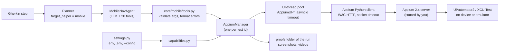
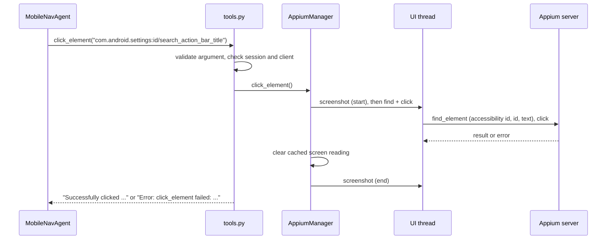

# Mobile Device Automation (Appium)

Hercules can drive native Android and iOS applications through
[Appium](https://appium.io) in addition to browser automation. Mobile support is
fully optional: it is only active when explicitly enabled, and the Appium client
is imported lazily, so environments without it are unaffected.

This page covers three things, in this order:

1. [Overview](#1-overview): what it is, when to use it, when not to, and the alternatives.
2. [Architecture](#2-architecture): how a mobile step travels from the planner to the device.
3. [How to use it](#3-how-to-use-it): a tested Android setup, configuration and a sample feature.

A reference section (environment variables, tool catalogue) and a troubleshooting
table close the page.

> **What was verified.** The Android recipe, the tool behaviour, the error texts
> and the session-cleanup behaviour below were run against a real emulator
> (Appium 2.15, `uiautomator2` 4.0.1, an Android 35 `google_apis_playstore` arm64
> AVD) on the TES-1939 branch. **iOS was not verified**; see
> [iOS (unverified)](#ios-unverified). The sample Gherkin feature has not been run
> through the planner (that needs an LLM); its device steps correspond to tool
> calls that were run by hand.

---

## 1. Overview

### What it is

With `DEVICE_MANAGER=appium` Hercules registers a `mobile_nav_agent` (class
`MobileNavAgent`) next to the browser, API, SQL and other helper agents. The
planner gains a `mobile` value for `target_helper`, so a Gherkin step such as
"tap the Search bar" can be handed to an LLM agent that reads the device screen
as an accessibility-tree text legend and acts through 20 tools (tap, swipe,
click by identifier, type, hardware keys, screenshots, screen recording).

Appium is the protocol layer: Hercules talks W3C WebDriver over HTTP to an
Appium 2.x server that **you** run; the server drives UiAutomator2 (Android) or
XCUITest (iOS) on the device.

### When to use it

- You already write Hercules scenarios in Gherkin and want a native-app
  smoke or acceptance flow in the same suite, with the same reports and proof
  folders (screenshots, video).
- The flow is short and exploratory in nature, or the UI changes often enough
  that maintaining hard-coded locators is the bigger cost.
- The app exposes reasonable accessibility data (content descriptions, resource
  ids or visible text), because that is all the agent sees.
- You want proof artifacts per run (every element action is bracketed by
  screenshots by default, plus a screen recording).

### When NOT to use it

- **Large, fast, deterministic regression suites.** Every step involves an LLM
  call; steps are slower, cost tokens and are less repeatable than a scripted
  test. A scripted framework will be faster and flake less.
- **Canvas, game, map or camera-heavy screens, and web views.** The agent sees
  the native accessibility tree only (no screenshot is returned to the model,
  see below) and there is no tool to switch to a `WEBVIEW` context.
- **Anything that needs an operation outside the 20 tools.** There is no tool to
  launch, install, terminate or activate an app, open a deep link, change device
  orientation, drag-and-drop, pinch, set the clipboard, push files, or fetch the
  raw page source (the legend is a lossy summary of it).
- **iOS, today.** The iOS code paths are covered by offline tests only.
- **Parallel runs against several devices.** One Appium session is created per
  manager (one per test id) from a single global configuration; Hercules has no
  device allocation or pooling. Treat it as one device per run.

### Alternatives

| Option | Fit | Trade-off versus Hercules mobile |
| --- | --- | --- |
| Appium scripts directly (Appium client in Python/Java/JS, WebdriverIO) | Deterministic, fast, full API surface (contexts, app management, page source) | You write and maintain locators and waits yourself; no natural-language steps |
| [Maestro](https://maestro.mobile.dev) | Simple declarative YAML flows for Android and iOS | Fixed flows, no LLM interpretation; separate runner and report format |
| [Detox](https://wix.github.io/Detox/) | Gray-box end-to-end tests for React Native, synchronised with the app | React Native only; tests live in the app repository |
| Espresso (Android) / XCUITest (iOS) | Native in-process or OS-level frameworks; fastest and most stable | One platform each, written in Kotlin/Java or Swift, built with the app |
| Cloud device farms (BrowserStack, Sauce Labs, AWS Device Farm, Firebase Test Lab) | Real devices at scale | Complementary rather than a replacement. Pointing `APPIUM_SERVER_URL` at a vendor Appium hub is **not tested** here; vendor-specific capabilities would have to be supplied through `APPIUM_CAPABILITIES` |

### Honest trade-offs and limits

All of these were checked in the code (`core/mobile/`, `simple_hercules.py`,
`runner.py`) unless marked otherwise.

- **Latency and determinism.** Each step is an LLM round trip plus the tool
  call; the same feature can take different paths on different runs. Tool calls
  themselves are quick on an emulator (about 0.2 s for a click, 0.9 s for the
  first screen read, 3.5-11 s to create the first session, the first session on
  a fresh emulator being slowest because UiAutomator2 installs its server), plus
  `REACTION_DELAY_TIME` (default 0.1 s) after every action.
- **Text-only perception.** All tools return strings. Screenshots are saved as
  proof artifacts; they are not sent to the model.
- **No app lifecycle tool.** The app under test is chosen through capabilities
  when the session is created (see [Launching a specific app](#launching-a-specific-app)).
  Without one, the session starts on the home screen and the agent has to tap the
  app icon.
- **Hercules does not start Appium or the device.** It never spawns an Appium
  server and never boots an emulator or simulator.
- **A Playwright browser is still initialised.** `BaseRunner.initialize`
  creates the Playwright manager unconditionally (code reading, not a run), so
  Playwright browsers must be installed even for a mobile-only feature.
- **One session per test id; state is reset by default.** Base capabilities use
  `noReset: false` (the Appium default).
- **Failure is returned as text, never raised.** Tools report errors as
  `Error: ...` strings so the agent can retry. The prompt tells the agent to
  stop after three repeated failures on the same action.
- **Orphaned sessions.** `SIGKILL` and hard crashes cannot be intercepted; the
  Appium server reclaims the session only after `newCommandTimeout` (300 s
  default).

---

## 2. Architecture

### Component flow



A tool call, in order:



### Module map

| Module | Responsibility |
| --- | --- |
| `core/mobile/__init__.py` | The gate (`mobile_enabled()`), lazy and idempotent registration of the tools (`ensure_mobile_tools_registered()`) |
| `core/mobile/settings.py` | Reads every mobile setting at call time (global config first, then environment); validation; timeouts; `APPIUM_CAPABILITIES` parsing; `platformName` reconciliation |
| `core/mobile/capabilities.py` | Pure function `build_capabilities()`; Android and iOS base blocks; user overrides applied last |
| `core/mobile/appium_manager.py` | `AppiumManager`: session lifecycle, worker pool, timeouts, gestures, keys, accessibility-tree parsing and legend rendering, screenshots, recordings, exit hooks |
| `core/mobile/keymaps.py` | Pure key-name to keycode/character tables, key-sequence parsing |
| `core/mobile/prompts.py` | The agent system prompt, the planner capability line, optional UI-assertion guidance |
| `core/mobile/tools.py` | The 20 `@tool` functions registered under `mobile_nav_agent` |
| `core/agents/mobile_nav_agent.py` | `MobileNavAgent` (a `MultimodalBaseNavAgent` subclass) with the mobile prompt |
| `core/agents/high_level_planner_agent.py` | `get_planner_prompt()` adds `mobile` to the helper list when the gate is open |
| `core/simple_hercules.py` | Creates the agent when the gate is open; rejects `target_helper: mobile` when it is closed |
| `core/runner.py` | `_teardown_appium_instances()` closes every manager on shutdown |

### Configuration gating and import safety

Mobile automation is double-gated. It is on only when **both** hold:

1. `DEVICE_MANAGER` resolves to `appium` (case-insensitive); and
2. the Appium client is importable (`importlib.util.find_spec("appium")`).

The gate is evaluated lazily on each call, so it does not depend on when `.env`
or the `--config` file was loaded. When it is open:

- the 20 tools are registered under `mobile_nav_agent` (the first time the gate is seen open);
- `SimpleHercules` constructs `MobileNavAgent`;
- the planner prompt lists `'mobile'` in the `target_helper` enum and adds the
  capability line "Mobile: Native app navigation, gestures, device keys, state
  verification";
- a plan that names `target_helper: mobile` while the gate is closed is rejected
  with `target_helper 'mobile' requires an available Appium client (set
  DEVICE_MANAGER=appium and install the appium package)`, and the planner is asked to
  correct it.

When it is closed (the default) the subsystem is inert. Checked by running it:
with `DEVICE_MANAGER` unset, `get_planner_prompt()` returns a string equal to the
base `PlannerAgent.prompt` and `appium` is not in `sys.modules`. `mobile_enabled()`
asks `find_spec` only; the client itself is imported inside manager methods, so
the package and `tools.py` import cleanly without the `mobile` extra. Runner
teardown simply tries to import `AppiumManager` and does nothing if that fails.

Settings are resolved **at use time** (not frozen at import) through the global
configuration, with the process environment as fallback. A key therefore works
from the environment, from a `.env` file, or from a `--config` YAML/JSON file
(config-file keys are upper-cased, so `device_manager: appium` becomes
`DEVICE_MANAGER`). A value present in the config wins over the environment.

### Session lifecycle

- **Start.** `start_mobile_session` (also the first thing the agent prompt tells
  the agent to do) calls `AppiumManager.create_session()`. Creation is serialised
  by a lock, so concurrent callers cannot each open a device session. It
  validates `DEVICE_OS` and `APPIUM_SERVER_PORT` first, builds the capabilities,
  and connects through `webdriver.Remote`. If a session already exists it is
  reused (the tool then says so by omitting the recording note). A driver that
  returns no session id is quit before the error is raised. After a successful
  start, the proof directories are created, the exit hooks are registered and
  screen recording starts (when `RECORD_VIDEO` is true, the default).
- **One manager per test id.** `AppiumManager` is a singleton per `stake_id`; the
  tools use the global default test id so proofs land in that run's folder.
- **Command execution.** All driver calls are synchronous Appium-client calls, so
  they run on a `ThreadPoolExecutor` (4-8 threads named `AppiumUI-*`) off the
  asyncio loop. Each call is awaited with `asyncio.wait_for` and the same limit
  is set as the HTTP socket timeout of the client. Session creation is bounded by
  `APPIUM_SESSION_START_TIMEOUT_SECONDS` (default 180); once the session exists
  the socket timeout drops to `APPIUM_COMMAND_TIMEOUT_SECONDS` (default 120). A
  server that accepts the connection and never answers therefore yields
  `Appium did not respond within Ns ...` instead of a hang. A thread already
  blocked in a driver call cannot be cancelled by asyncio, which is why the
  socket timeout exists as well. If `create_session` times out while the server is
  still starting the session, a done-callback on the worker quits the driver when
  it finally comes back (it is never adopted), so the device is not left locked
  to a session nobody owns until `newCommandTimeout`.
- **Close.** `close_mobile_session` stops the recording (best effort, the video
  path is returned) and quits the driver.
- **Exit hooks.** On the first successful session Hercules registers an `atexit`
  hook and `SIGTERM`/`SIGINT` handlers (main thread only). They quit every active
  session, each driver call limited to 5 s, then chain to the previously
  installed handler (for example telemetry's) or re-raise the default action.
  The signal handler does not make the HTTP calls on the interrupted main thread:
  it runs the cleanup on a short-lived daemon thread and waits at most 15 s for it
  before chaining on. Teardown first waits up to 3 s for a driver command that is
  still running on a worker thread (a tap or read in flight), then quits anyway.
  The first signal always ends the device session, even if the application would
  have handled `KeyboardInterrupt` itself (a later `close_mobile_session` finds no
  session and is a no-op). `BaseRunner.shutdown` also calls `AppiumManager.close_all_instances()`
  so an aborted scenario cannot leak the session or its worker pool.
- **Orphaned sessions.** Verified with a session created with
  `newCommandTimeout: 10`: after a normal exit and after `SIGTERM` the server
  listed no sessions; after `SIGKILL` the session stayed listed until the timeout
  expired, then disappeared. The built-in `newCommandTimeout` is `300`.

### Capability building

`AppiumManager.build_default_capabilities()` composes, in order:

1. **Base block** by `DEVICE_OS`:
   - Android: `platformName: Android`, `automationName` (`UiAutomator2`),
     `deviceName`, `noReset: false`, `newCommandTimeout: 300`,
     `settings[waitForIdleTimeout]: 0` (keeps UiAutomator2 from waiting on idle).
   - iOS: `platformName: iOS`, `automationName` (`XCUITest`), `deviceName`,
     `noReset: false`, `fullReset: false`, `newCommandTimeout: 300`,
     `wdaLaunchTimeout`/`wdaConnectionTimeout` 120000, `webviewConnectTimeout`
     90000, `shouldUseSingletonTestManager: false`, `showXcodeLog: true`,
     `includeSafariInWebviews: true`, `maxTypingFrequency: 60`. Heavier
     WebDriverAgent options (`useNewWDA`, `clearSystemFiles`) are not defaulted.
2. **Optional keys** when their variables are set: `platformVersion`, `udid`,
   `app`. `app` comes from `APP_PATH`, else `APPIUM_APK_PATH` (the APK variable is
   not restricted to Android in code).
3. **`APPIUM_CAPABILITIES`** merged last (see below).

Permissions are not granted automatically and `startIWDP` is not enabled; opt in
per run, e.g. `{"autoGrantPermissions": true}` (Android) or `{"startIWDP": true}`
(iOS web views).

**`platformName` reconciliation.** `platformName` always follows `DEVICE_OS`
(`android`, or any value starting with `ios`; anything else is a configuration
error when the session starts, `get_device_os()` itself logs a warning and falls
back to android). A `platformName` or `appium:platformName` in
`APPIUM_CAPABILITIES` that disagrees is replaced with a warning, because element
lookup, gestures and the agent prompt follow `DEVICE_OS`. The old `PLATFORM_NAME`
setting is deprecated and ignored (a warning is logged at session start).

**Overrides.** Any key can be overridden or added with `APPIUM_CAPABILITIES`
(JSON object), applied **last**. Values keep their JSON types, so object and array
capabilities (`processArguments`, `otherApps`, `permissions`, ...) reach the
server as structures, and a `null` value removes a capability:

```bash
export APPIUM_CAPABILITIES='{"appium:noReset": true, "appium:appActivity": ".MainActivity"}'
```

In a `--config` YAML/JSON file `appium_capabilities` may be written as a mapping
instead of a JSON string. **A malformed payload is ignored** (an error is logged
and it is treated as `{}`), so a bad value cannot block session creation; the
practical consequence is that a typo silently drops your `appPackage`, see
[Troubleshooting](#troubleshooting).

### Screen legend and coordinate model

`read_mobile_screen` fetches the page source, parses it (documents declaring a
DTD or entity, and documents over 10 million characters, are rejected before
parsing), and renders one line per visible node that has a label, value, id, is an
input, or is clickable. Real output from the Android Settings app:

```text
Device screen (android) - 59 visible elements. Use on-screen labels / accessibility ids as element identifiers. Input fields are marked [input].
[8] ViewGroup id=com.android.settings:id/search_action_bar [clickable] @[41,580][1039,714]
[9] TextView value="Search settings" id=com.android.settings:id/search_action_bar_title @[195,613][537,681]
[20] TextView value="Network & internet" id=android:id/title @[185,809][606,877]
```

| Legend part | Android source | iOS source |
| --- | --- | --- |
| type (`TextView`) | `class`, last segment | `type` without `XCUIElementType` |
| quoted label | `content-desc` | `label` |
| `value="..."` | `text` | `value` |
| `id=...` | `resource-id` | `name` |
| `[input]` | `EditText`, `AutoCompleteTextView`, `MultiAutoCompleteTextView` | text field, secure field, search field, text view |
| `[clickable]` | `clickable="true"` | `enabled="true"` (so most iOS nodes carry it) |
| `@[x1,y1][x2,y2]` | `bounds` | rebuilt from `x`/`y`/`width`/`height` |

The leading `[n]` is only a position in the list, not an identifier. Bounds are in
the device coordinate space reported by the driver (on the test emulator
1080x2400 px, matching `get_mobile_viewport_size`). `tap` and `swipe` coordinates
are validated against `get_window_size()` (`0 <= x < width`, `0 <= y < height`),
which is the same space. Whether iOS point-versus-pixel scaling lines up was not
tested.

The reading is cached and reused until an action changes the screen; every
mutating tool clears the cache. The app can also change by itself (loading,
animation), so `read_mobile_screen(refresh=true)` forces a fresh fetch.

**Element lookup.** `click_element`, `enter_text`, `clear_text` and
`long_press_element` take one identifier and try, in order:

- Android: accessibility id (content-desc), then `By.ID` (resource-id, bare or
  package-qualified), then the exact visible text via `UiSelector().text(...)`.
- iOS: accessibility id (`name`, shown as `id=`), then the exact visible label
  (predicate `label == "..."`).

Quotes and backslashes in the identifier are escaped. In the Android example
above, `com.android.settings:id/search_action_bar_title` (an `id=`) and `Search
settings` (a `value=`) both resolve to the same element.

### Proofs: screenshots and recordings

Artifacts land under the proof folder of the current test run, the same
`proofs/<test_id>/run_<timestamp>/` directory the browser evidence uses:

- Videos: `.../videos/<test_id>_<epoch>.mp4`
- Screenshots: `.../screenshots/<name>_<epoch>.png` (the name is reduced to
  `A-Z a-z 0-9 _ . -`)

Two defaults produce a lot of artifacts: `TAKE_SCREENSHOTS=true` makes every
element action and gesture (`click_element`, `enter_text`, `clear_text`,
`long_press_element`, `tap`, `swipe`, and so the scrolls) take a `<action>_start`
and `<action>_end` screenshot around the call (about 0.15-0.4 s each in the test
run), and `RECORD_VIDEO=true` starts a screen recording when the session is
created. Key presses and the read tools take no automatic screenshots.
`RECORD_VIDEO=false` disables video capture entirely (the recording tools then
report an error rather than pretend to succeed); `TAKE_SCREENSHOTS=false` does the
same for screenshots. Sessions still open at runner shutdown are quit best effort
(a pending recording is saved first).

### Tool catalogue

All 20 tools are registered for `mobile_nav_agent` only. They return
human-readable strings and never raise. Common checks, in order: argument
validation (no device call), Appium client installed (otherwise `Error: Mobile
automation requires the Appium client. Install with: pip install
'testzeus-hercules[mobile]'`), active session (otherwise `Error: No active Appium
session. Please initialize a session first with start_mobile_session.`). Failures
from the device come back as `Error: <tool> failed: <message>` where the Appium
server stack trace is removed and the text is capped at 500 characters; the full
details stay in the Hercules log. After every successful action the tool waits
`REACTION_DELAY_TIME` seconds (default 0.1).

| Tool | Arguments | Behaviour | Validation and tool-specific errors |
| --- | --- | --- | --- |
| `start_mobile_session` | none | Creates the session from the configured capabilities; reuses an existing one | Invalid `DEVICE_OS`/`APPIUM_SERVER_PORT`; unreachable server; timeout; server-side errors (bad capabilities, no device) |
| `close_mobile_session` | none | Stops recording (best effort), quits the driver, returns the video path if any | `No active Appium session` when none |
| `tap` | `x: int`, `y: int`, `wait_before_action: float = 0.0` | W3C touch pointer press at the point | Non-numeric or non-finite values rejected; negative wait rejected; coordinates must be inside the viewport |
| `swipe` | `start_x`, `start_y`, `end_x`, `end_y`: int; `duration_ms: int = 800` | Driver swipe between two points | Same numeric checks; all four coordinates inside the viewport; negative duration rejected (not clamped) |
| `scroll_down` | none | Reveals content below: drags from 70% to 30% of the screen height at the horizontal centre (800 ms) | Session checks only |
| `scroll_up` | none | Reveals content above: drags from 30% to 70% of the height | Session checks only |
| `long_press_element` | `accessibility_id: str`, `duration_ms: int = 1000` | Locates the element, presses and holds at its centre | Empty identifier rejected; negative duration rejected; `No element found for identifier ...` |
| `click_element` | `accessibility_id: str` | Locates and clicks | Empty identifier rejected; `No element found for identifier ... (tried accessibility id and platform fallbacks)` |
| `enter_text` | `accessibility_id: str`, `text: str` | Locates the field and sends the text (does not clear it first; use `clear_text`) | Empty identifier rejected; element not found |
| `clear_text` | `accessibility_id: str` | Locates the field and clears it | Empty identifier rejected; element not found |
| `press_key` | `key_name: str` | Keyboard key. Android: `press_keycode`; iOS: unicode key via a key action. Names: `enter`, `return`, `tab`, `space`, `backspace`, `delete`, `escape`, `esc`, `up`, `down`, `left`, `right` | Unknown name: `Unknown key name: 'x'. Supported keys: [...]` |
| `press_hardware_key` | `key_name: str` | Hardware button. Android names: `volume_up`, `volume_down`, `power`, `camera`, `call`, `end_call`, `menu`, `back`, `home`, `app_switch`. iOS supports only `volume_up`, `volume_down`, `home` (`mobile: pressButton`) | Unknown name lists the supported ones; other keys on iOS: `not supported on iOS` |
| `press_key_sequence` | `sequence: str` | Comma-separated segments, `+`-joined modifiers (`ctrl`/`control`, `shift`, `alt`, `meta`), e.g. `Control+A,Enter`. On Android modifiers travel as the main key's meta-state | Unknown modifier or key rejected (`Unknown modifier name: 'Hyper'. Supported modifiers: [...]`); on iOS only keys with a unicode mapping work, and modifier combinations are rejected with an error |
| `press_back_button` | none | Android: back keycode. iOS: taps a navigation-bar button identified as a back button (`name`/`label` `Back`, or a `name` containing `Back`/`back` such as `BackButton`; never Edit, Cancel or Close), otherwise swipes from the left edge | Session checks only |
| `press_home_button` | none | Android: home keycode. iOS: `mobile: pressButton` home | Session checks only |
| `read_mobile_screen` | `refresh: bool = false` | Returns the legend; cached until an action changes the screen | Empty legend returns a hint to scroll or re-read; parse failure returns the legend header plus `Error reading screen` |
| `take_mobile_screenshot` | `name: str = "mobile_screenshot"` | Saves a PNG under the proofs folder, returns the path | `Screenshot capture is disabled (TAKE_SCREENSHOTS=false)` |
| `start_screen_recording` | none | Starts a recording (one already starts with the session) | Error when `RECORD_VIDEO=false` or the device refuses |
| `stop_screen_recording` | none | Stops, writes the MP4, returns the path | Error when disabled or none was active |
| `get_mobile_viewport_size` | none | Returns `Device viewport size: WxH pixels.` | Session checks only |

`assert_ui` and `capture_ui_value` are opt-in tools (`ENABLE_UI_ASSERTIONS=true`,
see the [API verification docs](api_verification.md)) and are not part of the 20.
The agent prompt mentions them only when the flag is on, so the agent is never
told about tools it does not have.

Modifier combinations such as `Control+A` are sent as the main key's Android
meta-state, and taps and long presses are W3C touch pointer actions, because the
supported Appium client versions have neither `TouchAction` nor `key_down`/`key_up`.

### The agent prompt

The prompt (`core/mobile/prompts.py`) tells the agent to call
`start_mobile_session` first, read the screen before acting, call read tools
separately from action tools, handle permission dialogs and system alerts first,
execute one tool at a time, retry a failed validation once with a different
approach, and stop and report after three repeated failures on the same action.
It answers in the same `previous_step` / `current_output` / `Data` /
`##TERMINATE TASK##` format as the other nav agents. A custom navigation prompt
(`other_settings.system_prompt`) is appended as "Additional instructions"; it
never replaces the mobile tool rules.

---

## 3. How to use it

### Install

```bash
pip install "testzeus-hercules[mobile]"
```

From a source checkout use `uv sync --extra mobile` (or `--all-extras`). The
extra installs `appium-python-client>=4.5.0,<6`.

> **The Appium server is not started or managed by Hercules.** You must run
> one yourself (Appium 2.x) and point `APPIUM_SERVER_URL` at it, with the driver
> matching your target platform installed (`appium driver install uiautomator2`
> for Android, `appium driver install xcuitest` for iOS), plus a connected
> device/emulator (Android) or booted simulator (iOS). Hercules never spawns an
> Appium server or boots an emulator.

### Tested Android setup

Prerequisites: a JDK and the Android SDK (platform-tools, emulator and a system
image). Everything below was run on macOS; `ANDROID_HOME` must be visible to the
Appium process.

```bash
export ANDROID_HOME="$HOME/Library/Android/sdk"          # your SDK location
export PATH="$PATH:$ANDROID_HOME/platform-tools:$ANDROID_HOME/emulator"

# 1. Appium and the Android driver
npm install -g appium@2
appium driver install uiautomator2

# 2. Create an emulator once, then boot it (add -no-window for a headless CI-style run)
avdmanager create avd -n test_hercules -k "system-images;android-35;google_apis_playstore;arm64-v8a"
emulator -avd test_hercules -no-snapshot -no-audio &
# the headless form used for verification:
#   emulator -avd test_hercules -no-window -no-audio -no-boot-anim -no-snapshot -gpu swiftshader_indirect

# 3. Wait until Android has finished booting (prints 1)
adb wait-for-device
until [ "$(adb shell getprop sys.boot_completed | tr -d '\r')" = 1 ]; do sleep 3; done
adb devices                                                # expect: emulator-5554   device

# 4. Start Appium yourself (any free port; 4723 is the default)
appium --port 4723 &
curl -s http://127.0.0.1:4723/status                       # "ready": true

# 5. Tell Hercules about it
export DEVICE_MANAGER=appium DEVICE_OS=android
export APPIUM_SERVER_URL=http://127.0.0.1:4723
export APPIUM_DEVICE_UUID=emulator-5554                    # from `adb devices`
```

The emulator uses TCP ports 5554/5555 and `adb` uses 5037; make sure nothing
else holds them.

When you are done:

```bash
adb -s emulator-5554 emu kill      # shuts the emulator down
kill %1                            # or the PID of the Appium process
adb kill-server
```

### Launching a specific app

Hercules does not have an "open app" tool: the app under test is chosen when
the session is created, through capabilities.

- **Install and launch an app file**: set `APP_PATH` (or, Android only by
  intent, `APPIUM_APK_PATH`; `APP_PATH` takes precedence when both are set) to a
  local `.apk` / `.app` / `.ipa` path or URL.
- **Launch an app that is already installed**, Android (this exact value was
  tested with the Settings app):

  ```bash
  export APPIUM_CAPABILITIES='{"appium:appPackage": "com.android.settings", "appium:appActivity": ".Settings"}'
  ```

- **Launch an app that is already installed**, iOS (unverified):

  ```bash
  export APPIUM_CAPABILITIES='{"appium:bundleId": "com.apple.Preferences"}'
  ```

Without any of these Appium starts the session on the device's current screen
(home screen), and since there is no app-launch tool the agent can only reach an
app by tapping its icon. There is also no page-source tool: the agent reads the
screen through `read_mobile_screen` only.

### Configuration via a config file

The same keys work from a `--config` file; lower-case keys are upper-cased, and
`appium_capabilities` may be a mapping:

```yaml
# mobile.yaml
device_manager: appium
device_os: android
appium_server_url: http://127.0.0.1:4723
appium_device_uuid: emulator-5554
appium_capabilities:
  appium:appPackage: com.android.settings
  appium:appActivity: .Settings
```

```bash
testzeus-hercules --config mobile.yaml --project-base=opt
```

(Checked by loading this file through the config loader: the resolved settings
were `appium`, `android`, the URL and UDID above, and the capabilities mapping
came back intact. The loader turns the mapping into a string and the settings
module parses it back as a Python literal. A full CLI run from a config file was
not repeated against a device.)

### Sample feature

Place it at `opt/input/test.feature` (or pass it with `--input-file`) and
provide the usual LLM settings (`LLM_MODEL_NAME`, `LLM_MODEL_API_KEY`). Write
steps in terms of what is on the device screen; the planner prompt only receives
the one-line description of the mobile helper, so wording that clearly names the
device, taps and the app is what routes a step to it.

```gherkin
Feature: Android Settings search

  Scenario: Typing in the settings search field
    Given the Android Settings app is open on the device
    When I tap the "Search settings" bar on the device
    And I type "Bluetooth" into the settings search field
    Then the search field on the device shows "Bluetooth"
    When I clear the search field
    And I press the back button on the device
```

Each step corresponds to tool calls that were run by hand against the emulator in
this verification: `start_mobile_session` with the Settings capabilities above,
`click_element` on `com.android.settings:id/search_action_bar_title`, a
`read_mobile_screen` to find the new field
(`com.google.android.settings.intelligence:id/open_search_view_edit_text`),
`enter_text` (the following read showed `value="Bluetooth"`), `clear_text` and
`press_back_button`. Note that the id of the field after tapping is different
from the id of the bar: the Settings search opens a second screen, which is why
the agent is told to re-read the screen after each action.

A minimal programmatic session (what the tools do, without an LLM):

```python
import asyncio
from testzeus_hercules.core.mobile import tools as T

async def main():
    print(await T.start_mobile_session())
    print(await T.read_mobile_screen())
    print(await T.click_element("com.android.settings:id/search_action_bar_title"))
    print(await T.take_mobile_screenshot("after search tap"))
    print(await T.close_mobile_session())

asyncio.run(main())
```

### iOS (unverified)

**iOS was not verified in testing.** No simulator runtime is installed on the
verification machine, and on that machine the `xcuitest` driver failed to load
(`Cannot find module 'appium-idb'`, an environment problem, not a Hercules one).
The iOS code paths (capabilities, legend parsing, `name`/`label` lookups, hardware
buttons via `mobile: pressButton`, back navigation, key sequences) are covered by
offline tests only.

What it needs, from the code and from Appium's requirements:

- macOS with Xcode and its licence accepted, plus the command-line tools
  (`xcode-select --install`);
- a booted simulator or a connected device (`APPIUM_DEVICE_UUID`, and
  `APPIUM_PLATFORM_VERSION` if useful);
- `appium driver install xcuitest` and a working WebDriverAgent build; expect to
  debug first-run WDA issues, and pre-build WDA once manually if needed;
- `DEVICE_OS=ios` (or any `ios*` value), and for an installed app a
  `appium:bundleId` capability or `APP_PATH` to a `.app`/`.ipa`.

Defaults when `DEVICE_OS=ios`: `deviceName` `iPhone Simulator`, `automationName`
`XCUITest`. iOS hardware buttons are limited to `volume_up`, `volume_down` and
`home`, and key sequences with modifier combinations are rejected.

---

## Reference

### Environment variables

| Variable                 | Purpose                                              | Default                                        |
| ------------------------ | ---------------------------------------------------- | ---------------------------------------------- |
| `DEVICE_MANAGER`         | `appium` enables mobile automation                    | `playwright`                                   |
| `DEVICE_OS`              | Target platform: `android` or `ios` (case-insensitive; an `ios*` prefix such as `ios17` also selects iOS). Any other value is a configuration error when the session starts | `android` |
| `APPIUM_SERVER_URL`      | Appium server base URL (a running server is required); `http://` is prefixed when the scheme is missing | `http://127.0.0.1:<APPIUM_SERVER_PORT>` |
| `APPIUM_SERVER_PORT`     | Server port used for the default URL (1-65535; an invalid value is a configuration error when the session starts) | `4723`              |
| `APPIUM_COMMAND_TIMEOUT_SECONDS` | Max seconds one Appium command may take before the tool returns an error | `120`                       |
| `APPIUM_SESSION_START_TIMEOUT_SECONDS` | Max seconds session creation may take (emulator boot, app install) | `180`                  |
| `DEVICE_NAME`            | `deviceName` capability                               | `emulator-5554` / `iPhone Simulator`           |
| `AUTOMATION_NAME`        | `automationName` capability                           | `UiAutomator2` / `XCUITest`                    |
| `APP_PATH`               | Path or URL of the app under test (the `app` capability) | unset                                       |
| `APPIUM_APK_PATH`        | Android app package path; **`APP_PATH` wins** when both are set | unset                                |
| `APPIUM_DEVICE_UUID`     | `udid` capability (specific device/simulator)         | unset                                          |
| `APPIUM_PLATFORM_VERSION`| `platformVersion` capability                          | unset                                          |
| `APPIUM_CAPABILITIES`    | JSON object merged over the built-in capabilities     | `{}`                                           |
| `RECORD_VIDEO`           | Screen recording at session start (shared with the browser) | `true`                                   |
| `TAKE_SCREENSHOTS`       | Screenshots around element actions and gestures, and `take_mobile_screenshot` (shared with the browser) | `true` |
| `REACTION_DELAY_TIME`    | Seconds to wait after every tool action (shared)      | `0.1`                                          |
| `ENABLE_UI_ASSERTIONS`   | Adds `assert_ui` / `capture_ui_value` and their prompt guidance | `false`                              |
| `PLATFORM_NAME`          | Deprecated and ignored (a warning is logged); use `DEVICE_OS` | n/a                                    |

### UI assertions (opt-in)

`assert_ui` and `capture_ui_value` are opt-in tools (`ENABLE_UI_ASSERTIONS=true`,
see the API verification docs). Pass them the text from the latest
`read_mobile_screen` reading as the payload.

### Safety notes

- Accessibility-tree XML from the device is parsed with DTD/entity declarations
  and oversized documents rejected up front.
- Session creation is serialised per manager; a driver that returns without a
  session id is quit rather than leaked.
- With `DEVICE_MANAGER` unset (the default) the mobile subsystem is inert: no
  tools or agent are registered, the planner prompt is unchanged and runner
  teardown touches no device session.

---

## Troubleshooting

Messages below were reproduced against a live Appium 2.15 server unless marked.

| Symptom | Cause | Fix |
| --- | --- | --- |
| Tools answer `Error: Mobile automation requires the Appium client. Install with: pip install 'testzeus-hercules[mobile]'` | The Appium client package is missing | `pip install "testzeus-hercules[mobile]"` (or `uv sync --extra mobile`), then re-run |
| No mobile tools, no `mobile_nav_agent`, `mobile` absent from the planner, or the plan is rejected with `target_helper 'mobile' requires an available Appium client` | The double gate is closed: `DEVICE_MANAGER` is not `appium` in the framework process, or the client is not installed | Export `DEVICE_MANAGER=appium` in the environment of the Hercules process (or `device_manager: appium` in `--config`) and install the extra |
| `Could not reach the Appium server at APPIUM_SERVER_URL (http://127.0.0.1:6299) for create_session: ... Connection refused` | Nothing is listening at that URL (server not started, wrong port or host) | Start Appium; check `APPIUM_SERVER_URL`/`APPIUM_SERVER_PORT`; `curl <url>/status`. A URL without a scheme (`127.0.0.1:6299`) is accepted with a warning and `http://` prefixed |
| `Appium did not respond within 3s for create_session. Check that the Appium server at APPIUM_SERVER_URL ... is running and responsive` (hang) | The server accepted the connection and never answered, or the operation really takes longer (emulator boot, app install, slow command) | Look at the Appium log; raise `APPIUM_SESSION_START_TIMEOUT_SECONDS` (default 180) for slow starts or `APPIUM_COMMAND_TIMEOUT_SECONDS` (default 120) for slow commands. Both also set the HTTP socket timeout |
| `Could not start an Appium session at APPIUM_SERVER_URL (...): Message: <!DOCTYPE HTML> ... Error code: 501` | Something that is not an Appium server answers on that port | Point `APPIUM_SERVER_URL` at the Appium server |
| `Invalid mobile configuration: DEVICE_OS='windows' is not valid; use 'android' or 'ios'` | Unknown `DEVICE_OS` | Use `android` or `ios` (an `ios*` value such as `ios17` is accepted) |
| `Invalid mobile configuration: APPIUM_SERVER_PORT='99999' is not valid; use an integer from 1 to 65535` | Port outside 1-65535 or not an integer | Fix the value |
| `Could not find a driver for automationName 'XCUITest' and platformName 'iOS' ... Cannot find module 'appium-idb'` (iOS) | The `xcuitest` driver is installed but cannot load (broken driver install) | Repair or reinstall the driver (`appium driver list --installed`, `appium driver uninstall xcuitest`, `appium driver install xcuitest`); see [iOS (unverified)](#ios-unverified) |
| `Either provide 'app' option to install 'com.nope.app' or consider setting 'noReset' to 'true' if 'com.nope.app' is supposed to be preinstalled` | `appPackage` names an app that is not installed on the device | Install the app, pass `APP_PATH`, or fix the package name (`adb shell pm list packages`) |
| The session starts but the device is on the home screen, not your app | `APPIUM_CAPABILITIES` is malformed JSON, so it was ignored: an error `Failed to parse APPIUM_CAPABILITIES ...` is logged and the capabilities are treated as `{}` | Fix the JSON (double quotes, no trailing commas); watch the log for that error |
| `Error: No active Appium session. Please initialize a session first with start_mobile_session.` | The agent called a tool before `start_mobile_session`, or after `close_mobile_session` | The prompt tells the agent to start first; if it keeps happening check the planner trace. A session creation failure also leaves you in this state |
| `Error: click_element failed: No element found for identifier 'x' (tried accessibility id and platform fallbacks): ...` | The identifier is not on the current screen, is stale, or was copied wrongly (for example the `[n]` index) | Re-read the screen (`read_mobile_screen`, `refresh=true` if the app changes on its own) and copy an `id=`, quoted label or `value=` text exactly; scroll if it is off screen |
| The tool error ends in a short message with no server stack trace | By design: the Appium `Stacktrace:` is stripped and the text capped at 500 characters for the model | The full error and traceback are in the Hercules log |
| `Error: Coordinate x=99999 is outside the device viewport (1080x2400)` | `tap`/`swipe` coordinates outside the screen | Use `get_mobile_viewport_size` and the `@[x1,y1][x2,y2]` bounds from the legend |
| `Error: Screen recording was not started` / `Screenshot capture is disabled` | `RECORD_VIDEO=false` / `TAKE_SCREENSHOTS=false` | Enable them; otherwise check the device error in the log |
| After killing Hercules with `kill -9` the next run cannot create a session, or the device looks busy | An orphaned Appium session; `SIGKILL` bypasses the cleanup hooks. It is reclaimed only after `newCommandTimeout` (300 s by default) | Wait, restart Appium, or lower `newCommandTimeout` via `APPIUM_CAPABILITIES` (for example `{"appium:newCommandTimeout": 60}`). A normal exit, `SIGTERM` or `SIGINT` quits the session |
| Android session hangs on a busy app | Some apps keep the UI thread busy | The base capabilities already set `settings[waitForIdleTimeout]: 0`; check `adb devices` and the emulator state |
| iOS session fails to start | WDA or Xcode prerequisites (unverified) | Install and license Xcode, boot a simulator or set `APPIUM_DEVICE_UUID`, pre-build WDA once manually |
