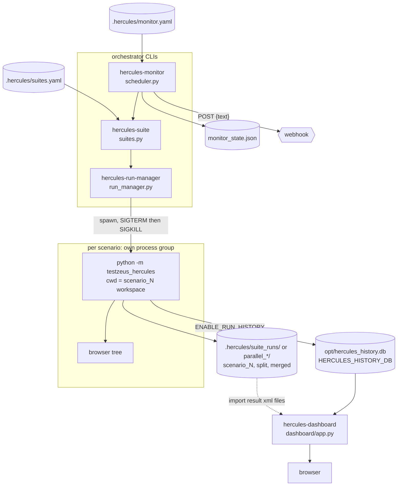

# Orchestrator and Dashboard: Run Manager, Suites, Monitor, Dashboard

Four console scripts sit on top of the single-run `testzeus-hercules` command:

| Command | Module | What it does |
| --- | --- | --- |
| `hercules-run-manager <feature>` | `testzeus_hercules/orchestrator/run_manager.py` | Splits one feature file into scenarios, runs each in its own subprocess (parallel), merges the JUnit XML |
| `hercules-suite <name>` | `testzeus_hercules/orchestrator/suites.py` | Runs a named group of features from YAML, with retries, dependency gating, per-suite env |
| `hercules-monitor` | `testzeus_hercules/orchestrator/scheduler.py` | Runs suites on an interval, detects regressions against the previous cycle, posts a webhook |
| `hercules-dashboard` | `testzeus_hercules/dashboard/app.py` | Local web UI over the run-history SQLite database |

Contents: [1 Overview](#1-overview) | [2 Architecture](#2-architecture) |
[3 How to use](#3-how-to-use) | [4 Reference](#4-reference) |
[5 Troubleshooting](#5-troubleshooting) | [6 Known limits / not verified](#6-known-limits--not-verified)

Related: `docs/run_guide.md` (single runs, CI exit codes), `docs/mcp_server.md`,
`docs/test_intelligence.md` (the `plan:` suite key).

## 1. Overview

### 1.1 When to use which

| Goal | Use | Why |
| --- | --- | --- |
| One feature, scenarios are independent, you want wall-clock speed | `hercules-run-manager --max-parallel N` | Each scenario gets its own process, browser and workspace |
| A repeatable set of features with retries and ordering | `hercules-suite` | YAML-defined, `depends_on` gating, per-suite env and retry |
| "Tell me when something that used to pass now fails" | `hercules-monitor` | Regression = passed last cycle, fails now; webhook summary |
| Look at past runs, evidence, flaky cases | `hercules-dashboard` | Reads the run-history DB; shows video, screenshots, network log |
| One run on one machine, no orchestration | `testzeus-hercules` | Simplest; set `STRICT_EXIT_CODE=true` for CI |
| An agent drives the runs interactively | MCP server (`docs/mcp_server.md`) | Sessions and structured results |

### 1.2 When not to use them

- **Scenarios that depend on each other.** The run manager splits a feature into
  independent per-scenario files (Feature header, Background and Rule blocks travel
  with each), so cross-scenario state in the browser or app does not carry over.
  Keep dependent steps in one scenario.
- **Shared mutable app state.** Parallel scenarios hit the same app and the same test
  accounts. Two scenarios editing one user will race.
- **Cheap scenarios.** Every scenario pays process start-up and its own browser
  launch. With a scripted mock LLM trivial scenarios took roughly 6 to 10 s each on an
  idle machine and 30 to 60 s under load (observed), which dwarfs the scenario itself.
- **Rate-limited LLM accounts.** N parallel scenarios mean N concurrent LLM sessions.
- **Strict resource isolation.** Scenario processes inherit the parent's whole
  environment (API keys included) and run as the same user.
- **A scheduler you can rely on without supervision.** The monitor is a simple
  sleep loop in one process: no persistence of the schedule, no missed-run catch-up,
  no clustering. Use cron/CI for guaranteed cadence and run `hercules-monitor --once`
  from it.
- **A multi-user portal.** The dashboard has one shared token (or none on loopback),
  no per-user access control, no TLS.

### 1.3 Things that surprise people

- Suites are **sequential by default**: `max_parallel: 1` runs one subprocess per
  *feature file* in order. Parallelism (per scenario) only starts at `max_parallel > 1`.
- With `max_parallel: 1` the unit is the feature file (scenario names in reports are the
  file name); with `> 1` it is the scenario title. Regression detection compares those
  names, so changing `max_parallel` between monitor cycles hides regressions.
- `depends_on` **gates**: a failed dependency feature makes the suite's own features
  `SKIPPED` and counted as errors (exit 1), unless `skip_on_dependency_failure: false`.
- Dependency suites are folded into the invoking suite's run under **the invoking
  suite's** `retry`, `env` and `max_parallel`; a warning is logged when they differ.
- `shared_state: true` exports `HERCULES_SUITE_STATE_FILE` to the scenario processes
  (a hook for your own tooling; Hercules itself does not read it, see 4.2).
- The dashboard is not purely read-only: `POST /import` writes into the history DB.
  It is also not static: pages render from the DB per request and `/live` polls.
- Running Hercules does not populate the dashboard by itself. Runs are recorded only
  with `ENABLE_RUN_HISTORY=true`, or you import `*_result.xml` files by hand.

## 2. Architecture



### 2.1 Module map

| Path | Responsibility |
| --- | --- |
| `orchestrator/run_manager.py` | Workspace preparation, `run_feature_isolated`, `run_scenarios_parallel`, JUnit merge, process-group kill, `run_cli` signal wrapper, `hercules-run-manager` entry |
| `orchestrator/suites.py` | YAML loading/validation, `resolve_suite` (dependency expansion, plan compile), `run_suite`, retries, gating, `suite_state.json`, `hercules-suite` entry |
| `orchestrator/scheduler.py` | Monitor config, state file, regression evaluation, retention sweeps, webhook, cycle loop, `hercules-monitor` entry |
| `dashboard/app.py` | Starlette app: pages, `/api/runs*`, `/artifact`, `/import`, middleware wiring, `hercules-dashboard` entry |
| `reporting/run_db.py` | Run-history schema and recording (used by the dashboard and by runs) |
| `utils/http_security.py` | Bind policy, bearer/basic token middleware, Host allowlist (shared with the MCP server) |
| `utils/path_guard.py` | Sensitive-name and containment helpers used by `/artifact` |
| `utils/redact.py` | `redact_webhook_url`, `redact_webhook_text` for monitor logs |

### 2.2 Data model and on-disk layout

```text
<cwd>/.hercules/
├── suites.yaml, monitor.yaml          your config (examples: .hercules/*.example.yaml)
├── monitor_state.json                 baseline + last 10 cycle summaries (path configurable)
├── suite_runs/<suite>_<ts>_<uuid>/    one per hercules-suite run (and per suite per monitor cycle)
│   ├── split/feature_NNN/             per-scenario feature files (parallel mode)
│   ├── scenario_<n>/                  one workspace per executed scenario subprocess
│   │   └── opt/{input,output,proofs,log_files,test_data,gherkin_files,temp}
│   ├── merged/merged_result.xml       merged JUnit of the suite run
│   └── suite_state.json               append-only JSONL completion record(s)
└── parallel_<ts>_<uuid>/              one per hercules-run-manager run (same inner layout, plus split/ merged/)
```

- `<cwd>` is the directory you launch the command from. Everything above is
  **cwd-relative**; run the same command from another directory and you get a
  different tree (and, for the monitor, a different default state file).
- A scenario workspace is the child's cwd: `PROJECT_SOURCE_ROOT=<ws>/opt`,
  `INPUT_GHERKIN_FILE_PATH=<ws>/opt/input/test.feature`, `TEST_DATA_PATH=<ws>/opt/test_data`
  (a `test_data/` directory next to the source feature is copied in).
- Workspaces of passing scenarios are deleted once their JUnit XML is staged into
  `merged/`; failed or errored ones are kept. `HERCULES_KEEP_WORKSPACES=1` keeps
  everything, including temporary dirs of compiled plans.
- Workspace numbers (`scenario_<n>`) come from a per-process counter, so a failing
  scenario can be `scenario_4` even in a one-scenario suite phase.
- `suite_state.json` lines look like
  `{"suite": "regression", "total": 5, "passed": 4, "failed": 1, "errors": 0, "retries_used": 0}`
  and are appended under `fcntl.flock` on POSIX.
- **Run ids.** The orchestrators do not mint run ids for the dashboard. Monitor cycles
  get `YYYYMMDDTHHMMSS-NNNN` ids stored in `monitor_state.json`; dashboard run ids are the
  `run_<timestamp>` output-folder name (import) or whatever the recording run assigned.
- **Result ids.** Scenario results are identified by the scenario/feature name in the
  merged XML. The monitor keys them as `<suite>::<scenario>`.
- **Child environment.** `os.environ` plus: `PROJECT_SOURCE_ROOT`, `INPUT_GHERKIN_FILE_PATH`,
  `TEST_DATA_PATH`, `STRICT_EXIT_CODE=true` (and `EXIT_CODE_COMPAT` removed), a shared
  `HERCULES_HISTORY_DB` (only when the parent has not set one, resolved the way
  `RunHistory` does), then the suite's `env:` entries. A suite `env:` entry with a reserved
  name replaces the injected value and logs a warning.

### 2.3 Verdict and exit-code model

A scenario counts as passed only if its subprocess exited 0 **and** its JUnit XML
(when present) reports no failed/errored testcases (children run strict, so a failing
scenario exits 1). A subprocess that never produced JUnit is folded into the totals
(`error` when it timed out or could not start, `failed` when it exited non-zero).

| Command | Exit codes |
| --- | --- |
| `hercules-run-manager` | `0` all passed; `1` any failed/errored; `2` feature file missing or without scenarios; `130` SIGINT; `143` SIGTERM |
| `hercules-suite` | `0` all passed; `1` any failed/errored (including `SKIPPED`); `2` configuration problem (missing/invalid suites file, unknown suite, dependency cycle, empty suite); `130`/`143` signals |
| `hercules-monitor --once` | `0` no failures/errors; `1` failures/errors; `2` missing/unreadable/invalid monitor or suites config (one line on stderr); `130`/`143` signals |
| `hercules-monitor` (daemon) | runs until stopped; SIGINT/SIGTERM exit `0`; `2` for a bad monitor config; a failing cycle is logged and the loop continues |
| `hercules-dashboard` | runs until stopped; `1` with a one-line message when a non-loopback bind has no (or a too short) `DASHBOARD_AUTH_TOKEN` |
| `testzeus-hercules` (single run) | `0` regardless of results **unless** `STRICT_EXIT_CODE=true` (then `1` on failures); `EXIT_CODE_COMPAT=1` forces `0` |

`EXIT_CODE_COMPAT=1` makes `hercules-run-manager`, `hercules-suite` and
`hercules-monitor --once` exit `0` even on failures (verified for `hercules-suite`);
it does not change the `2` configuration exits or the signal exits. Failures are
always visible in the printed summary and the merged JUnit XML.

### 2.4 Signals and shutdown

Each scenario subprocess is started with `start_new_session=True`, so it leads its own
process group (its browser and the Playwright driver are in it). On SIGINT/SIGTERM
(and on any exit path, via a `finally`) the CLIs send SIGTERM to every live group, wait up
to 3 s, then SIGKILL the group. The SIGKILL is unconditional: it also fires when the
group leader already exited but a descendant that ignores SIGTERM keeps the group alive,
and a second SIGINT/SIGTERM during the grace period cannot skip it (code-level guarantee
from the review fixes; covered by `tests/test_landed_fixes_platform.py`, not re-run as a
manual double-signal test here).

A process-group id is only signalled while its scenario run is in progress. When a
scenario ends (normal exit, timeout or cancellation) whatever is still in its group, for
example a chromium that outlived the runner, is SIGKILLed right away and the group is
dropped from the live-group registry in the same step. The registry therefore never
holds a pgid whose group has died and whose number the OS may have given to an unrelated
process, so the exit-time sweep (`terminate_live_children`) cannot hit a stranger. It
also means the registry stays empty between scenarios in a long-running `hercules-monitor`.

Verified on this branch (signal sent 25 s into a run whose scenario hangs on the LLM):

| Command | Signal | Exit | Output |
| --- | --- | --- | --- |
| `hercules-run-manager` | SIGINT | 130 | `hercules-run-manager: interrupted (signal 2); scenario processes terminated.` |
| `hercules-run-manager` | SIGTERM | 143 | `... (signal 15) ...` |
| `hercules-suite` | SIGTERM | 143 | `hercules-suite: interrupted (signal 15); scenario processes terminated.` |
| `hercules-monitor` (daemon, mid-cycle) | SIGINT | 0 | none (logged as a normal stop) |

No scenario or browser process remained afterwards. This protection is cooperative:
`SIGKILL` of the orchestrator itself cannot be caught (see 6).

### 2.5 Trust boundaries and threat table

```text
 suites.yaml / monitor.yaml ──(trusted config)──► orchestrator ──env + files──► scenario subprocess (same user, inherited env)
 browser ──HTTP──► [Host check] ─► [token] ─► dashboard ─► [path containment] ─► files under --project-root
```

| Threat | Guard | What it does not prevent |
| --- | --- | --- |
| Orphaned browsers/scenarios after Ctrl-C or TERM | Process-group kill with grace, `finally` safety net | `SIGKILL`/power loss of the orchestrator; a browser that daemonizes out of the group |
| Hung scenario | Per-scenario timeout (default 1800 s in run-manager `--timeout`; suites and the monitor use the same 1800 s default with no CLI flag) kills the group | A wedged process that survives SIGKILL; pipes are reaped with a 10 s bound |
| Child reports a false pass | Children run `STRICT_EXIT_CODE=true`; JUnit failures override exit 0 | A scenario whose planner claims success without evidence (LLM behaviour) |
| Webhook secret in logs | `redact_webhook_url` keeps `scheme://host[:port]` plus `/[REDACTED]`; error text goes through `redact_webhook_text` | The webhook itself receives the summary text; no SSRF guard or domain allowlist on `webhook_url` (it is trusted config) |
| Malicious YAML | `yaml.safe_load`, type validation, unknown keys ignored with a warning | The config is code-equivalent: `tests`, `plan` and `env` (for example `PYTHONPATH`) decide what runs. Do not take suite files from untrusted sources |
| Running an unreviewed LLM plan | None here: `plan:` compiles whatever `test_plan.json` you point at. The approval gate exists only in the MCP server | Review the file first (`docs/test_intelligence.md`) |
| Dashboard exposed beyond loopback | Bind policy (token mandatory, >= 16 chars), constant-time token compare (Bearer, or Basic with any user and the token as password), Host allowlist, strict CSP, `X-Frame-Options: DENY` | Token in cleartext without TLS; no per-user auth; case pages print absolute artifact paths from the DB |
| Arbitrary file read via `/artifact?path=` | `realpath` containment inside `--project-root`; refuses dotfiles, dot-directories, `*.db`, `*.sqlite*`, `*.env`, keys, `sessions.json`, `agents_llm_config*`; only png/jpeg/gif/webm/mp4/pdf render inline, everything else (html, svg, xml, json) is a forced download with `nosniff` | Anything else under the project root is downloadable by whoever can reach the port. The same sensitive-file and dot-directory filter also applies to the files the case page reads itself (video, screenshots, network log, planner thoughts), so a hostile JUnit `property` cannot make the dashboard open a secret file for rendering |
| Cross-site POST to `/import` | Rejects a cross-site `Sec-Fetch-Site`, an `Origin` that is not this host, and requests with neither header when no token is configured | Import only adds rows; a malicious `*_result.xml` in the output tree still gets parsed |
| Stored XSS via run/case names | Every value is HTML-escaped; CSP `default-src 'none'`, inline script only with a per-request nonce on `/live` | |

## 3. How to use

### 3.1 Offline set-up used for every command below

You do not need a real LLM to verify the orchestration. This stub answers the planner
prompt with "done" (or "failed" when the scenario text contains `FAILME`, or hangs when it
contains `HANGME`). It proves process management, exit codes, merging and reporting; it
says nothing about test quality because no browser interaction happens.

```python
# mock_llm.py   usage: python mock_llm.py 6011
import json, sys, time
from http.server import BaseHTTPRequestHandler, ThreadingHTTPServer

class Handler(BaseHTTPRequestHandler):
    def log_message(self, *args): pass
    def _reply(self, payload):
        data = json.dumps(payload).encode()
        self.send_response(200); self.send_header("Content-Type", "application/json")
        self.send_header("Content-Length", str(len(data))); self.end_headers(); self.wfile.write(data)
    def do_GET(self): self._reply({"data": [{"id": "mock"}]})
    def do_POST(self):
        body = json.loads(self.rfile.read(int(self.headers.get("Content-Length", 0))) or b"{}")
        text = " ".join(str(m.get("content")) for m in body.get("messages", []))
        if "HANGME" in text: time.sleep(600)
        if '"next_step"' in text and "target_helper" in text:      # planner prompt
            ok = "FAILME" not in text
            content = json.dumps({"plan": "p", "next_step": "done", "terminate": "yes",
                "final_response": "Scenario complete ##TERMINATE TASK##" if ok else "Assertion failed",
                "is_assert": True, "assert_summary": "ok" if ok else "bad", "is_passed": ok, "target_helper": "browser"})
        else:
            content = "ok"
        self._reply({"id": "x", "object": "chat.completion", "created": int(time.time()), "model": "m",
                     "choices": [{"index": 0, "message": {"role": "assistant", "content": content}, "finish_reason": "stop"}],
                     "usage": {"prompt_tokens": 1, "completion_tokens": 1, "total_tokens": 2}})

ThreadingHTTPServer(("127.0.0.1", int(sys.argv[1])), Handler).serve_forever()
```

```bash
python mock_llm.py 6011 &
export LLM_MODEL_NAME=mock-model LLM_MODEL_API_KEY=sk-mock LLM_MODEL_BASE_URL=http://127.0.0.1:6011/v1
export ENABLE_TELEMETRY=0 RECORD_VIDEO=false HEADLESS=true
mkdir -p demo/features/smoke demo/features/reg && cd demo
printf 'Feature: A\n  Scenario: a one\n    Given a simple thing\n' > features/smoke/a.feature
printf 'Feature: B\n  Scenario: b one\n    Given a simple thing\n  Scenario: b two\n    Given another simple thing\n' > features/smoke/b.feature
printf 'Feature: C\n  Scenario: c fail\n    Given FAILME thing\n' > features/reg/c.feature
printf 'Feature: D\n  Scenario: d one\n    Given a simple thing\n' > features/reg/d.feature
```

The runs in this document used the `litellm` profile file
(`AGENTS_LLM_CONFIG_FILE`, `AGENTS_LLM_CONFIG_FILE_REF_KEY=litellm`) pointing at the stub;
the `LLM_MODEL_*` variables above are the plain alternative (the single-run CLI and the
orchestrator children read them; the MCP server's own LLM tools do not).

For a real run, replace the stub variables with your normal LLM configuration
(`docs/run_guide.md`); remember `RECORD_VIDEO=false` if the matching Playwright ffmpeg
is not installed.

### 3.2 `hercules-run-manager`

```bash
hercules-run-manager features/smoke/b.feature --max-parallel 2
```

Observed:

```text
[ok] b one (30.0s)
[ok] b two (30.0s)
Totals: 2 total, 2 passed, 0 failed, 0 errors
Merged junit XML: <cwd>/.hercules/parallel_20261023_112358_<uuid>/merged/merged_result.xml
Workspaces: <cwd>/.hercules/parallel_20261023_112358_<uuid>
```

Failing scenario: `[FAILED] c fail (48.1s) :: Subprocess exited with code 1.`, totals
`1 total, 0 passed, 1 failed, 0 errors`, exit 1. Missing file:
`hercules-run-manager: error: Feature file not found: <abs path>`, exit 2. A feature
without scenarios: `Error: No scenarios found in feature file: <abs path>`, exit 2.

Options: `--max-parallel` (default 4), `--out-dir` (merged JUnit directory, default
`<workroot>/merged`), `--timeout` (per scenario seconds, default 1800). Status labels:
`ok`, `FAILED` (non-zero exit or JUnit failures), `error` (timeout, crash or could not
start).

### 3.3 `hercules-suite`

`.hercules/suites.yaml`:

```yaml
smoke:
  description: Fast sanity checks.
  tests: [../features/smoke]        # relative to this file first, then to the cwd
  retry: 1
  max_parallel: 2
regression:
  description: Full regression; gated on smoke.
  tests: [../features/reg]
  depends_on: [smoke]
  shared_state: true
  max_parallel: 2
```

(`.hercules/suites.example.yaml` in the repository is the annotated version; its
`tests:` paths point at this repository's own features, so replace them.)

```bash
hercules-suite smoke --config .hercules/suites.yaml
```

```text
[ok] a one (38.7s)
[ok] b one (38.7s)
[ok] b two (21.2s)
Suite 'smoke' totals: 3 total, 3 passed, 0 failed, 0 errors, 0 retries
Merged junit XML: <cwd>/.hercules/suite_runs/smoke_20261023_112714_<uuid>/merged/merged_result.xml
```

`hercules-suite regression` ran smoke's three scenarios first (folded in), then `c` and
`d`: `5 total, 4 passed, 1 failed, 0 errors`, exit 1.

Dependency gating (a suite `after` that `depends_on` a suite `broken` whose feature fails):

```text
[FAILED] c (58.8s) :: Subprocess exited with code 1.
[SKIPPED] d (0.0s) :: skipped: dependency 'broken' failed
Suite 'after' totals: 2 total, 0 passed, 1 failed, 1 errors, 0 retries
```

exit 1. Configuration errors, exit 2, one line each (the suite request is validated before anything runs: file, suite name, `depends_on` cycles and empty suites; failures while running, such as a full disk, keep their traceback):

```text
hercules-suite: error: Unknown suite 'nope'. Known suites: after, broken, planned, regression, smoke.
hercules-suite: error: Suites config not found: missing.yaml
```

Per-suite keys: `description`, `tests` (feature files or directories of `*.feature`),
`plan` (a `test_plan.json`; used only when `tests` is empty), `tags` (informational),
`retry` (default 0), `depends_on`, `skip_on_dependency_failure` (default `true`), `env`,
`shared_state` (default `false`), `max_parallel` (default 1). CLI: `--config`,
`--max-parallel` (overrides the suite value), `--out-dir`. There is no `--timeout`
flag; the per-scenario limit is 1800 s.

Retry semantics: with `max_parallel: 1` a failed feature file is re-run whole, up to
`retry` more times; with `> 1` failed scenarios are re-run in rounds. `retries_used` in
the summary counts the extra attempts.

### 3.4 `hercules-monitor`

`.hercules/monitor.yaml`:

```yaml
suites: [flip]                      # required, non-empty
config: suites.yaml                 # default .hercules/suites.yaml; relative to this file first
interval_hours: 24                  # fractional OK; daemon sleeps this long between cycles
webhook_url: https://hooks.example.com/services/T000/B000/XXXX
notify_on: regression               # always | failure | regression (default)
baseline: last_run                  # or a run_id present in the state file
state_file: monitor_state.json
```

```bash
hercules-monitor --config .hercules/monitor.yaml --once       # one cycle, exit code reflects results
hercules-monitor --config .hercules/monitor.yaml              # daemon
hercules-monitor --config .hercules/monitor.yaml --interval-hours 1
```

Verified sequence with a local webhook listener (a ~10-line `http.server` that logs
POST bodies) and a one-scenario suite `flip`:

1. Cycle 1, scenario passes: exit 0.
   `Hercules monitor run 20261023T113229-0001: 1/1 passed, 0 failed, 0 errors; regressed=False; new failures: none`.
   No webhook (`notify_on: regression`, and the first cycle has no baseline).
2. Edit the feature so it fails; cycle 2: exit 1,
   `... 0/1 passed, 1 failed, 0 errors; regressed=True; new failures: flip::flip`.
   The webhook received exactly one POST with body
   `{"text": "Hercules monitor run 20261023T113301-0001: 0/1 passed, 1 failed, 0 errors; regressed=True; new failures: flip::flip"}`
   and the log line read `Webhook notification sent to http://127.0.0.1:6020/[REDACTED]`
   (the path and the `?token=` query never appear in logs).
3. Webhook answering 500 with `notify_on: failure`: the cycle still completed (exit 1 from
   the failing scenario) and logged
   `Webhook POST to http://127.0.0.1:6020/[REDACTED] failed: HTTPStatusError: Server error '500 Internal Server Error' for url 'http://127.0.0.1:6020/[REDACTED]'`.
   There is no retry.
4. The state file then held `last_results`, `last_run_id`, `updated_at` and `runs` with
   the three cycle ids (the newest 10 are kept).
5. A missing, unreadable or invalid config file (`hercules-monitor --config nope.yaml --once`)
   prints `hercules-monitor: error: <reason>` to stderr and exits 2, like `hercules-run-manager`
   and `hercules-suite`. With `--once` the suites file the monitor points at is checked the
   same way before the cycle starts (unreadable, invalid, unknown suite, dependency cycle);
   an exception raised while the cycle itself runs is not turned into a config error.

Notification rules: `always` posts every cycle; `failure` posts when any scenario
failed/errored; `regression` (default) posts only when a scenario that passed in the
baseline fails now. A baseline that is a run id pruned out of the 10-run window disables
regression detection for that cycle (warning logged, `baseline_missing: true`).

Within a cycle, suites run in listed order and each runs its own features; dependency
results come from the per-cycle map, so `[smoke, regression]` with
`regression.depends_on: [smoke]` executes smoke once.

`config` is looked up in the monitor YAML's directory first, then the cwd. A relative
`state_file` is anchored to the monitor YAML's directory, so the baseline does not move when
you start the daemon from another directory; a state file that already exists in the cwd
(written by an older version) is still picked up, and an entry that already names a path inside the YAML's directory when read from the cwd (such as `.hercules/monitor_state.json` in `.hercules/monitor.yaml`) is used as written, not nested a second time. `.hercules/monitor.example.yaml` ships `state_file: monitor_state.json`. The default (no `state_file` key) is
`.hercules/monitor_state.json` relative to the cwd. Absolute paths are used as given.

Retention: before every cycle, `.hercules/suite_runs/*` and `.hercules/parallel_*` older
than `HERCULES_RUN_RETENTION_HOURS` (default 72, never less than 1 hour) are removed.
`hercules-run-manager` sweeps `parallel_*` at the start of each run too.

### 3.5 `hercules-dashboard`

Populate the history DB, then serve it.

```bash
# record runs as they happen
ENABLE_RUN_HISTORY=true HERCULES_HISTORY_DB=$PWD/history.db hercules-run-manager features/smoke/b.feature
# or serve an existing DB and import finished output folders from the UI
hercules-dashboard --port 8001 --db history.db --project-root opt
```

```text
Hercules dashboard listening on http://127.0.0.1:8001
Auth: none (loopback bind only)
Run history DB: sqlite:////.../history.db
Press Ctrl+C to stop.
```

`--project-root` must be the directory that **contains** `output/` (`opt` for a normal
run), because import scans `<project-root>/output/*/*_result.xml` and `/artifact` is
confined to it. `--db` accepts a SQLAlchemy URL or a bare path (made absolute,
`sqlite:///` prefixed).

Routes (status codes verified on a populated DB):

| Route | Purpose |
| --- | --- |
| `GET /` | Latest 50 runs with pass/fail/error counts and an "Import from output folders" button |
| `POST /import` | Scan `output/*/*_result.xml` and record new runs, then redirect to `/` (303) |
| `GET /run/<run_id>` | Run metadata and case table (404 plain text for an unknown id) |
| `GET /case/<run_id>/<case>` | Steps, failure message, recorded or heuristic failure classification, healing events, artifacts, video, screenshots, network log (first 200 entries), planner thoughts (first 4000 chars) |
| `GET /trend` | Pass-rate bars for the last 30 runs and the flakiest cases |
| `GET /live` | Polls `/api/runs/latest` every 2 s |
| `GET /api/runs?limit=N` | JSON runs list (N clamped to 1..1000) |
| `GET /api/runs/latest` | Newest run, or `{}` |
| `GET /artifact?path=` | The only file-serving route (see 2.5) |

Import behaviour to know (all verified):

- It records **one run per output folder**, named after the folder. If a folder holds
  several `*_result.xml` files (an MCP server process writes all its runs into one
  `run_<startup>` folder), only the first one by file name is imported; later files in
  that folder are skipped on this and every later import. In the verification a
  folder with a 1-case and a 4-case result showed 1 case.
- The run's "Started" time is the **import time**, not when the tests ran (three runs
  imported together showed the same timestamp).
- Folders whose XML is unparseable or has zero testcases are rejected with HTTP 400 and
  an error list; nothing is recorded for them. A locked DB returns 503.
- Failed cases show a classification (`product_bug`, `test_fragility`, `environment`,
  `contract_violation`); a classification recorded at run time wins over the heuristic.
- The orchestrators' scenario workspaces live under `.hercules/...`, not under
  `opt/output`, so import does not see them. `ENABLE_RUN_HISTORY=true` with a shared
  `HERCULES_HISTORY_DB` (the orchestrators inject one into the children when you have not
  set it) records them. Each child names its run after its output folder
  (`run_<YYYYMMDD_HHMMSS>`), so children that start in the same second get the same name; the
  history keeps every one of them (the later records get a free `_1`, `_2`, ... suffix) and
  only re-recording the very same result file replaces its own earlier record. Children also
  tolerate the first-use race on a brand-new history DB file (they retry the schema setup
  instead of failing with "database is locked"). Verified with
  `hercules-run-manager --max-parallel 2` on a two-scenario feature: two runs, two cases.
- A case whose artifacts list shows `<root>/None` for `video` simply had no recording.

Token and remote access (verified):

```bash
export DASHBOARD_AUTH_TOKEN="$(openssl rand -hex 24)"      # >= 16 chars
hercules-dashboard --host 0.0.0.0 --port 8001              # refused without the token, exit 1
```

| Request | Status |
| --- | --- |
| no credentials | 401 |
| `Authorization: Bearer <token>` | 200 |
| HTTP Basic, any user, token as password (what a browser prompts for) | 200 |
| `Host: evil.com` | 421 |
| `POST /import` with a token and no `Origin` | 303 (the token authenticates the caller) |
| `POST /import` without a token and without `Origin`/`Sec-Fetch-Site` | 403 `import rejected: send an Origin/Sec-Fetch-Site header or configure DASHBOARD_AUTH_TOKEN` |
| `POST /import` with `Origin: http://evil.example` | 403 `cross-site import rejected` |
| `GET /artifact?path=/etc/passwd` | 403 |
| `GET /artifact?path=<root>/.hercules/sessions.json` | 403 |
| `GET /artifact?path=<root>/output/.../x_result.xml` | 200, `Content-Disposition: attachment` |

Add public names with `DASHBOARD_ALLOWED_HOSTS=dash.example.com`. Put TLS in front when
the dashboard leaves your machine.

### 3.6 Plan-driven suites

```yaml
planned:
  plan: ../../root/.hercules/sess_xxxxxxxxxxxxxxxx/test_plan.json
  max_parallel: 2
```

`hercules-suite planned` compiles the whole plan into a temporary `plan.feature` and runs
it like any other feature. See `docs/test_intelligence.md` for the pipeline that
produces the plan, and for why no approval gate applies here.

### 3.7 CI recipes

```bash
hercules-suite smoke --config .hercules/suites.yaml || status=$?
# 1 = failures, 2 = bad config, 130/143 = interrupted; the merged XML path is printed
hercules-monitor --config .hercules/monitor.yaml --once      # from cron/CI instead of the daemon
```

## 4. Reference

### 4.1 Environment variables

| Variable | Used by | Effect |
| --- | --- | --- |
| `STRICT_EXIT_CODE` | `testzeus-hercules` | Exit 1 on failures. The orchestrators always run children with it on |
| `EXIT_CODE_COMPAT=1` | all | Force exit 0 for result-based exits; removed from children |
| `HERCULES_KEEP_WORKSPACES=1` | run-manager, suite, monitor | Keep passing workspaces and compiled-plan temp dirs |
| `HERCULES_RUN_RETENTION_HOURS` | monitor, run-manager | Sweep age for `suite_runs/` and `parallel_*` (default 72, floor 1) |
| `HERCULES_HISTORY_DB` | runs, dashboard | History DB location; injected into children when unset (a relative value in a suite `env:` resolves inside the throwaway workspace) |
| `ENABLE_RUN_HISTORY` | runs | Record runs into the DB the dashboard reads |
| `DASHBOARD_AUTH_TOKEN`, `DASHBOARD_ALLOWED_HOSTS` | dashboard | Token (mandatory for non-loopback binds) and extra Host names |
| `HERCULES_SUITE_STATE_FILE` | children of `shared_state` suites | Path of the suite JSONL file (an output of the suite, not a setting: it is not read as a default anywhere) |

### 4.2 `shared_state`

With `shared_state: true` every scenario receives
`HERCULES_SUITE_STATE_FILE=<workroot>/suite_state.json`. The suite itself appends one
completion record per suite run (always, whether or not `shared_state` is on).

*Design note:* the variable is an output of `hercules-suite`, not a setting. The Hercules
code base does not read it, so it is a hook for your own scripts or tools; setting it
yourself in `env:` has no effect (a suite with `shared_state: true` replaces it and logs a
warning). Whether a given Hercules tool can read the environment variable from a feature
step was not verified.

## 5. Troubleshooting

| Symptom | Cause | Fix |
| --- | --- | --- |
| `hercules-suite: error: Suites config not found: ...` | Wrong `--config` or cwd | Pass the right path; default is `.hercules/suites.yaml` relative to the cwd |
| `Suite tests entry not found: ...` / `... is a directory containing no .feature files` | `tests:` path wrong (relative paths try the YAML's directory first, then the cwd) | Fix the path |
| `[SKIPPED] ... skipped: dependency 'x' failed` | Dependency gating | Fix the dependency, or `skip_on_dependency_failure: false` |
| Exit 1 but every printed line is `ok` | `EXIT_CODE_COMPAT` is not set; check `errors` in the totals (skips and timeouts count as errors) | Read the totals line and the merged XML |
| Scenario shows `error` with `Timed out after Ns; process killed.` | Scenario exceeded the 1800 s limit (`--timeout` on run-manager) | Raise `--timeout`; suites and the monitor have no flag |
| Monitor never reports a regression | First cycle (no baseline); `notify_on` not `regression`; `max_parallel` changed between cycles (names differ); pinned baseline pruned; the default (unset) `state_file` resolves against a different cwd | Keep `max_parallel` stable, pin `state_file` absolutely, check logs for `baseline_missing` |
| Monitor webhook not received | Wrong URL, non-2xx answer (logged as a warning, no retry), `notify_on` filtered it out | Read the `Webhook POST ... failed` line; secrets are masked as `[REDACTED]` |
| `hercules-monitor: error: ...` (exit 2) | Missing, unreadable or invalid monitor YAML | Fix the config; use `--config` with an existing file |
| Dashboard shows no runs | Runs were not recorded and nothing was imported | `ENABLE_RUN_HISTORY=true`, or click "Import from output folders" with `--project-root` pointing at the directory that contains `output/` |
| Imported run has fewer cases than the XML files hold | Import takes the first result file per output folder | Run each result in its own folder, or record with `ENABLE_RUN_HISTORY=true` |
| Dashboard exits at start with `Refusing to bind ...` | Non-loopback host without `DASHBOARD_AUTH_TOKEN` | Set the token (>= 16 chars) or use `--host 127.0.0.1` |
| 421 `Invalid Host header` | Accessed by a name not in the allowlist | `DASHBOARD_ALLOWED_HOSTS=name` |
| `import rejected: send an Origin/Sec-Fetch-Site header ...` | `curl -X POST /import` without browser headers and without a token | Use the button, add `-H "Origin: http://127.0.0.1:8001"`, or configure a token |
| Artifact link returns 403 | Outside `--project-root`, dotfile/dot-directory, or a sensitive name | Keep evidence under the project root; wrong `--project-root` is the usual cause |
| Parallel runs flake only when parallel | Shared app state or LLM rate limits | Lower `--max-parallel`; give scenarios separate data |
| `.hercules/` fills the disk | Failed workspaces are kept on purpose | Retention sweeps handle `suite_runs/` and `parallel_*`; delete manually otherwise |
| Same-named result in two features | Sequential mode names results after the feature file | Use distinct feature names |

## 6. Known limits / not verified

- Real-LLM runs were not verified; all runs used a scripted stub, so per-scenario timings
  above reflect process start-up, not real agent work, and no browser interaction was
  exercised.
- Slack/Discord webhook formats were not tried; only a generic JSON POST to a local
  listener. The monitor posts `{"text": ...}` and nothing else.
- TLS (for the dashboard or a webhook) was not tested.
- Windows: the orchestrators rely on POSIX process groups and `fcntl`; Windows paths and
  signal behaviour were not verified.
- `SIGKILL` of an orchestrator leaves its scenario processes running (verified: after `kill -KILL` on `hercules-run-manager` the scenario `python -m testzeus_hercules` process was reparented to pid 1; they live in their
  own sessions and cannot be signalled by the dead parent). Stop with SIGINT/SIGTERM.
- `hercules-suite` and `hercules-monitor` have no per-scenario timeout flag.
- The dashboard displays absolute artifact paths on case pages; do not expose it to
  people who should not see the host layout.
- There are no `start/status/stop/resume` subcommands on `hercules-run-manager`: it runs
  one feature file to completion in the foreground.

### Design notes (intended behaviour, not defects)

- Dashboard import keeps **one run per output folder**, named after the folder, and
  stamps the **import time** as the run's start time (import does not read a start time
  from the result file). A run recorded by the run itself (`ENABLE_RUN_HISTORY=true`) is
  stamped when it is recorded, right after the run finishes, and gets one run per result
  file; prefer that when you need close-to-real times or several result files per folder.
