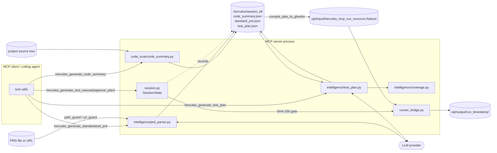

# Test Intelligence: Code Summary, PRD, Test Plan, Gated Execution

Test intelligence is the pipeline that turns a product requirements document
into an executable, reviewable set of Hercules scenarios:

```text
project source tree ──► code summary (heuristic, local)          informational
PRD (file / URL)    ──► standardized PRD  (LLM)  ──► test plan (LLM) ──► Gherkin (deterministic)
                                                         │
                                          human review + approve_plan
                                                         ▼
                                              in-process Hercules run
```

It lives in `testzeus_hercules/intelligence/` (PRD, plan, coverage) and
`testzeus_hercules/orchestrator/code_scan/` (code summary, git diff helpers).
The normal way to drive it is the MCP server (`docs/mcp_server.md`); every stage
is also an ordinary Python function, so you can run it without MCP (see
[How to use](#3-how-to-use)).

## 1. Overview

### 1.1 What each stage does

| Stage | Input | Output | LLM? | MCP tool | Library entry point |
| --- | --- | --- | --- | --- | --- |
| Code summary | project directory | `code_summary.json` | no | `hercules_generate_code_summary` | `orchestrator.code_scan.code_summary.generate_code_summary` |
| Standardized PRD | `.md/.markdown/.txt/.rst/.pdf/.docx` file or public `http(s)` URL | `standard_prd.json` | yes | `hercules_generate_standardized_prd` | `intelligence.prd_parser.build_normalized_prd` |
| Test plan | standardized PRD | `test_plan.json` plus a requirement coverage matrix | yes | `hercules_generate_test_plan` | `intelligence.test_plan.generate_test_plan` |
| Gherkin compile | test plan (optionally a `test_ids` subset) | a `.feature` file | no | (inside `hercules_generate_and_execute`) | `intelligence.test_plan.compile_plan_to_gherkin` |
| Approval gate + run | the compiled feature | JUnit/HTML results | agents use the LLM | `hercules_generate_and_execute`, `hercules_rerun` | `orchestrator.runner_bridge.execute_feature_file` |

### 1.2 When to use it

- You have a written PRD (or a README that works as one) and want a first
  draft of test cases with a traceable requirement-to-case mapping
  (`REQ-001` -> `TC001, TC002`).
- You want a coding agent (Cursor, Claude Code, Windsurf) to propose tests, and a
  human to approve them before anything executes.
- You want a coverage number ("which requirements have no case") rather than a
  pile of scenarios.

### 1.3 When not to use it

- You already have hand-written Gherkin. Run it directly
  (`testzeus-hercules`, `hercules-suite`, or
  `hercules_generate_and_execute(gherkin=...)`); the pipeline adds LLM cost and a
  review step for no benefit.
- Your PRD has no concrete navigation information (URLs, page names, field
  labels). The plan generator sees only the PRD text. It does **not** receive
  `app_url`, the code summary, or the running application, so steps for an
  under-specified PRD are guesses (verified: `generate_test_plan` takes only the
  PRD and the case count; the code summary is stored on the session but no later
  stage reads it).
- You need deterministic, reviewable-by-diff test content in version control and
  do not want LLM variance: generate once, review, commit the compiled
  `.feature`, and stop regenerating.
- You need diff-scoped testing ("only what this PR changed"). `test_scope="diff"`
  is rejected by the MCP server. `orchestrator/code_scan/git_diff.py` has the
  building blocks as library functions but nothing wires them in.

### 1.4 Alternatives

| Alternative | Use it when | Trade-off |
| --- | --- | --- |
| Hand-written Gherkin | You know what to test | Most precise; costs author time |
| `hercules_generate_and_execute(description=...)` | One scenario from a sentence | No requirement mapping, no plan review step, generated Gherkin runs immediately |
| OpenAPI importer (`intelligence/openapi_importer.py`) | API tests from a spec | API only; library/CLI, not an MCP tool |
| `docs/case_library.md` cases | Reusing existing cases | Not requirement-driven |

### 1.5 Honest trade-offs

- **Cost scales with the PRD.** One LLM call per ~8000-character PRD chunk
  (up to 8 in flight), one summary call, then one batched plan call when the PRD
  has at most 3 requirements and otherwise one call per requirement.
- **Silent partial failure.** A chunk whose extraction fails is skipped (counted in
  `source_metadata.failed_chunks`; the MCP tool adds a `warning`). A requirement
  whose plan call fails is logged and skipped; it then shows up as uncovered in the
  coverage matrix. The run is only an error when zero requirements or zero cases
  survive.
- **Approval friction is deliberate.** A PRD-derived plan is untrusted LLM output
  that drives a browser and HTTP calls with the server's privileges, so it needs
  `approve_plan=true`. Automation that cannot pause for review has to opt out with
  `HERCULES_MCP_AUTO_APPROVE_PLAN=true`, which removes the control.
- **Review is on you.** The hash binding proves "this exact file was approved", not
  that the file is safe.
- **`data_refs` are placeholders.** A case with `data_refs` compiles to a
  `Scenario Outline` whose Examples rows are literal `<name>` placeholders; real
  values come from test-data resolution at run time, not from the pipeline.
- **PRD content goes to your LLM provider.** The code summary does not (it is
  computed locally).

## 2. Architecture



### 2.1 Module map

| Path | Role |
| --- | --- |
| `testzeus_hercules/orchestrator/code_scan/code_summary.py` | `generate_code_summary` (walk, detect), `save_summary`, `enrich_with_llm` (not called by any tool) |
| `testzeus_hercules/orchestrator/code_scan/git_diff.py` | `get_diff_summary`, `suggest_test_targets`, `validate_base_ref` (library only) |
| `testzeus_hercules/intelligence/normalized_prd.py` | `NormalizedPRD`, `PRDRequirement`, JSON (de)serialization |
| `testzeus_hercules/intelligence/prd_parser.py` | text extraction (file/URL), chunking, LLM extraction, dedupe, JSON repair |
| `testzeus_hercules/intelligence/test_plan.py` | `TestPlan`, `TestCase`, `PlanStep`; `generate_test_plan`; `compile_plan_to_gherkin` |
| `testzeus_hercules/intelligence/coverage.py` | `coverage_matrix`, `format_coverage_markdown`, `filter_plan_by_test_ids` |
| `testzeus_hercules/intelligence/openapi_importer.py` | OpenAPI spec -> functional Gherkin (separate flow, see 3.6) |
| `testzeus_hercules/orchestrator/runner_bridge.py` | `write_plan_scenarios_feature`, `execute_feature_file` |
| `testzeus_hercules/mcp_server.py` | tool wrappers, approval gate, path/URL confinement |
| `testzeus_hercules/utils/{path_guard,url_guard}.py` | PRD path and URL confinement |

### 2.2 Data model

Artifacts live per session in `.hercules/<session_id>/` (see
`docs/mcp_server.md` for the full session layout):

```text
code_summary.json   {project_path, generated_at, languages{ext: count}, total_files, frameworks[],
                     entry_points[], routes[{route, method, file}], package_managers[], test_dirs[],
                     summary_text}
standard_prd.json   NormalizedPRD {project_name, summary,
                     requirements[{id: "REQ-001", title, description, acceptance_criteria[], source}],
                     source_metadata{version, source, source_type, file_type, chunk_count,
                                     failed_chunks, requirement_count, ...}}
test_plan.json      TestPlan {meta{project, version, generated_by},
                     requirements[{id, description, source, test_ids[]}],
                     test_cases[{id: "TC001", title, description, category, priority, tags[],
                                 steps[{type: action|assertion, description}], data_refs[],
                                 requirement_ids[]}]}
```

- `category` is one of `functional`, `error_handling`, `security`, `ui_ux`,
  `performance`; `priority` is `high`, `medium`, `low`. Unknown values from the LLM
  are coerced to `functional` / `medium`.
- Requirement ids are renumbered `REQ-001...` after dedupe; case ids are assigned
  `TC001...` in requirement order after generation. Ids are therefore **not
  stable across regenerations**: regenerating a plan can renumber everything, which
  is one reason approval is bound to the file hash.
- `code_summary.json` stores the absolute scan path (`project_path`, and inside
  `summary_text`). `standard_prd.json` stores the absolute local PRD path in
  `source_metadata.source` (a URL source is stored redacted). These files stay on
  the host; tool results show root-relative paths only.

### 2.3 Trust boundaries and threat table

```text
 [PRD text, code]  ─►  [LLM output: untrusted]  ─►  [plan file on disk]  ─►  [feature file]  ─►  [agents act]
     path_guard /          JSON parse +                SHA-256 approval        deterministic       process
     url_guard             schema coercion             gate                    sanitizing          privileges
```

| Threat | Guard | What it does not cover |
| --- | --- | --- |
| PRD points at a secret/local file (`agents_llm_config.json`, `.env`, `/etc/passwd`) | `path_guard.resolve_within` (realpath inside allowed roots, `/` and `$HOME` rejected as roots) plus `check_prd_document` (document extensions only; dotfiles/config/secret names refused, also behind symlinks) | A readable `.md` inside an allowed root is sent to the LLM; keep secrets out of the project tree |
| PRD URL targets internal services or cloud metadata | `url_guard.fetch_text`: http/https only, no URL credentials, every resolved address must be public (NAT64/6to4/v4-mapped judged by their embedded IPv4), every redirect re-validated, connection pinned to the validated IP, 5 MB and total-time bounds | No domain allowlist; `PRD_FETCH_ALLOW_PRIVATE_HOSTS=true` turns the private-range block off |
| Malicious text inside the PRD steers the LLM into harmful steps | The generated plan does not run until `approve_plan=true`; approval is stored with the plan file's SHA-256, so an edited or regenerated plan needs re-approval | The reviewer must actually read the plan. Executed steps can use every enabled Hercules tool (browser, HTTP, SQL, python sandbox); none of those is a sandbox boundary |
| Plan edited or swapped after approval | Gate compares `sha256(plan bytes)` to the stored digest and parses the **same bytes** it hashed (no check/use gap) | A local user who can write `opt/input/*.feature` can change what `hercules_rerun` re-executes for a plan-less session |
| LLM returns malformed or hostile structure | Tolerant JSON extraction, then per-field coercion; entries without a title or without valid steps are dropped | Semantic quality of steps |
| Newline or table-pipe injection through titles or steps to smuggle extra Gherkin | `compile_plan_to_gherkin` collapses all whitespace (including newlines) to single spaces, truncates titles, and replaces the pipe character with `/` | Meaning of the (single-line) text |
| Oversized or hostile documents | DOCX `word/document.xml` capped at 10 MB, URL body at 5 MB, JSON-scan budget bounded, code scan capped at 5000 files / 512 KB per file | Very large PDFs are parsed by `pypdf`/`unstructured` without an extra cap in this module (not verified) |
| Data egress | The code summary is computed locally and never sent to an LLM | PRD chunks and the plan prompts go to the configured provider (and to Portkey if enabled) |

## 3. How to use

### 3.1 Prerequisites

The LLM-backed stages (`standardized_prd`, `test_plan`) need a litellm profile:

```bash
export AGENTS_LLM_CONFIG_FILE=/abs/path/agents_llm_config.json   # with a top-level "litellm" section
export AGENTS_LLM_CONFIG_FILE_REF_KEY=litellm
```

See `docs/run_guide.md` and `docs/mcp_server.md` for the schema. The code summary
needs no LLM at all.

### 3.2 Through MCP (recommended)

Start the server from the project root, then drive it with any MCP client. The
sequence below was run end to end against this branch with a scripted
OpenAI-compatible mock LLM (real-LLM output quality was **not** verified):

```text
1  hercules_configure_session(app_url="http://127.0.0.1:6030/", project_path="sample", prd_path="docs/prd.md")
     -> {"session_id": "sess_5492dba0f386d012", "app_url_reachable": false, "project_path": "sample", ...}
2  hercules_generate_code_summary(session_id)
     -> {"summary": {"frameworks": ["express (package.json)", "fastapi (requirements.txt)"],
                     "languages": [".json", ".md", ".py", ".txt"], "entry_points_count": 2, "routes_count": 2},
         "total_files": 4, "code_summary_path": ".hercules/sess_.../code_summary.json"}
3  hercules_generate_standardized_prd(session_id)
     -> {"requirement_count": 2, "project_name": "Sample", "requirements": [{"id": "REQ-001", ...}, ...]}
4  hercules_generate_test_plan(session_id, cases_per_requirement=3)
     -> {"case_count": 4, "coverage": {"totals": {"requirements_total": 2, "requirements_covered": 2,
                                                  "coverage_percent": 100.0}}, "test_cases": [...]}
5  (review .hercules/<session_id>/test_plan.json)
6  hercules_generate_and_execute(session_id)                       # no approve_plan
     -> {"error": "The test plan was generated by an LLM from a PRD and has not been approved. Review it at
                   .hercules/sess_.../test_plan.json and call again with approve_plan=true (or pass gherkin explicitly)."}
7  hercules_generate_and_execute(session_id, approve_plan=true, test_ids=["TC001"])
     -> {"success": true, "source": "test_plan", "feature_file": "opt/input/hercules_mcp_run_e1c66012.feature", ...}
8  hercules_get_run_results(session_id)
     -> {"run_id": "run_20261023_112028", "result_id": "hercules_mcp_run_e1c66012.feature_result",
         "total": 1, "passed": 1, "test_cases": [{"name": "TC001 REQ-001 happy", "status": "passed", ...}]}
```

A complete, copy-pasteable client for the same flow is in
`docs/mcp_server.md` (section "End-to-end walkthrough").

Rules worth knowing before you script it:

- Stage 3 resolves its source as: `prd_path` argument, then the session's
  `prd_path`, then `README.md` in the session's `project_path`.
- Stage 4 reuses the session's standardized PRD. It errors if there is none; it
  never falls back to another session's file. Passing `prd_path` forces a PRD
  rebuild first.
- Generating a plan sets `plan_approved=false` and clears the stored digest.
- `test_ids` must all exist in the session plan, otherwise
  `Unknown test_ids [...]; the session plan contains: [...]` is returned and
  nothing runs. The approval check comes first, so an unapproved call reports the
  approval error rather than the unknown ids.
- `hercules_rerun` with a plan present re-runs the **plan** (all cases unless
  `test_ids` is given), not "the last run". Verified: after running only `TC001`,
  `hercules_rerun` ran all four cases (`source: "test_plan"`). Without a plan it
  re-executes the session's last recorded feature file (`source: "last_run"`).
- `gherkin=` and `description=` skip the gate entirely, because you (or the
  client) supplied what runs.

### 3.3 Approval semantics

| Situation | Result |
| --- | --- |
| Plan just generated, no `approve_plan` | error, nothing runs |
| `approve_plan=true` | digest stored on the session; the run proceeds |
| Later call without `approve_plan`, same plan bytes | runs (digest matches) |
| Plan file edited | error, "It changed since it was last approved." |
| Plan regenerated | approval cleared; new approval needed |
| Session reloaded from an older `sessions.json` without a digest | treated as not approved |
| `HERCULES_MCP_AUTO_APPROVE_PLAN=true` | gate bypassed (and the digest is recorded) |

To check what you approved: `shasum -a 256 .hercules/<session_id>/test_plan.json`
equals `plan_approved_sha256` for that session in `.hercules/sessions.json`
(verified).

### 3.4 Without MCP: library stages in a script

All stages are plain async functions. Run from the directory that holds your
`agents_llm_config.json` (or set `AGENTS_LLM_CONFIG_FILE`); this exact script ran
against this branch and produced the four artifacts plus a compiled feature:

```python
import asyncio
from testzeus_hercules.orchestrator.code_scan.code_summary import generate_code_summary, save_summary
from testzeus_hercules.intelligence.prd_parser import build_normalized_prd
from testzeus_hercules.intelligence.normalized_prd import prd_to_json
from testzeus_hercules.intelligence.test_plan import generate_test_plan, plan_to_json, compile_plan_to_gherkin
from testzeus_hercules.intelligence.coverage import format_coverage_markdown

async def main():
    save_summary(generate_code_summary("sample"), "out/code_summary.json")
    prd = await build_normalized_prd("docs/prd.md")
    prd_to_json(prd, "out/standard_prd.json")
    plan = await generate_test_plan(prd, cases_per_requirement=2)
    plan_to_json(plan, "out/test_plan.json")
    open("out/plan.feature", "w").write(compile_plan_to_gherkin(plan))
    print(format_coverage_markdown(plan))

asyncio.run(main())
```

```bash
uv run python script.py     # or: python script.py inside an environment with testzeus-hercules installed
```

Output of `format_coverage_markdown`:

```text
| Requirement | Description | Test Cases | Covered |
| --- | --- | --- | --- |
| REQ-001 | Users log in. | TC001, TC002 | Yes |
| REQ-002 | Admins see users. | TC003, TC004 | Yes |

**100% of requirements covered (2/2)**
```

`generate_test_plan` also accepts `include_categories=[...]` (library only; the MCP
tool does not expose it). Execute the compiled feature with `testzeus-hercules`,
`hercules-run-manager out/plan.feature`, or (3.5).

### 3.5 Running a plan from a suite

A suite entry can point at a `test_plan.json` instead of feature files; the whole
plan is compiled into a temporary feature (removed after the run unless
`HERCULES_KEEP_WORKSPACES=1`):

```yaml
planned:
  description: Whole plan, no approval step.
  plan: ../root/.hercules/sess_xxxxxxxxxxxxxxxx/test_plan.json
  max_parallel: 2
```

```bash
hercules-suite planned --config .hercules/suites.yaml
```

Note what this implies: **the approval gate lives in the MCP server, not in the
plan format.** `hercules-suite` runs whatever plan file you point it at. Review
the file yourself before you do (see `docs/orchestrator_and_dashboard.md`).

### 3.6 Library-only helpers (not exposed as tools)

```python
from testzeus_hercules.orchestrator.code_scan import get_diff_summary, suggest_test_targets

diff = get_diff_summary(".", base_ref="HEAD~1", include_uncommitted=False)
# {'counts': {'added': 1, 'modified': 14, ...}, 'changed_files': [{'path': ..., 'status': 'M'}, ...],
#  'diff_stat': ..., 'warnings': []}
suggest_test_targets(diff)                                  # -> area tokens, e.g. ['docs', 'tests', 'testzeus_hercules']
suggest_test_targets(diff, plan_test_cases=[...dicts...])   # -> ids of cases whose tags/title/description mention a changed area
```

`validate_base_ref` rejects refs that start with `-` or contain odd characters
(verified: `--output=x` raises `ValueError`). `get_diff_summary` runs the local `git`
binary with a 60-second timeout and requires a git work tree.

`enrich_with_llm(summary)` can add `llm_notes` and `testable_areas`; no MCP tool
calls it, so `hercules_generate_code_summary` never returns `llm_notes` today.

OpenAPI-driven tests are a separate generator:
`python -m testzeus_hercules.intelligence.openapi_importer spec.yaml --output out/ --number_of_testcase 20`
(LLM-backed; the CLI path was not exercised here, see `docs/api_verification.md`
for the API tool side).

## 4. Stage reference

### 4.1 Code summary

- Walks the tree skipping `.git`, `node_modules`, `.venv`, `venv`, `dist`, `build`,
  `__pycache__`, `.next`, `vendor`, `target`, `opt` and `.hercules`; stops at 5000
  files; ignores files over 512 KB.
- Frameworks come from manifests only: `package.json` (react, next, vue, nuxt,
  svelte, angular, express, fastify, nestjs, vite, jest, playwright, cypress),
  `requirements.txt` / `pyproject.toml` (django, flask, fastapi, sqlalchemy, pytest,
  playwright), `go.mod`, `Gemfile`, `pom.xml` / `build.gradle`, `composer.json`.
  Each entry carries its evidence, e.g. `fastapi (requirements.txt)`.
- Routes: Python decorators on `app|router|api|blueprint|bp` (`@app.get("/x")`,
  `@bp.route(..., methods=[...])`), Express-style `app|router.<verb>('/x')`, and
  Next.js `pages/` and `app/**/page.*` files. At most 200 are kept.
- Entry points are candidate file names that exist (`main.py`, `app.py`, ...) plus a
  `package.json` `main` and `scripts.start`. They are **not checked for existence**
  when they come from `package.json` (the verification run listed `server.js` for a
  project with no such file).
- It is a regex heuristic: decorators spread over several lines, router prefixes and
  dynamic registration are missed or shown without their prefix.

### 4.2 Standardized PRD

1. `extract_text`: URL (through `url_guard`, HTML tags stripped) or file (PDF via
   `pypdf`, DOCX via `unstructured` with a stdlib fallback, everything else as text).
2. `chunk_text`: paragraph-aware chunks of at most 8000 characters with an overlap tail.
3. One LLM call per chunk, concurrently (cap 8); each returns requirement objects
   (`title`, `description`, `acceptance_criteria`).
4. Dedupe: exact casefolded title match, then token-set Jaccard >= 0.85; acceptance
   criteria of merged duplicates are unioned.
5. Ids renumbered `REQ-001...`; a best-effort summary call names the project (falls back
   to the first markdown heading, then the file name).

Failure semantics: a failed chunk is counted and skipped; zero surviving requirements
is an error that mentions the failed-chunk count.

### 4.3 Test plan

- At most 3 requirements: one batched prompt. More: one prompt per requirement.
- Prompt rules: happy path plus at least one negative case; security/ui_ux/performance
  only when relevant; an assertion step must be last.
- Cases without a title or without any valid step are dropped. Zero cases overall
  raises `No test cases could be generated for project: ...`.

### 4.4 Gherkin compile

| Plan element | Gherkin |
| --- | --- |
| case | `Scenario: <id> <title>` (title truncated to 120 chars; duplicates get `_2`, `_3`) |
| case with non-empty `data_refs` | `Scenario Outline:` plus an `Examples:` table of literal `<ref>` placeholders |
| first `action` step | `Given` |
| later `action` steps | `When` |
| `assertion` steps | `Then` |
| feature title | `Hercules Test Plan - <project>` |

Output is parseable by `utils.gherkin_helper.split_feature_file`, which is what the
parallel orchestrators use.

## 5. Troubleshooting

| Symptom | Cause | Fix |
| --- | --- | --- |
| `LiteLLM is required. Set AGENTS_LLM_CONFIG_FILE ...` | Only `LLM_MODEL_*` variables set | Provide the litellm-profile config (3.1) |
| `No standardized PRD found for this session` | Stage 3 not run for this session | Call `hercules_generate_standardized_prd` first (or pass `prd_path` to the plan tool) |
| `No PRD source available` | No `prd_path`, no session PRD, no `README.md` in `project_path` | Pass `prd_path` |
| `prd_path 'x' is not an allowed PRD document` | Dotfile, config/secret name, or wrong extension | Use a plain `.md/.txt/.rst/.pdf/.docx` file |
| `... is outside the allowed roots` | Path resolves outside root/`PROJECT_SOURCE_ROOT`/`TEST_DATA_PATH` | Move it or set `HERCULES_MCP_ALLOWED_ROOTS` |
| `Refusing to fetch PRD source URL ...: resolves to a non-public address` | URL host is loopback/private | Use a public URL, or `PRD_FETCH_ALLOW_PRIVATE_HOSTS=true` if you accept the risk |
| `PRD chunk(s) failed extraction` warning | Some LLM replies were not parseable JSON | Re-run; check the requirement list for gaps; use a stronger model |
| `No test cases could be generated` | Every plan call failed or returned nothing usable | Check the log for `Skipping requirement`; try fewer, clearer requirements |
| `has not been approved. ... It changed since it was last approved.` | Plan file edited or regenerated | Review and pass `approve_plan=true` again |
| `Unknown test_ids [...]` | Ids come from an older plan | Read the ids from the latest plan |
| Plan steps visit a URL you never mentioned | The LLM invented it; the plan never sees `app_url` | Put concrete URLs and labels in the PRD, or write the Gherkin yourself |
| `llm_notes` never appears | Enrichment is not wired to the tool | Expected today |

## 6. Known limits / not verified

- Verified with a scripted mock LLM only; real-model plan quality, JSON conformance
  rate, and cost were not measured.
- `additional_instructions` are written to the feature file as `#` comments; whether
  the agents read Gherkin comments was not verified.
- `data_refs` binding to real test data was not exercised.
- PDF and DOCX extraction paths were not exercised in this verification (text and
  markdown were).
- The `plan:` suite path (3.5) was verified with the mock LLM: a 4-case plan compiled and
  ran as `hercules-suite planned` (4 total, 4 passed, exit 0).
- `git_diff` and `enrich_with_llm` are library code with unit tests but no
  end-to-end consumer.

### Design notes (intended behaviour, not defects)

- The code summary is informational. It is stored on the session
  (`code_summary_path`) and returned to the caller, and PRD and plan generation do not read
  it (verified in the code: only `hercules_generate_code_summary` touches it). Use it as
  context for the human or agent, not as an input to the pipeline.
